# Replica-transfer benchmark

## Production scenario (default)

`send` and `receive` default to `--scenario full`. Each runner starts its own
**disposable, real Garnet server** from `--server`, a DLL or executable. The two
paths may point to different builds: their dependencies and checkpoint formats
are never loaded into the same process. Use an isolated, trusted private test
network; neither the runner control channel nor these test servers provide TLS
or authentication. Public/wildcard bind addresses are rejected.

Create existing parent directories on the desired source/destination storage,
build `main\GarnetServer` and the benchmark in Release, then run:

```powershell
# Receiver: selected replica version, separate server port from control port.
dotnet benchmark\Replica-transfer.benchmark\bin\Release\net10.0\Replica-transfer.benchmark.dll receive --server E:\build-new\GarnetServer.dll --output F:\replica-bench --server-port 7011 --write-buffers 2 --write-buffers-concurrently true

# Sender: selected primary version; defaults to one 16-MiB/depth-4 case.
dotnet benchmark\Replica-transfer.benchmark\bin\Release\net10.0\Replica-transfer.benchmark.dll send --server E:\build-old\GarnetServer.dll --output E:\primary-bench --server-port 7012 --data-size 512m --csv .\full-results.csv
```

For two hosts, set receiver `--bind` to its private IP, sender `--bind` to the
primary's private IP, and sender `--host` to the receiver IP. `--port` selects the
runner control endpoint (default 7010), not the Garnet server endpoint.
`--runs` on receive must equal distinct sender `--chunks`/`--depths` pairs times
`--repeats`. Full defaults: one repeat/run, 300-second total run deadline,
one replica buffer, sequential writes. Both endpoints require `--server` and
`--output`. Full mode rejects component-only switches, including artificial ACK
delay, offline source prefixes and `--buffered`/`--device`. Full uses the real
server `--device-type RandomAccess|Native|FileStream`, default `RandomAccess` on
both nodes. Windows Native devices require short parent paths for checkpoints.

Every case starts fresh nodes in new `full-send-<guid>`/`full-receive-<guid>`
directories. The primary is populated through RESP with reproducible seeded
ASCII values, alternating strings and hashes, and takes its own checkpoint.
Population and validation use bounded batches of 128 requests outside timing.
Logical payload is exactly `--data-size`; records, objects and checkpoint files
add overhead. Both nodes use 64-MiB log memory, 1-MiB pages, 64-MiB log segments,
16-MiB index, real storage and AOF, with diskless sync disabled. Launch arguments
and stdout/stderr are retained per run.
The runner waits for its child server's own readiness banner before connecting;
it does not identify an owned server merely by finding an occupied port.

Timing starts immediately before `CLUSTER REPLICATE ... SYNC` and ends when a
new post-attach marker is readable on the replica. Population, preparatory SAVE
and exhaustive logical verification are outside timing. The marker measures
AOF catch-up and read visibility, **not fsync/crash durability**. The runner
verifies replica recovery status, all logical values, and checkpoint files in
the fresh replica's directory; no replacement receiver processes checkpoint
data. Failed/incompatible runs are explicit CSV failures and return nonzero.

For version comparisons, regenerate the deterministic dataset and checkpoints
for every build/scenario. The normal production wire transfer necessarily
ships the primary's checkpoint; the benchmark does not share/preinstall its
files or open them using another build outside that protocol. Compatibility
with arbitrary old builds is not promised: missing required startup options
or incompatible replication protocols fail explicitly. No restart on old
on-disk data, automatic build installation, or production-server attachment is
performed. Files are retained, and only processes launched by the runner are
terminated.

If an older replica does not expose a buffer/policy option and the caller did
not explicitly request it, the runner uses that build's own default, emits an
`UNAVAILABLE` diagnostic, and records unavailable policy fields rather than
inventing equivalent settings. Explicitly requested unsupported settings fail.

### Production phase timing

`--phase-timing true` on either runner sets
`GARNET_REPLICA_BENCH_PHASE_TIMING=1` on its owned server. Supporting builds
expose the most recent successful checkpoint shipment duration/payload byte
count and replica recovery duration in `INFO REPLICATION` as
`benchmark_checkpoint_transfer_ms`, `benchmark_checkpoint_bytes` and
`benchmark_recovery_ms`. Older/uninstrumented builds report unavailable fields.
Enable it on both runners for both phases.

Instrumentation uses a timestamp pair per complete shipment/recovery, counts
bytes at file boundaries, and publishes bounded state after success. It adds
no per-chunk measurements, allocations, logging, locks or I/O, and metrics are
collected after timing. Durations use each process's own monotonic clock.
`barrier_seconds` is post-attach marker visibility, not an inferred recovery
phase; phase durations need not add up to total sync time. CSV records both
server identities, build SHA-256 fingerprints (managed/native binaries and
dependency/runtime manifests), policy, payload, phases and
verification status.

Before treating phase timing as performance-neutral on a deployment, compare
paired, rotated Release runs with it disabled/enabled and identical settings.
Use a 1% material-regression boundary and report uncertainty; a noisy single
pair cannot establish negligible overhead.

Release controls on GCRAZCDL0014 (2026-11-06), using 2-GiB logical datasets,
16-MiB chunks, depth 4, two concurrent replica buffers, RandomAccess devices,
an OS-disk primary and temporary-disk replica, gave:

| Pair/order | Timing off: full sync (s) | Timing on: full sync (s) | On: shipment (s) | On: recovery (s) |
| --- | ---: | ---: | ---: | ---: |
| Off/on | 6.314 | 6.447 | 5.813 | 0.333 |
| On/off | 6.288 | 6.152 | 5.560 | 0.296 |
| Off/on | 6.075 | 6.203 | 5.551 | 0.347 |

All six runs passed exhaustive verification and used the same server fingerprint,
`7836A72A78F1998440C4EA771A12FC5B079F21D3CDD09B9C98F34ECBF5074136`.
Files were fresh; no cache eviction was performed. Mean paired change was +0.68%,
but the three-pair 95% Student-t interval was -5.45% through +6.81%:
**these full runs do not establish a less-than-1% end-to-end regression bound**.
An isolated warmed Release control of the actual shipment/recovery recorder
methods, including both caller timestamp reads, measured 156-182 ns and 32
allocated bytes per combined publication. It excludes file-boundary accounting
and full-system effects; it is not a substitute for the full-run uncertainty.
Timing remains opt-in and disabled by default.

### Production versus component data flow

```mermaid
flowchart LR
    FP["Full runner: fresh real primary, RESP population, SAVE"]:::driver
    SP["Production checkpoint negotiation and multi-file driver"]:::prod
    FS["FileDataSource / FileTransmitSource / GarnetClientSession"]:::shared
    NET["TCP checkpoint commands"]:::shared
    RP["Production NetworkHandler / RespServerSession / ClusterSession"]:::prod
    RH["ReceiveCheckpointHandler / production device factory"]:::prod
    SINK["OverlappedFileDataSink or FileDataSink / device writes"]:::shared
    DONE["Production EOF, metadata, recovery, AOF catch-up"]:::prod
    END["Full runner: marker barrier, logical verification"]:::driver
    TS["Component sender: one offline generated file, hash, BEGIN"]:::replacement
    TR["Component TcpListener / Protocol / Receiver.Transfer / direct device creation"]:::replacement
    TA["Component ordered acknowledgements / artificial delay / SHA-256"]:::replacement
    FP --> SP --> FS --> NET --> RP --> RH --> SINK --> DONE --> END
    TS --> FS
    NET --> TR --> SINK
    SINK --> TA
    classDef shared fill:#d8f3dc,stroke:#238636
    classDef prod fill:#dbeafe,stroke:#2563eb
    classDef replacement fill:#ffedd5,stroke:#ea580c
    classDef driver fill:#f3e8ff,stroke:#9333ea
```



Green is shared implementation, blue is production orchestration, orange is
component replacement, and purple is the full benchmark driver. Component
throughput isolates file shipping; it does not certify full production throughput.
Full mode includes strings, objects, metadata and recovery; the component's
single string HLOG is not an identical logical workload. Use production phase
measurements, not subtraction between scenarios, to attribute costs.
On one host, source reads and destination writes can share storage bandwidth,
even on different guest disks. Record placement/cache settings when comparing.

## Transfer-only component scenario

Explicitly select `--scenario transfer-only`. This signed executable sweeps checkpoint chunk sizes and bounded
pipeline depths using the real Garnet
`FileDataSource → FileTransmitSource → GarnetClientSession.ExecuteClusterSnapshotData`
sender and the replica's `OverlappedFileDataSink` (or, with `--write-buffers 0`,
`FileDataSink`) receiver path, acknowledging each chunk once accepted and the end marker only after all writes complete. It uses two processes:
one sender and one dedicated benchmark receiver, on the same machine or on two
machines. No Garnet server is started, reset, or modified. Checkpoint selection,
recovery, AOF replay, cluster administration, and TLS are deliberately excluded.
The receiver is a small TCP harness using Garnet's RESP reader/writer helpers,
not the full Garnet server's network/session dispatch.

## Safety and prerequisites

- Build with the .NET 10 SDK. Run Release builds without a debugger.
- **Never point the sender at a production Garnet server port.** It requires a
  benchmark-specific handshake before sending any checkpoint commands.
- There is **no authentication or encryption**. The receiver defaults to
  `127.0.0.1:7010`. For two machines, bind an explicit private interface on an
  isolated, trusted test network; restrict the firewall to the sender. Do not
  bind a public interface, production interface, or `0.0.0.0`.
- The source is an **offline, immutable file**, opened read-only after optional
  checkpoint generation. Do not use existing files still being
  changed by a running server. A source file is kept open throughout the sweep,
  and every received file is checked against its original SHA-256 hash.
  This is not a live-checkpoint locking mechanism: keeping the input offline
  and immutable is the caller's responsibility.
- Tsavorite devices take a **segment prefix**, not a normal file name. To
  transfer `E:\checkpoint-input\sample.0`, pass
  `--source-prefix E:\checkpoint-input\sample` (omit `.0`).
  This benchmark uses `Initialize(-1)`: a single unsegmented device, physical
  file `<prefix>.0`, starting at offset zero. It does not support multi-segment
  files, offsets, metadata, or recovery. An existing `<prefix>.1` is rejected.
- Source length and effective chunk size must both be multiples of **both
  devices' sector sizes**. Use files and chunks aligned to 4096 bytes for the
  usual 512-byte/4-KiB devices. A final short chunk is supported if sector aligned.
  Unaligned existing files fail instead of silently padding them. Generated
  checkpoints include explicit zero padding to a 4-KiB file boundary; this is
  after the checkpoint's logical tail and does not change its records or recovery.
- `--output` must already exist on the destination storage. Each run creates a
  new `checkpoint-bench-<token>\payload.0`, reserved with `FileMode.CreateNew`.
  Existing run paths, source files, and CSV files are never overwritten. Received
  files, including partial files from failed runs, are retained. **There is no
  automated cleanup or arbitrary-path deletion.** Remove only your benchmark
  run directories yourself when finished.
- Budget destination capacity: the default sweep retains **48 copies** of the
  source (4 chunks × 4 depths × 3 repeats). For a 512-MiB source, that is 24 GiB.
  A receiver serves one connection at a time and exits after `--runs` verified
  transfers. Set `--runs` to the number of distinct effective chunk/depth pairs
  times repeats; sender deduplicates pairs that normalize to the same values.

## Build

From the repository root:

```powershell
dotnet build benchmark\Replica-transfer.benchmark\Replica-transfer.benchmark.csproj -c Release -f net10.0
dotnet benchmark\Replica-transfer.benchmark\bin\Release\net10.0\Replica-transfer.benchmark.dll --help
```

You can run the same built executable on both machines, or build the same revision
on each. Record the revision, OS, CPU, source/destination device, filesystem,
network link speed, and all arguments alongside the CSV.

## Generate a checkpoint

No existing checkpoint or running Garnet server is required. `send --generate`
populates a disposable Tsavorite store and takes a real full **FoldOver**
checkpoint before the sweep. It transfers that checkpoint's main HLOG file,
not random bytes masquerading as a checkpoint. Index and metadata files are
retained for inspection but are not transferred; this is a file-shipping
benchmark, not a complete replica sync.

Choose existing parent directories on your source and destination storage.
Each generation creates a fresh `generated-<guid>` subdirectory, never reuses a
store, and retains its log and checkpoint files, including on failure.
`--data-size` is value payload, not the physical file size: record headers, keys,
page headers, and sector padding add bytes. Values are reproducible pseudorandom
data, up to 16 KiB per distinct key; objects and object serialization are excluded.
Generation uses a 64-MiB log buffer and 64-MiB index, plus engine overhead,
independently of payload size. It does not preallocate the 1-TiB segment address
range; the supported 64-GiB payload limit keeps the generated HLOG in segment 0.
Generation is untimed, cancellable with Ctrl+C, and not subject to the transfer's
per-operation timeout.

To prepare once and reuse the exact same checkpoint across sender invocations:

```powershell
dotnet benchmark\Replica-transfer.benchmark\bin\Release\net10.0\Replica-transfer.benchmark.dll generate --output E:\checkpoint-input --data-size 512m
```

Pass the printed `source-prefix` (without `.0`) to `send --source-prefix`.
Alternatively, use an immutable, sector-aligned copy of an offline checkpoint
file. No source generation occurs in `--source-prefix` mode.

## Run locally

Start the receiver in terminal 1, then start the sender in terminal 2. The
120-second timeout allows time to start the sender, generate its checkpoint and
hash the source before the connection; increase the receiver timeout for very
large checkpoints or slow storage, or prepare with `generate` before starting it.

```powershell
# Terminal 1: dedicated destination path, 48 successful runs, no ACK delay.
dotnet benchmark\Replica-transfer.benchmark\bin\Release\net10.0\Replica-transfer.benchmark.dll receive --scenario transfer-only --output F:\checkpoint-output --runs 48 --timeout-seconds 120

# Terminal 2: default sweep, with a NEW results file.
dotnet benchmark\Replica-transfer.benchmark\bin\Release\net10.0\Replica-transfer.benchmark.dll send --scenario transfer-only --generate E:\checkpoint-input --data-size 512m --csv .\replica-transfer-results.csv --timeout-seconds 120
```

For a quick functional check, use `receive --runs 1` and
`send --generate E:\checkpoint-input --data-size 64m --chunks 128k --depths 1 --repeats 1`.
For an existing 260-KiB source aligned to
4096 bytes, that exercises two full 128-KiB chunks, one 4-KiB chunk, and EOF.

## Run on two machines

For example, if the receiver's **private test interface** is `192.168.50.20`,
and both machines have built the same revision:

```powershell
# Receiver machine (private trusted network only).
dotnet benchmark\Replica-transfer.benchmark\bin\Release\net10.0\Replica-transfer.benchmark.dll receive --scenario transfer-only --bind 192.168.50.20 --port 7010 --output F:\checkpoint-output --runs 48 --timeout-seconds 120

# Sender machine.
dotnet benchmark\Replica-transfer.benchmark\bin\Release\net10.0\Replica-transfer.benchmark.dll send --scenario transfer-only --host 192.168.50.20 --port 7010 --generate E:\checkpoint-input --data-size 512m --chunks 128k,1m,4m,16m --depths 1,2,4,8 --repeats 3 --csv .\replica-transfer-private-network.csv --timeout-seconds 120
```

`--host` and `--bind` take IP literals (IPv4 or IPv6), not DNS names. Unix users
can run the same DLL with their platform's path separators and existing storage
paths.

## Options

| Mode | Option | Default | Meaning |
| --- | --- | --- | --- |
| send | `--source-prefix` | none | Existing offline `<prefix>.0` file; choose exactly one of this and `--generate` |
| send | `--generate` | none | Existing parent directory in which to generate a fresh checkpoint before timing |
| send / generate | `--data-size` | `512m` | Generated value payload, 16 KiB through 64 GiB; requires generation |
| generate | `--output` | required | Existing parent directory; print a reusable source prefix and exit |
| send | `--host` | `127.0.0.1` | Benchmark receiver IP |
| send | `--chunks` | `128k,1m,4m,16m` | Comma-separated chunk sizes |
| send | `--depths` | `1,2,4,8` | Comma-separated bounded FIFO depths |
| send | `--repeats` | `3` | Repeats per distinct effective pair |
| send | `--csv` | none | New CSV path; refuses an existing file |
| receive | `--output` | required | Existing destination directory |
| receive | `--bind` | `127.0.0.1` | Listener IP |
| receive | `--runs` | `1` | Number of verified transfers before exit |
| receive | `--max-chunk` | `16m` | Bounded receive-frame allocation limit |
| receive | `--ack-delay-us` | `0` | Fixed additional ACK availability delay, in microseconds, after chunk acceptance and EOF completion; e.g. `1000` models a 1 ms RTT |
| receive | `--write-buffers` | `1` | Maximum received chunks queued or being written, as Garnet's `--repl-disk-based-sync-write-buffers` (0–8); `0` writes each chunk before receiving the next |
| receive | `--write-buffers-concurrently` | `false` | Concurrent positional writes when more than one buffer is configured; independent of buffer count |
| send / receive | `--port` | `7010` | Dedicated benchmark port |
| send / receive | `--timeout-seconds` | `30` | Connect, command, I/O, verification, and receiver accept/read timeout (1–3600 seconds) |
| all | `--device` | `RandomAccess` | Real Tsavorite local device: `RandomAccess`, `Native`, or `FileStream` |
| all | `--buffered` | `false` | Request OS-buffered device I/O; backend/platform support varies |

Integer options (`--port`, `--runs`, `--repeats`, `--timeout-seconds`,
`--ack-delay-us` and `--write-buffers`) accept C#-style digit separators, for example
`--ack-delay-us 20_000`.

Chunk/depth validation reuses `GarnetServerOptions`: memory sizes use binary
units, chunks normalize down to powers of two, and pipeline depth is bounded
(currently 1–64, with depth × effective chunk at most 512 MiB). Output and CSV
show **effective bytes**, not the requested spelling. The default receiver
accepts chunks up to 16 MiB; increase `--max-chunk` explicitly for larger sweeps.
The sender uses the production checkpoint send-buffer sizing rule:
`max(1 MiB, 2 × effective chunk)`.

## Representative output

Excerpt from one generated-checkpoint sweep on 2026-11-03: .NET 10 Release,
Windows loopback, source and destination on the same D: NTFS volume,
`RandomAccess` devices, `--buffered false`, no added ACK delay, and the receiver's
default single write buffer. The command used
`--generate`, `--data-size 64m`, `--chunks 128k,1m,4m`, `--depths 1,3,8`,
and `--repeats 1`. All nine combinations completed and passed SHA-256 verification.
These are individual illustrative observations, **not medians, cold-cache disk
measurements, network bandwidth, or recommended settings**:

```text
VERIFIED token=6752831b-4174-47f1-91f2-d7640bc75f9f repeat=1 chunk=131072 depth=1 bytes=68177920 seconds=0.418233 MB/s=163.014 ACK-delay-us=0 write-buffers=1
VERIFIED token=cc69c5b1-e51b-4c8f-b2c8-61265ca69060 repeat=1 chunk=1048576 depth=3 bytes=68177920 seconds=0.151840 MB/s=449.010 ACK-delay-us=0 write-buffers=1
VERIFIED token=3937fa9c-9f90-46f4-9109-affda772588b repeat=1 chunk=4194304 depth=8 bytes=68177920 seconds=0.089714 MB/s=759.946 ACK-delay-us=0 write-buffers=1
```

The 64-MiB value payload produced a 68,177,920-byte checkpoint HLOG, including
record/page overhead and padding. Output byte counts and rates use the physical
file size. Checkpoint generation and both hash passes are outside the measured
interval. Prehashing and repeats can warm caches; use multiple repeats and your
own devices/network before selecting parameters. The separate [historical
results](RESULTS.md) used random-file inputs before checkpoint generation existed;
they are not measurements of this generated checkpoint.

`RandomAccess` is the portable default and uses actual Tsavorite device I/O.
To match Windows native checkpoint I/O, set `--device Native` on both ends.
On Linux, the native source device does not implement a read-only open, so the
sender refuses it: use `RandomAccess` for the source, optionally `Native` on the
receiver. `Native` requires its supported OS/native dependencies. Backends can
fall back from direct I/O to buffered I/O depending on the filesystem/platform;
do not assume `--buffered false` proves cache bypass. Record the actual backend
and buffering choices on **both machines**.

## Delayed-ACK experiment

Loopback round trips take tens of microseconds, so a single machine hides the
acknowledgement latency that limits a real primary-to-replica link. To observe
the benefit of depth under latency without a second machine, make the receiver
hold each ACK for a fixed delay, for example a 1 ms RTT, typical between
availability zones in one region:

```powershell
# Terminal 1: eight runs, 1 ms additional delay, same retained-file rules.
dotnet benchmark\Replica-transfer.benchmark\bin\Release\net10.0\Replica-transfer.benchmark.dll receive --scenario transfer-only --output F:\checkpoint-output --runs 8 --ack-delay-us 1000 --timeout-seconds 120

# Terminal 2: one chunk size, four depths, two repeats.
dotnet benchmark\Replica-transfer.benchmark\bin\Release\net10.0\Replica-transfer.benchmark.dll send --scenario transfer-only --generate E:\checkpoint-input --data-size 64m --chunks 128k --depths 1,2,4,8 --repeats 2 --csv .\replica-transfer-delayed-ack.csv --timeout-seconds 120
```

An independent FIFO response writer releases each ACK no earlier than
`acceptance-time + delay` for chunks, or `file-completion-time + delay` for EOF. The receiver **continues reading and writing
subsequent chunks while earlier ACKs are delayed**; it does not sleep in the
write loop or add a serial service-time delay per chunk. A depth-1 sender
therefore waits the full delay for every chunk, while a deeper window overlaps
it, as it would overlap a network round trip. Its response queue is bounded
above the maximum supported pipeline depth.

The writer waits for each release time by spinning on the high-resolution
`Stopwatch`; only waits longer than 40 ms sleep first, until 20 ms before the
target. Timer-based waits alone are too coarse: Windows timers fire on
~15.6 ms ticks, so a 1 ms `Task.Delay` can last a full tick. The receiver's
`VERIFIED` line reports the measured release lateness (mean and maximum); expect
microseconds, with rare millisecond outliers when the OS preempts the spinning
thread. While ACKs are pending, the spin keeps one receiver core busy.

This models delayed ACK availability, not bandwidth limits, packet loss, TCP
retransmission, or every property of a real WAN. The data itself still crosses
loopback immediately; the whole delay is applied to the ACK. For throughput that
is equivalent to an RTT of the same length: the sender must keep
`delay × throughput` bytes unacknowledged to stay busy. Validate final settings
on the real network. The delayed samples in [RESULTS.md](RESULTS.md) predate this
precise wait: a requested 1 ms there lasted about one 15.6 ms timer tick.

## What the results mean

The timed interval starts immediately before `FileTransmitSource.TransmitAsync`
and ends when it returns after the final empty EOF marker's `OK`. It includes
source reads, framing/copying/batching, real TCP transfer, sector-aligned
receiver writes, ACK waits, and sink completion/device close. Connection
setup, checkpoint generation, file reservation, source SHA-256, and destination SHA-256 are outside
the interval. Hash reads can warm filesystem caches; source prehash and repeats
make these **steady-state**, not guaranteed cold-cache measurements.

For every run, the receiver validates token, file type, contiguous addresses,
exact chunk sizes, declared total bytes, and one EOF at exactly the final
address. It sends chunk `OK` after copying and queue acceptance, and the EOF `OK`
only after all writes succeed and sink completion closes the file. As in Garnet,
the receiver keeps reading chunks while earlier writes are in progress (unless
`--write-buffers 0`). Replies remain in command order; the benchmark's independent
reply writer models added network delay, not deferred device-write acknowledgements.
The versioned benchmark handshake requires both processes to use this strategy. The handshake reports
the receiver's write buffers, which the sender prints and records in the CSV's
`receiver_write_buffers` column. A separate untimed `VERIFY` then checks physical
length and SHA-256. Only a verified run prints throughput or writes a CSV row.
Both processes exit nonzero on disconnect, timeout, protocol/I/O error,
cancellation, or hash mismatch; a failed run has **no success-shaped rate**.
CSV rows already written for earlier successful runs remain valid, but a
nonzero sender exit means the sweep was incomplete. Ctrl+C cancels the run;
network waits and storage waits are bounded by the selected timeout.

`MB/s = completed payload bytes / elapsed seconds / 1,000,000` (decimal MB,
not MiB). Reported bytes exclude RESP framing and count completed receiver
writes, not just bytes submitted to a socket. Completed device I/O is not a
claim of crash/power-loss durability; this does not add an extra filesystem
fsync or verify recovery.

Compare medians across repeats for each pair; inspect variability and the
first run separately. Choose the smallest chunk/depth near the throughput
plateau, rather than the largest possible values: extra outstanding work and
larger buffers cost memory and can hurt other workloads. Tiny files primarily
measure startup/EOF overhead, not sustained throughput. Use sufficiently large
representative data, avoid competing disk/network work, and account for loopback
CPU/memory limits, shared-device read/write contention, storage caches, and
destination capacity. This benchmark selects candidates for the file-transfer
stage, not a guarantee of optimal end-to-end replica recovery settings.

On one machine, loopback TCP makes the sender's thread copy each chunk into the
receiver's socket buffer, which a network adapter does on a real link. The
sender's loop pays that copy, which is about 2.6 ms per 16 MiB chunk on a 64-core
AMD EPYC test host, so large chunks can look slower over loopback than they are
between machines. The receiver's memory state also affects that copy, so a
receiver-side change can move the sender's numbers.

## Validation checklist

The focused regression fixture covers option parsing, generation size bounds,
cancellation, unique retained checkpoints and recovery of the original value:

```powershell
dotnet test test\cluster\Garnet.test.cluster\Garnet.test.cluster.csproj -f net10.0 -c Release --filter "FullyQualifiedName~ReplicaTransferBenchmarkTests"
```

- Single run, depth 1; single run, depth 8; short sector-aligned final chunk.
- Multi-pair/repeat sweep with CSV; check row count, bytes, chunks, and hashes.
- Delayed-ACK sweep: confirm depth > 1 can overlap ACK delay.
- Try an unaligned source, existing CSV, occupied port, receiver disconnect,
  and receiver timeout: expect nonzero exit, retained partial output, and no
  throughput row for the failed run.
- Use separate processes/devices and then two private-network machines for
  realistic performance measurements; do not compare Debug to Release.
