# Replica-transfer benchmark

## Production scenario (default)

`send` and `receive` default to `--scenario full`. Each runner starts its own
**disposable, real Garnet server** from `--server`, a DLL or executable. The two
paths must select the same Garnet build on **both nodes within each pass**.
Compare reference/reference and candidate/candidate in separate passes, using
one runner build throughout. Each server's dependencies and checkpoint formats
remain isolated in its own process. Use an isolated, trusted private test
network; neither the runner control channel nor these test servers provide TLS
or authentication. Public/wildcard bind addresses are rejected.

Create existing parent directories on the desired source/destination storage,
build `main\GarnetServer` and the benchmark in Release, then run:

```powershell
# Receiver: selected build on both nodes, separate server port from control port.
dotnet benchmark\Replica-transfer.benchmark\bin\Release\net10.0\Replica-transfer.benchmark.dll receive --server E:\build-candidate\GarnetServer.dll --output F:\replica-bench --server-port 7011 --write-buffers 2 --write-buffers-concurrently true

# Sender: same selected build; defaults to one 16-MiB/depth-4 case.
dotnet benchmark\Replica-transfer.benchmark\bin\Release\net10.0\Replica-transfer.benchmark.dll send --server E:\build-candidate\GarnetServer.dll --output E:\primary-bench --server-port 7012 --data-size 512m --csv .\full-results.csv
```

For two hosts, set receiver `--bind` to its private IP, sender `--bind` to the
primary's private IP, and sender `--host` to the receiver IP. `--port` selects the
runner control endpoint (default 7010), not the Garnet server endpoint.
`--runs` on receive must equal distinct sender `--chunks`/`--depths` pairs times
`--repeats`. Full defaults: one repeat/run, 300-second total run deadline,
one replica buffer, sequential writes. Both endpoints require `--server` and
`--output`. Full mode rejects component-only switches, including artificial ACK
delay, offline source prefixes and `--buffered`/`--device`. Full uses the real
server `--device-type RandomAccess|Native|FileStream`. Full mode on Linux
requires Native and defaults to the issue-report Native/Uring profile below;
an explicit conflicting type fails. Windows keeps its RandomAccess default
and existing Native/FileStream behavior. Windows Native devices require short
parent paths for checkpoints.

### Linux native I/O profile

Both `send` and `receive` accept the existing Garnet server switch names.
Linux full defaults match this profile, explicitly forwarded to **both owned
servers**, including the storage/AOF/checkpoint factories:

| Switch | Linux full default | Bounds / meaning |
| --- | --- | --- |
| `--device-type` | `Native` | Required on Linux full; no managed fallback |
| `--device-io-backend` | `Uring` | `Default` (= Libaio), `Libaio`, or `Uring` |
| `--device-completion-threads` | `16` | 1-64 completion drain threads |
| `--device-io-contexts` | `256` | 0-4096 kernel contexts/rings; 0 = device default |
| `--device-queue-depth` | `256` | 0-32768 events per ring; 0 = device default |
| `--device-throttle-limit` | `4096` | 0-65536 per-device in-flight limit; 0 = device default |
| `--device-aio-max-devices` | `32` | 1-4096 target devices sharing the global Libaio budget; ignored by Uring |

Native tuning except throttle is Linux-only and requires Native. Explicit
backend/numeric overrides are allowed for controlled experiments; the Linux
Native type requirement remains. These are startup settings, not runtime CONFIG
changes. Bounds match the existing host options. The native device can raise a
positive ring count below its drainer count; zero retains device-owned defaults.
Libaio may cap default queue reservations against `fs.aio-max-nr`; record its
diagnostics. Do not interpret a configured zero as a measured kernel queue size.
No SQPOLL behavior is changed by this profile.

For Linux, use the native library and its existing libaio/liburing dependencies
(the shipped Uring-enabled library requires `liburing.so.2`). Kernel permissions
must permit io_uring. Unsupported server switches, unavailable native libraries,
backend initialization failures, and process startup errors fail the run; the
runner does not substitute RandomAccess or Libaio. Every forwarded I/O option
must be exposed by the selected external build, including profile defaults.
Windows does not forward Linux-only switches and uses zero/default throttle
unless overridden.

Example two consoles on one Linux host, with existing `/mnt/primary/bench`,
`/mnt/replica/bench`, and `/mnt/results` parents (adapt to local storage).
The explicit profile must appear on **both** commands:

```sh
# Console 1: replica. Run first.
dotnet benchmark/Replica-transfer.benchmark/bin/Release/net10.0/Replica-transfer.benchmark.dll receive --scenario full --server main/GarnetServer/bin/Release/net10.0/GarnetServer.dll --output /mnt/replica/bench --bind 127.0.0.1 --port 7010 --server-port 7011 --runs 1 --write-buffers 2 --write-buffers-concurrently true --phase-timing false --timeout-seconds 600 --device-type Native --device-io-backend Uring --device-completion-threads 16 --device-io-contexts 256 --device-queue-depth 256 --device-throttle-limit 4096 --device-aio-max-devices 32

# Console 2: primary. Choose a NEW CSV name for every invocation.
dotnet benchmark/Replica-transfer.benchmark/bin/Release/net10.0/Replica-transfer.benchmark.dll send --scenario full --server main/GarnetServer/bin/Release/net10.0/GarnetServer.dll --output /mnt/primary/bench --bind 127.0.0.1 --host 127.0.0.1 --port 7010 --server-port 7012 --data-size 2g --chunks 16m --depths 4 --repeats 1 --csv /mnt/results/native-uring-pair1.csv --phase-timing false --timeout-seconds 600 --device-type Native --device-io-backend Uring --device-completion-threads 16 --device-io-contexts 256 --device-queue-depth 256 --device-throttle-limit 4096 --device-aio-max-devices 32
```

For two hosts, change both binds to their private IPs and sender host to the
replica IP. Continue to use isolated trusted test endpoints, fresh version-owned
run directories, and separately selected server builds. Do not reuse historical
RandomAccess measurements as Native/Uring results: **this new profile has not
been performance-evaluated by the prior controls below**.

Every case starts fresh nodes in new `full-send-<guid>`/`full-receive-<guid>`
directories. The primary is populated through RESP with reproducible seeded
ASCII values, alternating strings and hashes, and takes its own checkpoint.
Population and validation use bounded batches of 128 requests outside timing.
Logical payload is exactly `--data-size`; records, objects and checkpoint files
add overhead. Both nodes use 64-MiB log memory, 1-MiB pages, 64-MiB log segments,
16-MiB index, real storage and AOF, with diskless sync disabled. Launch arguments
and stdout/stderr are retained per run.
The runner waits for its child server's own readiness banner before connecting;
it does not identify an owned server merely by finding an occupied port.

Timing starts immediately before `CLUSTER REPLICATE ... SYNC` and ends when a
new post-attach marker is readable on the replica. Population, preparatory SAVE
and exhaustive logical verification are outside timing. The marker measures
AOF catch-up and read visibility, **not fsync/crash durability**. The runner
verifies replica recovery status, all logical values, and checkpoint files in
the fresh replica's directory; no replacement receiver processes checkpoint
data. Failed/incompatible runs are explicit CSV failures and return nonzero.

For version comparisons, regenerate the deterministic dataset and checkpoints
for every build/scenario. Select the reference build on BOTH nodes for each
reference pass, then the candidate build on BOTH nodes for each candidate pass;
do not mix Garnet versions within a replication pair. On separate hosts, adapt
each local `--server` path to that same selected build. The normal production wire transfer necessarily
ships the primary's checkpoint; the benchmark does not share/preinstall its
files or open them using another build outside that protocol. Compatibility
with arbitrary old builds is not promised: missing required startup options
or incompatible replication protocols fail explicitly. No restart on old
on-disk data, automatic build installation, or production-server attachment is
performed. Files are retained, and only processes launched by the runner are
terminated.

Older-build handling supports homogeneous reference/reference passes, not a
mixed-version replication comparison. If the reference build's replica does
not expose a buffer/policy option and the caller did
not explicitly request it, the runner uses that build's own default, emits an
`UNAVAILABLE` diagnostic, and records unavailable policy fields rather than
inventing equivalent settings. Explicitly requested unsupported settings fail.

For an unmodified primary build without the chunk/depth options, select
`send --server-transfer-defaults true` instead of `--chunks`/`--depths`.
This explicitly omits both primary transfer options, including on builds that
support them. The runner does not infer a physical transfer shape from its own
defaults: CSV `chunk_bytes`/`depth` are `unavailable`, and
`primary_transfer_configuration` is `server-defaults` rather than `configured`.
Record any source-verified legacy defaults separately with the selected source
revision. Without this selector, unsupported primary tuning fails before startup.
The selector does not change the replica's independently selected write policy.

### Production phase timing

`--phase-timing true` on either runner passes the experimental startup option
`--repl-enable-benchmark-timing true` to its owned server. Supporting builds
expose the most recent successful checkpoint shipment duration/payload byte
count and replica recovery duration in `INFO REPLICATION` as
`benchmark_checkpoint_transfer_ms`, `benchmark_checkpoint_bytes` and
`benchmark_recovery_ms`. Older/uninstrumented reference builds report unavailable
fields even when both nodes use that same build.
Enable it on both runners for both phases.

The server option defaults to false and captures one optional recorder per
replication manager at startup; changing it requires restart. It is independent
of DEBUG authorization and read-only through `CONFIG GET`/`CONFIG GET *`.
The runner passes true/false explicitly to supporting builds. For older builds
without the option, timing false omits it and retains unavailable metrics;
timing true fails before server startup. Legacy environment activation is not
supported, and the runner removes any inherited legacy timing variable.

Instrumentation uses a timestamp pair per complete shipment/recovery, counts
bytes at file boundaries, and publishes bounded state after success. It adds
no per-chunk measurements, allocations, logging, locks or I/O, and metrics are
collected after timing. Durations use each process's own monotonic clock.
`barrier_seconds` is post-attach marker visibility, not an inferred recovery
phase; phase durations need not add up to total sync time. CSV records both
server identities, build SHA-256 fingerprints (managed/native binaries and
dependency/runtime manifests), policy, payload, phases and
verification status. Appended `primary_io`/`replica_io` CSV fields record each
node's forwarded device/backend/numeric configuration; `launch.json` retains
the actual server arguments. Full control protocol V2 requires both runners
to support this identity, avoiding missing peer settings in paired results.

Before treating phase timing as performance-neutral on a deployment, compare
paired, rotated Release runs with it disabled/enabled and identical settings.
Use a 1% material-regression boundary and report uncertainty; a noisy single
pair cannot establish negligible overhead.

Release controls on a Linux Azure VM (2026-11-06), using 2-GiB logical datasets,
16-MiB chunks, depth 4, two concurrent replica buffers, RandomAccess devices,
an OS-disk primary and temporary-disk replica, gave:

| Pair/order | Timing off: full sync (s) | Timing on: full sync (s) | On: shipment (s) | On: recovery (s) |
| --- | ---: | ---: | ---: | ---: |
| Off/on | 6.314 | 6.447 | 5.813 | 0.333 |
| On/off | 6.288 | 6.152 | 5.560 | 0.296 |
| Off/on | 6.075 | 6.203 | 5.551 | 0.347 |

All six runs passed exhaustive verification and used the same server fingerprint,
`7836A72A78F1998440C4EA771A12FC5B079F21D3CDD09B9C98F34ECBF5074136`.
Files were fresh; no cache eviction was performed. Mean paired change was +0.68%,
but the three-pair 95% Student-t interval was -5.45% through +6.81%:
**these full runs do not establish a less-than-1% end-to-end regression bound**.
An isolated warmed Release control of the actual shipment/recovery recorder
methods, including both caller timestamp reads, measured 156-182 ns and 32
allocated bytes per combined publication. It excludes file-boundary accounting
and full-system effects; it is not a substitute for the full-run uncertainty.
Timing remains opt-in and disabled by default.

### Production versus component data flow

```mermaid
flowchart LR
    FP["Full runner: fresh real primary, RESP population, SAVE"]:::driver
    SP["Production checkpoint negotiation and multi-file driver"]:::prod
    FS["FileDataSource / FileTransmitSource / GarnetClientSession"]:::shared
    NET["TCP checkpoint commands"]:::shared
    RP["Production NetworkHandler / RespServerSession / ClusterSession"]:::prod
    RH["ReceiveCheckpointHandler / production device factory"]:::prod
    SINK["OverlappedFileDataSink or FileDataSink / device writes"]:::shared
    DONE["Production EOF, metadata, recovery, AOF catch-up"]:::prod
    END["Full runner: marker barrier, logical verification"]:::driver
    TS["Component sender: one offline generated file, hash, BEGIN"]:::replacement
    TR["Component TcpListener / Protocol / Receiver.Transfer / direct device creation"]:::replacement
    TA["Component ordered acknowledgements / artificial delay / SHA-256"]:::replacement
    FP --> SP --> FS --> NET --> RP --> RH --> SINK --> DONE --> END
    TS --> FS
    NET --> TR --> SINK
    SINK --> TA
    classDef shared fill:#d8f3dc,stroke:#238636
    classDef prod fill:#dbeafe,stroke:#2563eb
    classDef replacement fill:#ffedd5,stroke:#ea580c
    classDef driver fill:#f3e8ff,stroke:#9333ea
```



Green is shared implementation, blue is production orchestration, orange is
component replacement, and purple is the full benchmark driver. Component
throughput isolates file shipping; it does not certify full production throughput.
Full mode includes strings, objects, metadata and recovery; the component's
single string HLOG is not an identical logical workload. Use production phase
measurements, not subtraction between scenarios, to attribute costs.
On one host, source reads and destination writes can share storage bandwidth,
even on different guest disks. Record placement/cache settings when comparing.

## Automating comparisons

Each receive/send invocation pair measures one pass; a script or agent supplies the loop, rotation, cleanup and statistics. Timing numbers below are from one test machine (64-core AMD EPYC 7702P, 256 GiB RAM, Windows Server 2025, primary and replica on separate NVMe SSDs, loopback).

### Settings and order

- Reference settings: `--data-size 2g`, `--chunks 16m` and `--depths 4` on the sender; `--write-buffers 2 --write-buffers-concurrently true` on the receiver; `--timeout-seconds 600` on both. The Windows measurements below used `--device-type RandomAccess`. Linux full runs use the Native/Uring profile above on both servers; record that difference rather than treating the Windows observations as Linux measurements.
- Run the plans below in order: the cost of a server change with timing off, then the phase-timing cost, then the sweeps. Between compared conditions, change only one factor: build, timing or write policy.
- Use one runner build for every condition: the newer build, if the reference predates the full scenario.
- Each runner's deadline covers startup, the control connection, population, SAVE, sync and verification, not just the measured interval; 600 s left a wide margin on the test machine (see Time and disk). If you need more, raise both runners' timeouts equally (at most 3600 s) and record the change.

### One pass

1. Check that the control and server ports (default 7010, 7011, 7012) are idle. `TIME_WAIT` entries left by the previous pass don't block a new listener; anything else does.
2. Start `receive` first, with its output redirected to a log. In full mode it prints nothing before accepting, so wait until its control port is listening and owned by the receiver's process (on Windows, `Get-NetTCPConnection -LocalPort <port> -State Listen`).
3. Start `send` immediately. It fails at once if the receiver isn't listening yet, and any delay consumes the receiver's deadline.
4. When the sender exits, wait for the receiver: up to 2 minutes after a successful sender. After a failed sender, give it 30 seconds, then kill its process tree; if the sender never connected, the receiver would otherwise wait out its whole deadline.
5. Accept the pass only if both runners exit 0 and the CSV row's `status` is `verified`. Record failed passes; don't drop them silently.
6. Record the pass's CSV and its new `full-send-*` and `full-receive-*` directories (compare directory listings before and after), then clean up as described below.

Run one untimed warm-up pass before a plan. Give every pass a new CSV.

### Plans

| Plan | Conditions | Order |
| --- | --- | --- |
| Cost of a server change | Reference vs. candidate build, the same build on both nodes, `--phase-timing false` | Pair *p*: reference first when *p* is odd, candidate first when even |
| Phase-timing cost | Candidate build, `--phase-timing false` vs. `true` | Same alternation |
| Write buffers × policy | `--write-buffers` 1, 2 and 4 × `--write-buffers-concurrently` false and true, with `--phase-timing true` throughout for the shipment and recovery phases | Each round starts one condition later than the previous round |
| Component comparison | The same buffers × policy with `--scenario transfer-only` (send and receive default to full) and `--ack-delay-us 0`, matching full mode's loopback | Run a second set in reverse order, so ordering can't explain a difference |

For the component runs, `generate` the source checkpoint once and reuse it with `--source-prefix`.
Linux Native component sources use read/write handles and only issue reads;
record `source_read_only=false` and require successful final source verification.
An explicitly managed source is a different I/O condition, not a like-for-like
Native primary comparison. Do not silently substitute the device.

One buffer with `--write-buffers-concurrently true` runs the same code as sequential writes. Keep it in sweeps as an A/A control: its difference shows the noise floor.

### Analysis

- Paired change: (candidate `sync_seconds` ÷ reference `sync_seconds` − 1) × 100. Report every pair, the mean, the SD and the Student-t 95% interval, mean ± t(n−1) × SD ÷ √n. In sweeps, pair conditions by round.
- Shipment throughput: `checkpoint_bytes` ÷ `checkpoint_transfer_ms`, with timing on. Compare that, not `sync_seconds`, with transfer-only MB/s, and don't subtract one scenario's time from the other's.
- Keep slow outliers in the primary result, and label any exclusion as post hoc.
- A mean change below 1% doesn't establish a 1% bound; the interval must lie within it. Add pairs until it does, or report the interval you reached.
- Budget samples from the noise. On the test machine, with 2 GiB of data, 16 MiB chunks and depth 4:
  - the paired SD was about 3–4%, or 8% including occasional slow runs;
  - six pairs gave about ±3.6%, and bounding ±1% would take about 70–280 pairs;
  - six rounds of the policy sweep gave paired intervals of ±3% to ±9%.

### Time and disk

- On the test machine, a 2 GiB pass took about 83 s: 3 s of startup, 24 s of population and SAVE, 2 s of measured sync and 59 s of exhaustive verification.
- The benchmark deletes nothing. A 2 GiB full pass leaves about 2.05 GiB in each of its two run directories (92 passes left 365 GiB), and the transfer-only receiver keeps every received copy.
- After a pass is verified and both runners have exited, delete the `log` and `checkpoints` directories inside that pass's own `full-send-<guid>` and `full-receive-<guid>` directories, and keep `launch.json`, `stdout.log` and `stderr.log`. In transfer-only mode, delete each verified `checkpoint-bench-<id>` directory. Keep everything from failed passes, and never delete the parent directories.
- Before each pass, check that each output volume has at least 3 × `--data-size` free.

### Environment

- Build the reference and candidate servers in separate worktrees, and never copy their outputs into one directory.
- `GarnetServer` rolls forward to the newest installed major runtime (`rollForward: LatestMajor`; prereleases are never chosen), but the runner doesn't. Check which `coreclr.dll` (Windows) or `libcoreclr.so` (Linux) a running server has loaded and record it, so that server and component runs aren't compared across runtimes.
- Hold source and destination placement, device type and machine load constant within a comparison.
- Fresh run directories don't mean cold caches; record whether any cache eviction was used.
- Besides what the Build section lists, record the run order.

## Transfer-only component scenario

Explicitly select `--scenario transfer-only`. This signed executable sweeps checkpoint chunk sizes and bounded
pipeline depths using the real Garnet
`FileDataSource → FileTransmitSource → GarnetClientSession.ExecuteClusterSnapshotData`
sender and the replica's `OverlappedFileDataSink` (or, with `--write-buffers 0`,
`FileDataSink`) receiver path, acknowledging each chunk once accepted and the end marker only after all writes complete. It uses two processes:
one sender and one dedicated benchmark receiver, on the same machine or on two
machines. No Garnet server is started, reset, or modified. Checkpoint selection,
recovery, AOF replay, cluster administration, and TLS are deliberately excluded.
The receiver is a small TCP harness using Garnet's RESP reader/writer helpers,
not the full Garnet server's network/session dispatch.

## Safety and prerequisites

- Build with the .NET 10 SDK. Run Release builds without a debugger.
- **Never point the sender at a production Garnet server port.** It requires a
  benchmark-specific handshake before sending any checkpoint commands.
- There is **no authentication or encryption**. The receiver defaults to
  `127.0.0.1:7010`. For two machines, bind an explicit private interface on an
  isolated, trusted test network; restrict the firewall to the sender. Do not
  bind a public interface, production interface, or `0.0.0.0`.
- The source is an **offline file that must remain unchanged**, opened after optional
  checkpoint generation. Source device handles are read-only except for Linux Native.
  Do not use existing files still being
  changed by a running server. A source file is kept open throughout the sweep,
  and every received file is checked against its original SHA-256 hash.
  Source length and SHA-256 are checked again after the sweep, outside timing.
  CSV rows are provisional until the sender exits successfully with
  `SOURCE VERIFIED`; a failed final check invalidates the entire sweep.
  This is not a live-checkpoint locking mechanism: keeping the input offline
  and immutable is the caller's responsibility.
- Tsavorite devices take a **segment prefix**, not a normal file name. To
  transfer `E:\checkpoint-input\sample.0`, pass
  `--source-prefix E:\checkpoint-input\sample` (omit `.0`).
  This benchmark uses `Initialize(-1)`: a single unsegmented device, physical
  file `<prefix>.0`, starting at offset zero. It does not support multi-segment
  files, offsets, metadata, or recovery. An existing `<prefix>.1` is rejected.
- Source length and effective chunk size must both be multiples of **both
  devices' sector sizes**. Use files and chunks aligned to 4096 bytes for the
  usual 512-byte/4-KiB devices. A final short chunk is supported if sector aligned.
  Unaligned existing files fail instead of silently padding them. Generated
  checkpoints include explicit zero padding to a 4-KiB file boundary; this is
  after the checkpoint's logical tail and does not change its records or recovery.
- `--output` must already exist on the destination storage. Each run creates a
  new `checkpoint-bench-<token>\payload.0`, reserved with `FileMode.CreateNew`.
  Existing run paths, source files, and CSV files are never overwritten. Received
  files, including partial files from failed runs, are retained. **There is no
  automated cleanup or arbitrary-path deletion.** Remove only your benchmark
  run directories yourself when finished.
- Budget destination capacity: the default sweep retains **48 copies** of the
  source (4 chunks × 4 depths × 3 repeats). For a 512-MiB source, that is 24 GiB.
  A receiver serves one connection at a time and exits after `--runs` verified
  transfers. Set `--runs` to the number of distinct effective chunk/depth pairs
  times repeats; sender deduplicates pairs that normalize to the same values.

## Build

From the repository root:

```powershell
dotnet build benchmark\Replica-transfer.benchmark\Replica-transfer.benchmark.csproj -c Release -f net10.0
dotnet benchmark\Replica-transfer.benchmark\bin\Release\net10.0\Replica-transfer.benchmark.dll --help
```

You can run the same built executable on both machines, or build the same revision
on each. Record the revision, OS, CPU, source/destination device, filesystem,
network link speed, and all arguments alongside the CSV.

## Generate a checkpoint

No existing checkpoint or running Garnet server is required. `send --generate`
populates a disposable Tsavorite store and takes a real full **FoldOver**
checkpoint before the sweep. It transfers that checkpoint's main HLOG file,
not random bytes masquerading as a checkpoint. Index and metadata files are
retained for inspection but are not transferred; this is a file-shipping
benchmark, not a complete replica sync.

Choose existing parent directories on your source and destination storage.
Each generation creates a fresh `generated-<guid>` subdirectory, never reuses a
store, and retains its log and checkpoint files, including on failure.
`--data-size` is value payload, not the physical file size: record headers, keys,
page headers, and sector padding add bytes. Values are reproducible pseudorandom
data, up to 16 KiB per distinct key; objects and object serialization are excluded.
Generation uses a 64-MiB log buffer and 64-MiB index, plus engine overhead,
independently of payload size. It does not preallocate the 1-TiB segment address
range; the supported 64-GiB payload limit keeps the generated HLOG in segment 0.
Generation is untimed, cancellable with Ctrl+C, and not subject to the transfer's
per-operation timeout.

To prepare once and reuse the exact same checkpoint across sender invocations:

```powershell
dotnet benchmark\Replica-transfer.benchmark\bin\Release\net10.0\Replica-transfer.benchmark.dll generate --output E:\checkpoint-input --data-size 512m
```

Pass the printed `source-prefix` (without `.0`) to `send --source-prefix`.
Alternatively, use an immutable, sector-aligned copy of an offline checkpoint
file. No source generation occurs in `--source-prefix` mode.

## Run locally

Start the receiver in terminal 1, then start the sender in terminal 2. The
120-second timeout allows time to start the sender, generate its checkpoint and
hash the source before the connection; increase the receiver timeout for very
large checkpoints or slow storage, or prepare with `generate` before starting it.

```powershell
# Terminal 1: dedicated destination path, 48 successful runs, no ACK delay.
dotnet benchmark\Replica-transfer.benchmark\bin\Release\net10.0\Replica-transfer.benchmark.dll receive --scenario transfer-only --output F:\checkpoint-output --runs 48 --timeout-seconds 120

# Terminal 2: default sweep, with a NEW results file.
dotnet benchmark\Replica-transfer.benchmark\bin\Release\net10.0\Replica-transfer.benchmark.dll send --scenario transfer-only --generate E:\checkpoint-input --data-size 512m --csv .\replica-transfer-results.csv --timeout-seconds 120
```

For a quick functional check, use `receive --runs 1` and
`send --generate E:\checkpoint-input --data-size 64m --chunks 128k --depths 1 --repeats 1`.
For an existing 260-KiB source aligned to
4096 bytes, that exercises two full 128-KiB chunks, one 4-KiB chunk, and EOF.

## Run on two machines

For example, if the receiver's **private test interface** is `192.168.50.20`,
and both machines have built the same revision:

```powershell
# Receiver machine (private trusted network only).
dotnet benchmark\Replica-transfer.benchmark\bin\Release\net10.0\Replica-transfer.benchmark.dll receive --scenario transfer-only --bind 192.168.50.20 --port 7010 --output F:\checkpoint-output --runs 48 --timeout-seconds 120

# Sender machine.
dotnet benchmark\Replica-transfer.benchmark\bin\Release\net10.0\Replica-transfer.benchmark.dll send --scenario transfer-only --host 192.168.50.20 --port 7010 --generate E:\checkpoint-input --data-size 512m --chunks 128k,1m,4m,16m --depths 1,2,4,8 --repeats 3 --csv .\replica-transfer-private-network.csv --timeout-seconds 120
```

`--host` and `--bind` take IP literals (IPv4 or IPv6), not DNS names. Unix users
can run the same DLL with their platform's path separators and existing storage
paths.

## Options

| Mode | Option | Default | Meaning |
| --- | --- | --- | --- |
| send | `--source-prefix` | none | Existing offline `<prefix>.0` file; choose exactly one of this and `--generate` |
| send | `--generate` | none | Existing parent directory in which to generate a fresh checkpoint before timing |
| send / generate | `--data-size` | `512m` | Generated value payload, 16 KiB through 64 GiB; requires generation |
| generate | `--output` | required | Existing parent directory; print a reusable source prefix and exit |
| send | `--host` | `127.0.0.1` | Benchmark receiver IP |
| send | `--chunks` | `128k,1m,4m,16m` | Comma-separated chunk sizes |
| send | `--depths` | `1,2,4,8` | Comma-separated bounded FIFO depths |
| send | `--repeats` | `3` | Repeats per distinct effective pair |
| send | `--csv` | none | New CSV path; refuses an existing file |
| receive | `--output` | required | Existing destination directory |
| receive | `--bind` | `127.0.0.1` | Listener IP |
| receive | `--runs` | `1` | Number of verified transfers before exit |
| receive | `--max-chunk` | `16m` | Bounded receive-frame allocation limit |
| receive | `--ack-delay-us` | `0` | Fixed additional ACK availability delay, in microseconds, after chunk acceptance and EOF completion; e.g. `1000` models a 1 ms RTT |
| receive | `--write-buffers` | `1` | Maximum received chunks queued or being written, as Garnet's `--repl-disk-based-sync-write-buffers` (0–8); `0` writes each chunk before receiving the next |
| receive | `--write-buffers-concurrently` | `false` | Concurrent positional writes when more than one buffer is configured; independent of buffer count |
| send / receive | `--port` | `7010` | Dedicated benchmark port |
| send / receive | `--timeout-seconds` | `30` | Connect, command, I/O, verification, and receiver accept/read timeout (1–3600 seconds) |
| all | `--device` | `RandomAccess` | Real Tsavorite local device: `RandomAccess`, `Native`, or `FileStream` |
| all component modes | `--device-type` | `RandomAccess` | Alias for `--device`; selecting both names fails |
| all | `--buffered` | `false` | Request OS-buffered device I/O; backend/platform support varies |

The component modes also accept the six native tuning switches listed above.
Linux Native component devices default to Uring when `--device-io-backend` is
omitted; explicit `Default` selects Libaio, and explicit `Libaio`/`Uring` overrides
remain supported. Other component tuning defaults remain 4 drainers,
0 contexts/depth/throttle and 32 AIO devices, not the Linux full numeric profile.
These settings affect the real generated log, checkpoint devices, source reader
and receiver sink. Set Native explicitly on both component endpoints to measure
Native/Uring without substituting managed device I/O. Linux Native source handles
open read/write because NativeStorageDevice does not implement read-only opens.
The sender issues only reads and disables delete-on-close; opening an existing
file read/write does not truncate it. Use only offline, test-owned source files
that remain unchanged throughout the sweep. The managed source guard is not a
lock against other native writers on Linux, and even a read-only handle would
not make the file globally immutable. Other supported devices/platforms retain
read-only source opens.
Component CSV appends `source_io`/`receiver_io` and `source_read_only`, which
records the source device's actual requested access mode. V6 reports receiver I/O identity;
the new receiver also accepts legacy V5 callers with their original five-field
reply, but new senders require V6 receivers rather than inventing missing settings.

Integer options (`--port`, `--runs`, `--repeats`, `--timeout-seconds`,
`--ack-delay-us` and `--write-buffers`) accept C#-style digit separators, for example
`--ack-delay-us 20_000`.

Chunk/depth validation reuses `GarnetServerOptions`: memory sizes use binary
units, chunks normalize down to powers of two, and pipeline depth is bounded
(currently 1–64, with depth × effective chunk at most 512 MiB). Output and CSV
show **effective bytes**, not the requested spelling. The default receiver
accepts chunks up to 16 MiB; increase `--max-chunk` explicitly for larger sweeps.
The sender uses the production checkpoint send-buffer sizing rule:
`max(1 MiB, 2 × effective chunk)`.

## Representative output

Excerpt from one generated-checkpoint sweep on 2026-11-03: .NET 10 Release,
Windows loopback, source and destination on the same D: NTFS volume,
`RandomAccess` devices, `--buffered false`, no added ACK delay, and the receiver's
default single write buffer. The command used
`--generate`, `--data-size 64m`, `--chunks 128k,1m,4m`, `--depths 1,3,8`,
and `--repeats 1`. All nine combinations completed and passed SHA-256 verification.
These are individual illustrative observations, **not medians, cold-cache disk
measurements, network bandwidth, or recommended settings**:

```text
VERIFIED token=6752831b-4174-47f1-91f2-d7640bc75f9f repeat=1 chunk=131072 depth=1 bytes=68177920 seconds=0.418233 MB/s=163.014 ACK-delay-us=0 write-buffers=1
VERIFIED token=cc69c5b1-e51b-4c8f-b2c8-61265ca69060 repeat=1 chunk=1048576 depth=3 bytes=68177920 seconds=0.151840 MB/s=449.010 ACK-delay-us=0 write-buffers=1
VERIFIED token=3937fa9c-9f90-46f4-9109-affda772588b repeat=1 chunk=4194304 depth=8 bytes=68177920 seconds=0.089714 MB/s=759.946 ACK-delay-us=0 write-buffers=1
```

The 64-MiB value payload produced a 68,177,920-byte checkpoint HLOG, including
record/page overhead and padding. Output byte counts and rates use the physical
file size. Checkpoint generation and all source/destination hash checks are outside the measured
interval. Prehashing and repeats can warm caches; use multiple repeats and your
own devices/network before selecting parameters. The separate [historical
results](RESULTS.md) used random-file inputs before checkpoint generation existed;
they are not measurements of this generated checkpoint.

`RandomAccess` is the portable default and uses actual Tsavorite device I/O.
To match native checkpoint device I/O, set `--device Native` on both ends.
Linux Native uses a read/write source handle, with unchanged-source verification;
Windows Native retains read-only source access.
`Native` requires its supported OS/native dependencies. Backends can
fall back from direct I/O to buffered I/O depending on the filesystem/platform;
do not assume `--buffered false` proves cache bypass. Record the actual backend
and buffering choices on **both machines**.

## Delayed-ACK experiment

Loopback round trips take tens of microseconds, so a single machine hides the
acknowledgement latency that limits a real primary-to-replica link. To observe
the benefit of depth under latency without a second machine, make the receiver
hold each ACK for a fixed delay, for example a 1 ms RTT, typical between
availability zones in one region:

```powershell
# Terminal 1: eight runs, 1 ms additional delay, same retained-file rules.
dotnet benchmark\Replica-transfer.benchmark\bin\Release\net10.0\Replica-transfer.benchmark.dll receive --scenario transfer-only --output F:\checkpoint-output --runs 8 --ack-delay-us 1000 --timeout-seconds 120

# Terminal 2: one chunk size, four depths, two repeats.
dotnet benchmark\Replica-transfer.benchmark\bin\Release\net10.0\Replica-transfer.benchmark.dll send --scenario transfer-only --generate E:\checkpoint-input --data-size 64m --chunks 128k --depths 1,2,4,8 --repeats 2 --csv .\replica-transfer-delayed-ack.csv --timeout-seconds 120
```

An independent FIFO response writer releases each ACK no earlier than
`acceptance-time + delay` for chunks, or `file-completion-time + delay` for EOF. The receiver **continues reading and writing
subsequent chunks while earlier ACKs are delayed**; it does not sleep in the
write loop or add a serial service-time delay per chunk. A depth-1 sender
therefore waits the full delay for every chunk, while a deeper window overlaps
it, as it would overlap a network round trip. Its response queue is bounded
above the maximum supported pipeline depth.

The writer waits for each release time by spinning on the high-resolution
`Stopwatch`; only waits longer than 40 ms sleep first, until 20 ms before the
target. Timer-based waits alone are too coarse: Windows timers fire on
~15.6 ms ticks, so a 1 ms `Task.Delay` can last a full tick. The receiver's
`VERIFIED` line reports the measured release lateness (mean and maximum); expect
microseconds, with rare millisecond outliers when the OS preempts the spinning
thread. While ACKs are pending, the spin keeps one receiver core busy.

This models delayed ACK availability, not bandwidth limits, packet loss, TCP
retransmission, or every property of a real WAN. The data itself still crosses
loopback immediately; the whole delay is applied to the ACK. For throughput that
is equivalent to an RTT of the same length: the sender must keep
`delay × throughput` bytes unacknowledged to stay busy. Validate final settings
on the real network. The delayed samples in [RESULTS.md](RESULTS.md) predate this
precise wait: a requested 1 ms there lasted about one 15.6 ms timer tick.

## What the results mean

The timed interval starts immediately before `FileTransmitSource.TransmitAsync`
and ends when it returns after the final empty EOF marker's `OK`. It includes
source reads, framing/copying/batching, real TCP transfer, sector-aligned
receiver writes, ACK waits, and sink completion/device close. Connection
setup, checkpoint generation, file reservation, source SHA-256, and destination SHA-256 are outside
the interval. Hash reads can warm filesystem caches; source prehash and repeats
make these **steady-state**, not guaranteed cold-cache measurements.

For every run, the receiver validates token, file type, contiguous addresses,
exact chunk sizes, declared total bytes, and one EOF at exactly the final
address. It sends chunk `OK` after copying and queue acceptance, and the EOF `OK`
only after all writes succeed and sink completion closes the file. As in Garnet,
the receiver keeps reading chunks while earlier writes are in progress (unless
`--write-buffers 0`). Replies remain in command order; the benchmark's independent
reply writer models added network delay, not deferred device-write acknowledgements.
The versioned benchmark handshake requires both processes to use this strategy. The handshake reports
the receiver's write buffers, which the sender prints and records in the CSV's
`receiver_write_buffers` column. A separate untimed `VERIFY` then checks physical
length and SHA-256. Only a verified run prints throughput or writes a CSV row.
Both processes exit nonzero on disconnect, timeout, protocol/I/O error,
cancellation, or hash mismatch; a failed run has **no success-shaped rate**.
CSV rows already written for earlier successful runs remain valid, but a
nonzero sender exit means the sweep was incomplete. Ctrl+C cancels the run;
network waits and storage waits are bounded by the selected timeout.

`MB/s = completed payload bytes / elapsed seconds / 1,000,000` (decimal MB,
not MiB). Reported bytes exclude RESP framing and count completed receiver
writes, not just bytes submitted to a socket. Completed device I/O is not a
claim of crash/power-loss durability; this does not add an extra filesystem
fsync or verify recovery.

Compare medians across repeats for each pair; inspect variability and the
first run separately. Choose the smallest chunk/depth near the throughput
plateau, rather than the largest possible values: extra outstanding work and
larger buffers cost memory and can hurt other workloads. Tiny files primarily
measure startup/EOF overhead, not sustained throughput. Use sufficiently large
representative data, avoid competing disk/network work, and account for loopback
CPU/memory limits, shared-device read/write contention, storage caches, and
destination capacity. This benchmark selects candidates for the file-transfer
stage, not a guarantee of optimal end-to-end replica recovery settings.

On one machine, loopback TCP makes the sender's thread copy each chunk into the
receiver's socket buffer, which a network adapter does on a real link. The
sender's loop pays that copy, which is about 2.6 ms per 16 MiB chunk on a 64-core
AMD EPYC test host, so large chunks can look slower over loopback than they are
between machines. The receiver's memory state also affects that copy, so a
receiver-side change can move the sender's numbers.

## Validation checklist

The focused regression fixture covers option parsing, generation size bounds,
cancellation, unique retained checkpoints and recovery of the original value:

```powershell
dotnet test test\cluster\Garnet.test.cluster\Garnet.test.cluster.csproj -f net10.0 -c Release --filter "FullyQualifiedName~ReplicaTransferBenchmarkTests"
```

- Single run, depth 1; single run, depth 8; short sector-aligned final chunk.
- Multi-pair/repeat sweep with CSV; check row count, bytes, chunks, and hashes.
- Delayed-ACK sweep: confirm depth > 1 can overlap ACK delay.
- Try an unaligned source, existing CSV, occupied port, receiver disconnect,
  and receiver timeout: expect nonzero exit, retained partial output, and no
  throughput row for the failed run.
- Use separate processes/devices and then two private-network machines for
  realistic performance measurements; do not compare Debug to Release.
