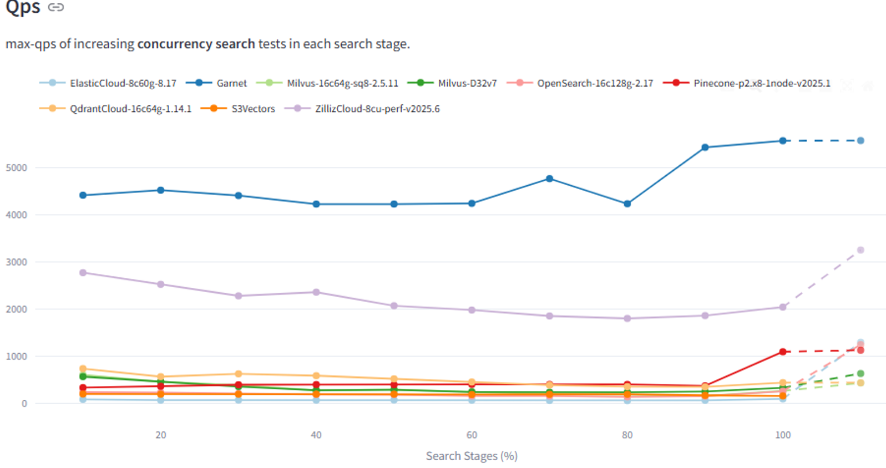
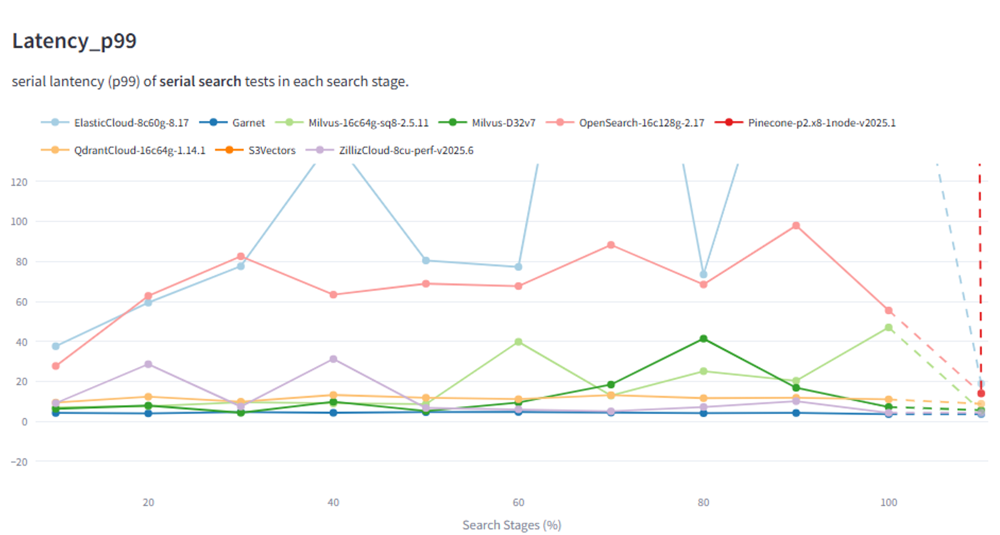
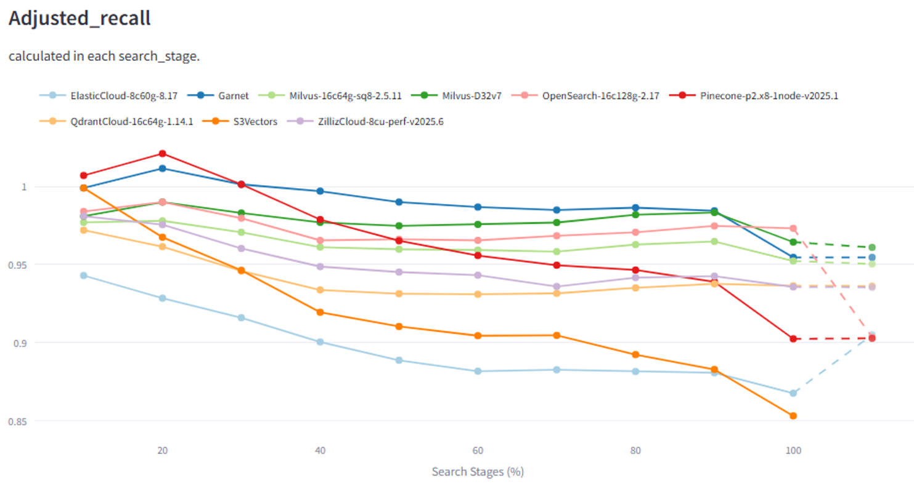
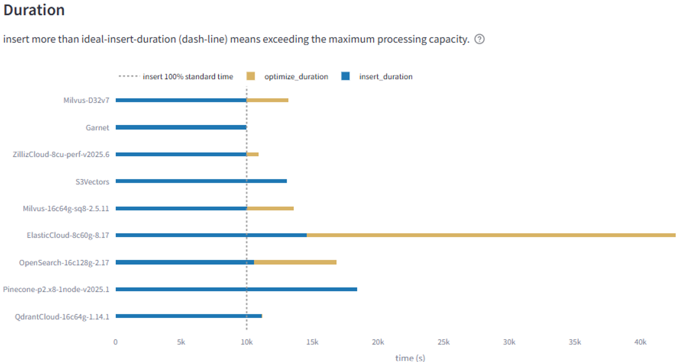

**Garnet is expanding into a vector database.**

We achieved this by bringing the [vector-set data-type and commands](/docs/commands/vector-sets)
of RESP into Garnet. You can use any RESP-compatible client, connect to a Garnet server started
with `--enable-vector-set-preview`, and use commands like `VADD`, `VREM`, and `VSIM` to load and
query vector-sets seamlessly. A single Garnet server can host multiple independent vector-sets
concurrently, indexed by unique keys.

<!--truncate-->

## How we built it

Instead of building a vector engine from scratch, we integrated Microsoft's state-of-the-art
[DiskANN](https://github.com/microsoft/DiskANN) library inside Garnet as an index. The latest
generation of DiskANN refactors its core algorithms to operate over any *data provider*.

In the Garnet integration, we offload all vector state — raw and quantized vectors, adjacency
lists, and metadata — directly back into [Tsavorite](https://github.com/microsoft/garnet), the
same high-performance storage engine that backs all other Garnet cache-store data.

Tsavorite itself can hold records in memory, on disk, or a combination of both. This lets us either
serve everything from memory, or cache just the quantized vectors in memory while tiering raw
vectors to storage — limiting I/O fetches primarily to the re-ranking phase.

Because of this hybrid design (Garnet ➡️ DiskANN ➡️ Tsavorite), the vector database inherits all of
Garnet's cache-store capabilities: high performance in main memory, storage tiering, sharding,
replication, checkpointing, logging, and recovery.

## The performance

Both Tsavorite and DiskANN are optimized for scale-up machines and in-place updates, and our
initial performance results reflect that. On 32 cores, while concurrently indexing vectors at
1,000 inserts/sec in real-time, the system achieves:

- ⚡ **4,000+ QPS**
- ⚡ **Sub-5ms p99 query latency**

This significantly outperforms many specialized vector databases that struggle to maintain low tail
latencies under continuous background ingestion.

#### Queries per second (higher is better)

#### p99 search latency (lower is better)

#### Recall (higher is better)

#### Ingestion duration (shorter is better)

## Learn more

- 📖 **Docs:** [Vector Sets](/docs/commands/vector-sets)
- 💻 **DiskANN integration:** [microsoft/DiskANN — diskann-garnet](https://github.com/microsoft/DiskANN/tree/main/diskann-garnet)
- 📊 **Benchmarks:** [Garnet providers vs other vector DBs](https://github.com/microsoft/DiskANN/wiki/Perf:-Garnet-Providers-vs-other-Vector-DBs-(Zilliz,-Pinecone,-etc.))

Congratulations to Harsha Simhadri, Kevin Montrose, Jack Moffitt, Tiago Nápoli, Mark Hildebrand,
Ted Hart, Vasileios Zois, and the many others who played key roles in this Azure–MSR collaboration.
