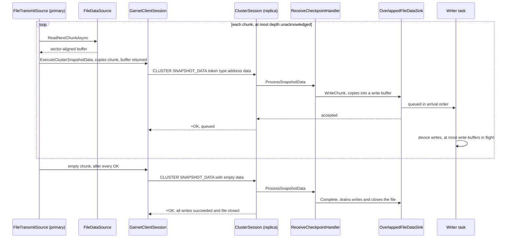

# Garnet Replication Overview

Garnet cluster mode allows users to setup a replication stream by assigning certain nodes of the cluster to be replicas of a single primary.
The replicas are configured by default to serve only reads, redirecting any write request to their primary.
Replicas server only a single primary but any primary can have multiple replicas.
Replicas aim to be an exact copy of the primary by receiving and replaying individual operations through log shipping.
For this reason, the nodes exercising replication need to be setup with the AOF feature enabled.

# Garnet Replication Attach/Sync Workflow

Every node in the cluster starts as a primary node and it can be assigned to be a replica by using either CLUSTER REPLICATE or REPLICAOF commands.
When this command is issued to a specific node, depending on how the node is configured (i.e. using diskless or disk-based replication), it will follow
a synchronization workflow according to the following steps:

1. Replica initiates attach and sends its local latest checkpoint and AOF information to the primary
2. The primary will decide if the a checkpoint needs to be shipped to the replica. For diskless replication, the primary will execute a streaming checkpoint only if the replica does not have enough data to partially synchronize using its local AOF.
3. The primary signals to the replica to recover from its latest checkpoint and replay its local AOF.
4. After recovery the replica, signals back to the primary to let it know that it is ready to start receiving the AOF pages not contained in the checkpoint that it recovered from.
5. A background AofSyncTask is spawned to start iterating from the address beyond the one that is covered from the replicas recovered checkpoint.

The primary maintains one distinct AofSyncTask per replica, keeping track the pages it has send.

## Replication Options

Users can configure Garnet replication by adjusting the AOF parameters in garnet options as well as a number of other options.
The most important options are shown below:
- EnableAOF: Enables AOF
- AofMemorySize: Sets the total size of the AOF memory buffer after which any newly append records will spill to disk
- AofPageSize: Determines the AOF page size
- FastAofTruncate: This option is used to aggressively shift the AOF address begin address in order to prevent the AOF from spilling to disk which could result in performance degradation. This happens in safe manner and is a best effort approach, which means data will be not lost and may spill to disk if there is delay is shipping the log pages to the replica (which will prevent the begin address from shifting ahead of the sync iterator for that replica). U
- UseAofNullDevice: Treat the AOF memory buffer a circular buffer for writing AOF records, ensuring no disk IO. This can be used in combination with fast-aof-truncate but could lead to potential data loss. One should adjust the AofMemorySize to ensure there is enough space for incoming AOF records to be written and shipped towards the replica before truncating.
- CommitFrequencyMs: Write ahead logging (append-only file) commit issue frequency in milliseconds. 0 = issue an immediate commit per operation, -1 = manually issue commits using COMMITAOF command. To avoid performance degradation when running with FastAofTruncate and/or UseAofNullDevice, one can set the CommitFrequencyMs to -1.
- AofReplicationRefreshFrequencyMs: "AOF replication (safe tail address) refresh frequency in milliseconds. 0 = auto refresh after every enqueue.
- ReplicaDisklessSync: Enable diskless sync to avoid disk write amplification when performing full synchronization when a new replica attaches. This options uses the streaming checkpoint feature to ship the store keys to the replica when full synchronization is required.
- ReplicaDiskBasedSyncChunkSize: Maximum Tsavorite disk-based checkpoint transfer payload on the primary (`--repl-disk-based-sync-chunk-size`, default `16m`). Sizes from 512 bytes through 512 MiB are rounded down to a power of two, subject to device-sector alignment. `CONFIG SET repl-disk-based-sync-chunk-size` applies to new transfers; `CONFIG GET` returns effective bytes. Excludes metadata, RangeIndex files, diskless sync and AOF streaming.
- ReplicaDiskBasedSyncPipelineDepth: Maximum unacknowledged disk-based Tsavorite checkpoint chunks per replica on the primary (`--repl-disk-based-sync-pipeline-depth`, default `4`; `1` disables pipelining). Values 1 through 64 are accepted if depth times effective chunk size is at most 512 MiB. `CONFIG SET repl-disk-based-sync-pipeline-depth` applies to new transfers. This bounds outstanding payload, not total buffer memory.
- ReplicaDiskBasedSyncWriteBuffers: Received disk-based Tsavorite checkpoint chunks the replica may hold for its file writer, queued or being written (`--repl-disk-based-sync-write-buffers`, default `1`; `0` writes each chunk before receiving the next). Values 0 through 8. Set on the replica.
- ReplicaDisklessSyncDelay: How long to wait between sync requests to allow for other replicas to attach in parallel hence amortize the cost of the streaming checkpoint.
- OnDemandCheckpoint: This options enables taking an on demand checkpoint when a replica attaches. It used to improve the synchronization performance in the event the AOF log has grown too large or when the AOF has been truncated and synchronization requires a fresh checkpoint to correctly synchronize with the replica. If this option is disabled and the AOF log gets truncated, not having enabled this option could break the attach process unless UseAofNullDevice or FastAofTruncate is enabled since in that case we expect data loss.
- AllowDataLoss (UseAofNullDevice || (FastAofTruncate && !OnDemandCheckpoint): This is an internal flag computed by base flags as indicated. It is used to skip AOF integrity check when an AOF sync task is started. Using this combination of options should be used with caution

## Diskbased Attach/Sync Details

The diskbased attach sync workflow is implemented in ```ReplicaDiskBasedSync.cs``` and is used both for attaching through CLUSTER REPLICATE, REPLICAOF and on startup recovery of a given node.
Before signaling the primary to start the attach/sync workflow, the node resets its state to prepare for synchronization.
This includes the following
1. Reset replay tasks if the node was already a replica and now is being assigned to a new primary
2. Reset replication offset value
3. Reset any active AOF sync tasks, if the node was a primary before being turned to a replica.
4. Reset/flush database to empty to avoid any synchronization conflicts
Every replica transmits its persistence data to the corresponding primary and waits for the attach process to complete.
If the connection breaks or an error is returned from the primary, the process releases any locks, resets the replica back to being a primary and responds to the caller with an error message.

When using diskbased replication, every replica attaching to a given primary transmits its latest checkpoint information and the begin and end addresses of its own AOF log.
A checkpoint is identified by its version number, a replication-id and the minimum AOF address it covers.
The primary uses that information to decide if the replica requires partial or full synchronization by comparing it to the latest available valid checkpoint.
From the primary's perspective a valid checkpoint is one for which the current begin AOF address is less or equal to the checkpoint covered AOF address.
In addition to that, the checkpoint must be of the same version and history for the nodes involved.
When the OnDemandCheckpoint flag is used the primary might initiate the process of taking a new checkpoint.
Any on-demand checkpoint can be shared across attaching replicas if it is still valid at the moment those replicas attach.
When a new checkpoint is created, we make a best effort approach to delete older checkpoints at the primary.
This approach requires a locking mechanism to ensure that actively read checkpoints (those part of the full synchronization) will not be deleted
The locking logic is for checkpoints is implemented in ```CheckpointStore.cs```.
The attaching replica communicates to the corresponding primary which creates a ```ReplicaSyncSession.cs``` for every attaching replica.
By examining the metadata of the replica the primary decides if a full or partial synchronization is needed
If full synchronization is necessary the primary will send the latest checkpoint files to the replica in chunks; see [Disk-Based Checkpoint File Transfer](#disk-based-checkpoint-file-transfer).
It will then signal the replica to recover its latest checkpoint and replay the AOF log if necessary.
For partial synchronization, the primary signals the replica to recover from its local checkpoint skipping the step for sending the latest checkpoint
When the recovery is complete, the primary will initiate a permanent background AofSyncTask by establishing an iterator over its own AOF, starting from the checkpoint covered AOF address.
At startup of the AOF sync task, we validate the AOF integrity unless the nodes are configured in such a way where data loss is inevitable (see AllowDataLoss).
Integrity validation is required to ensure that the start address requested by the replica has not been truncated and the AOF sync task can start streaming the AOF records to the replica from.

## Disk-Based Checkpoint File Transfer

During a full disk-based sync, the primary ships each Tsavorite checkpoint file (index, main log, object log and snapshot files) to the replica over a dedicated connection. It sends the file as a sequence of `CLUSTER SNAPSHOT_DATA token type startAddress data` requests, then one with empty data that marks the end of the file. The replica replies `+OK` once it accepts a chunk for writing at the same offset in its own copy, and confirms completed writes at end of file. Checkpoint metadata and RangeIndex files use the same command but their own transmitters, unchanged by the work described here.

Originally every file moved in fixed 128 KiB chunks, strictly one at a time. The primary read a chunk, sent it, and waited for the replica to write it and reply before reading the next. Each chunk therefore paid a full network round trip on top of a serial read, send and write, which held a link with a 1 ms round trip to about 100 MB/s. Two pull requests remove those limits:

| Pull request | Side | Intent |
| --- | --- | --- |
| [#2334](https://github.com/microsoft/garnet/pull/2334): configurable, pipelined transfer | Primary | Take the round trip off the critical path without changing the protocol or the replica. Larger chunks amortize per-request costs, and a bounded window of unacknowledged chunks overlaps each round trip, and the replica's write, with the next reads and sends. Settings are captured once per transfer, so `CONFIG SET` cannot mix sizes within one. Also adds the replica-transfer benchmark and fixes TLS send-buffer ownership on abort. |
| Overlapped replica writes, stacked on #2334 | Replica, and primary read buffers | The replica receives while writing, acknowledges chunk acceptance inline, and waits for every write at end of file. Multiple buffers overlap receive/write; the separate concurrency flag permits concurrent writes to non-overlapping ranges. The primary stops zeroing each read buffer on return, which its serial loop paid per chunk, and the default chunk size rises to 16 MiB. Also fixes an unrelated `ClusterSession` bug that broke connections whose slot-verification errors overflowed the response buffer. |

In single-machine benchmark runs with an emulated 1.05 ms round trip, throughput went from 81 MB/s with 128 KiB stop-and-wait chunks, to about 1.1 GB/s with #2334's defaults (4 MiB chunks, depth 4), to about 1.8 GB/s with both changes (16 MiB chunks, depth 4).

### Code flow



#### Primary: reading and sending (`PrimaryOps/DiskbasedReplication`)

1. `ReplicaSyncSession.SendCheckpointAsync` captures one validated chunk-size and pipeline-depth pair from `RuntimeServerConfig.GetReplicaDiskBasedSyncSettings()`. It creates the `GarnetClientSession` to the replica with send buffers sized for that chunk (`ReplicationManager.CreateRSSNetworkBufferSettings`: at least 1 MiB, otherwise twice the chunk). Runtime changes apply to later transfers only. The replication buffer pool has size classes for the whole configurable range but allocates nothing in advance.
2. `SnapshotTransmissionDriver` sends the files one after another. `TsavoriteSnapshotReader.GetTransmitSources()` yields a `FileTransmitSource` around a `FileDataSource` for each file, built from the same captured settings, and then the metadata sources. One file at a time matches the replica, which has a single active sink.
3. `FileTransmitSource.TransmitAsync` keeps a FIFO of response tasks: the window, bounded by the pipeline depth. For each chunk:
   - if the window is full, it flushes framed requests and waits for the oldest acknowledgement;
   - it reads the next chunk with `FileDataSource.ReadNextChunkAsync`. Reads are bounded by the chunk size and the next segment boundary, and the final read is aligned up to the device sector;
   - it frames the chunk with `GarnetClientSession.ExecuteClusterSnapshotData(..., flush: false)`. That copies the chunk into the client's send buffer, so the read buffer goes straight back to the pool;
   - it adds the response task to the window. Ready requests can share a send buffer; `CompletePending(wait: false)` flushes before a window wait, an asynchronous read, and the final drain.
4. After the last chunk it waits for every acceptance acknowledgement, then sends the end-of-file request and waits for its `OK`. Acceptance does not imply a completed write; a failed end-of-file request aborts the transfer even if every chunk was accepted.
5. Each request has its own `ReplicaSyncTimeout` deadline. It starts before submission, so socket backpressure counts, and it is not restarted when the request reaches the head of the window. Every response is checked as it completes.
   - On the first failure (an error reply, a deadline, a disconnect or a cancellation), the transfer cancels any overlapping read and closes the socket to unblock a stalled send.
   - Full client disposal waits until synchronous buffer access has unwound. Abort observes every outstanding response, and the first failure is rethrown.
6. `FileDataSource` rents read buffers without the pool's zeroing on return. That zeroing would run once per chunk inside the serial loop above. The read fills the buffer, except when a device read returns fewer bytes than requested, at the end of a file. The whole aligned length is still sent, so the unread tail is zeroed explicitly, as the pool's zeroing used to leave it.

Chunk sizes are validated against device sectors at startup, through `INamedDeviceFactory.GetSectorSize` for the configured checkpoint and log paths, and again on each runtime change. `FileDataSource` also validates each device it opens.

#### Replica: receiving and writing (`ReplicaOps/DiskbasedReplication`)

1. `ReplicaDiskbasedSync` creates a `ReceiveCheckpointHandler` before it asks the primary to start, and disposes it when the attempt ends. The primary's requests arrive on an inbound connection, served by an ordinary `RespServerSession` and its `ClusterSession`.
2. `ClusterSession.NetworkClusterSnapshotData` parses each request and calls `ReceiveCheckpointHandler.ProcessSnapshotData`:
   - start address −1 carries checkpoint metadata, or the header that precedes a RangeIndex file's chunks, handled synchronously;
   - empty data ends the file and completes its sink;
   - anything else is a chunk. The file's first chunk opens its device and sink, and the chunk is handed to the sink.
3. With `ReplicaDiskBasedSyncWriteBuffers` above 0 (default 1), the sink is an `OverlappedFileDataSink`:
   - `WriteChunk` waits for one of the write-buffer slots, which is the backpressure point. It copies the chunk into a sector-aligned pool buffer, queues it, and returns without waiting for that chunk's write;
   - the dispatcher awaits each write by default. With `ReplicaDiskBasedSyncWriteBuffersConcurrently=true`, it issues writes without awaiting earlier writes. The same slots bound queued and in-flight writes together. Chunks must advance past the preceding chunk's sector-padded end, so concurrent writes cannot overlap. After each write it returns the buffer, which the pool zeroes, then frees the slot;
   - the first failed or timed-out write is retained for subsequent requests and completion. Queued chunks not yet issued are discarded and their buffers returned; other issued writes are still awaited. A timed-out write's buffer is abandoned rather than reused, because the device may still read from it;
   - the end-of-file request blocks in `Complete` until every queued write has been processed and the file is closed, and throws if any write failed.

   With 0 write buffers the sink is `FileDataSink`, which writes each chunk before the command returns, as before these changes.
4. `ReceiveCheckpointHandler.Dispose` cancels outstanding writes and closes every sink before it frees the buffer pool that their writers return buffers to.

#### Replies: acceptance and completion

`NetworkClusterSnapshotData` writes every reply inline, preserving RESP command order without a background responder. A chunk's `OK` confirms that its payload has been copied and accepted into the bounded write queue. Other commands do not wait for those writes.

The empty end-of-file request is the completion barrier: it waits for all queued writes and closes the device before replying `OK`. A write failure is reported on a subsequent chunk or this barrier, including failures occurring after the last chunk's acceptance reply. The primary must await this final response before returning success or advancing to another file.

### Guarantees

- A chunk's `OK` means accepted, not written. The end-of-file `OK` confirms every queued write succeeded and the file is closed. Both peers must run the updated implementation; mixed-version negotiation is not provided.
- Memory is bounded on both sides.
  - On the primary, at most depth × chunk of payload is unacknowledged, capped at 512 MiB, in send buffers of up to twice the chunk.
  - On the replica, there is one chunk per write buffer, plus a receive buffer that holds one whole request.
- Every wait is bounded by `ReplicaSyncTimeout` or by cancellation. Any failure aborts the transfer and closes its connection, and the replica's sync attempt fails as before.

### Configuration

| Setting | Set on | Default | Range and notes |
| --- | --- | --- | --- |
| `ReplicaDiskBasedSyncChunkSize` (`--repl-disk-based-sync-chunk-size`) | Primary | 16 MiB | 512 bytes to 512 MiB, rounded down to a power of two, a multiple of the device sector. `CONFIG GET` and `CONFIG SET`. |
| `ReplicaDiskBasedSyncPipelineDepth` (`--repl-disk-based-sync-pipeline-depth`) | Primary | 4 | 1 to 64, with depth × chunk at most 512 MiB; 1 is stop-and-wait. `CONFIG GET` and `CONFIG SET`. |
| `ReplicaDiskBasedSyncWriteBuffers` (`--repl-disk-based-sync-write-buffers`) | Replica | 1 | 0 to 8; bounds queued and in-flight writes together. 0 writes each chunk before receiving the next. Requires restart. |
| `ReplicaDiskBasedSyncWriteBuffersConcurrently` (`--repl-disk-based-sync-write-buffers-concurrently`) | Replica | false | Concurrent positional writes with more than one buffer; otherwise sequential writes with receive/write overlap. Requires restart; read-only `CONFIG GET`. |

Tuning guidance and memory costs are in the [operator guide](../../cluster/replication.md#disk-based-full-sync-transfer-size).

### Where to start reviewing

| Code | Role | Changed by |
| --- | --- | --- |
| `ReplicaSyncSession`, `TsavoriteCheckpointReader.cs` (`TsavoriteSnapshotReader`), `ReplicationNetworkBufferSettings.cs` (`ReplicationManager`) | Capture the settings; size the client's buffers; build the file sources | #2334 |
| `FileTransmitSource` | Pipelined send loop, deadlines, abort | #2334 |
| `FileDataSource` | Chunked, sector-aligned reads | #2334 (chunk size); overlapped writes (no zeroing, short-read tail) |
| `GarnetClientSession`, `GarnetClientSessionReplicationExtensions`, `GarnetClientSessionTcpNetworkHandler`, `NetworkHandler` | Framing without a flush, explicit flushes, TLS send-buffer ownership on abort | #2334 |
| `GarnetServerOptions`, `Options`, `OptionsValidators`, `RuntimeServerConfig`, `defaults.conf` | Settings, validation, `CONFIG GET`/`SET` | #2334; overlapped writes (write buffers, 16 MiB default) |
| `ReceiveCheckpointHandler` | Routes requests to sinks and waits for end-of-file completion | Overlapped writes |
| `OverlappedFileDataSink` | Bounded queued writes, sequential or concurrent, with an end-of-file barrier | Overlapped writes |
| `RespClusterReplicationCommands.cs` (`NetworkClusterSnapshotData`) | Inline acceptance replies and end-of-file completion | Overlapped writes |
| `benchmark/Replica-transfer.benchmark` | Real-server full-sync driver; optional component file-transfer driver | #2334; overlapped writes |

### Tests and measurement

| Test | Covers |
| --- | --- |
| `CheckpointPipelineTests` | The window bound, the end-of-file request after every acknowledgement, and each abort path, including TLS |
| `GarnetClientArgumentFramingTests` | Rejecting a chunk too large for the client's send buffer, and sending one that exactly fits |
| `GarnetClientSessionTlsLifetimeTests` | Releasing the TLS send buffer whichever owner finishes first, and after reconnects and failed handshakes or authentication |
| `DiskBasedCheckpointChunkTests` | Chunk sizing, sector and segment bounds, and the zeroed tail of a short read |
| `ReplicaCheckpointWriteTests` | Out-of-order write completion, bounded concurrency, non-overlapping padded ranges, disposal, failures and timeouts; immediate acceptance replies and the end-of-file write barrier over a real connection |
| `ClusterReplicationBaseTests.DiskBasedSync*` | Full syncs across chunk sizes, depths, runtime changes, and 0, 1, 2 and 4 write buffers, with and without TLS |
| `GarnetServerConfigTests`, `RespConfigTests` | Option parsing, validation and `CONFIG GET`/`SET` |
| `ReplicaTransferBenchmarkTests` | The benchmark's options, checkpoint generation and ACK-delay precision |
| `ClusterRedirectTests.ClusterSlotErrorsOverflowingTheResponseBufferAreAllDelivered` | The `ClusterSession` send-size fix |

The [replica-transfer benchmark](https://github.com/microsoft/garnet/tree/main/benchmark/Replica-transfer.benchmark) defaults to `--scenario full`: separate real primary/replica processes, independently selected builds, version-owned fresh checkpoints, real negotiation/transfer/recovery/AOF catch-up, and logical verification. `--scenario transfer-only` retains the shared file sender/sinks but replaces receiver parsing, orchestration, device creation and reply scheduling; only that component mode supports `--ack-delay-us`. Its README includes the production/component flowchart and timing boundaries. Same-host source reads and destination writes can share host storage bandwidth, so separate guest disks do not guarantee isolated I/O.

Optional production phase instrumentation is enabled by `GARNET_REPLICA_BENCH_PHASE_TIMING=1` (the runner's `--phase-timing true`). It records only whole-shipment/recovery timestamps and file-boundary byte counts, with bounded last-successful state exposed through `INFO REPLICATION` after timing. It adds no work to chunk loops. Uninstrumented/older builds have unavailable phase fields; mixed-version compatibility is tested, not assumed. Confirm negligible instrumentation overhead with paired Release controls before interpreting fine performance differences.

## Diskless Attach/Sync Details

Diskless synchronization works similar to the diskbased approach.
Its major difference is that it does not require a disk checkpoint.
It leverages the Streaming Checkpoint primitive to scan and transmit the kv pairs from the underlying Tsavorite store.
The diskless attach/sync workflow is implemented at the primary within ```ReplicaSyncManager.cs```.
The replica side implementation is implemented within ```ReplicaDisklessSync.cs```
The attaching replica transmit their persistence information (i.e. AOF start and tail address and store version).
As opposed to the disk-based approach, the attaching replicas are grouped and synced together.
There is no limit on the number of replicas that can be synced in parallel.
The only parameter that controls how many replicas are synced in parallel is ```ReplicaDisklessSyncDelay``` which delays replication sync to allow more replicas to sync together (i.e. at startup where a primary might need to be configured with few replicas).
Once the specified delay period passes the primary will examine all the metadata transmitted by the associated replicas and decide which ones require full vs partial synchronization.
Those requiring partial synchronization will be released immediately and a new AOF sync task will be created for them to start receiving the associated AOF records
The rest will be fully synchronized using the StreamingCheckpoint primitive.
Before starting the full synchronization, the primary broadcasts FLUSHDB command to cleanup the replica store so there is no conflicts with the primary store.
This streaming checkpoint primitive utilizes and iterator over the TsavoriteStore and it broadcasts batches of kv pairs to the replica.
The replica will receive those pairs and insert them into its store.
At completion the replica sets its version number to be equal the the version number of primary.
Finally, the primary executes the partial synchronization workflow which includes steps to validate the integrity of the AOF and the creation of the AOF sync tasks to start streaming the corresponding AOF records to each replica.

# Sharded Append-Only-File Feature

Garnet replication leverages the Append-Only-File (AOF) implementation to stream update operations to the corresponding replica.
The Garnet's AOF implementation uses a single instance of TsavoriteLog to record update operations as they occur at the primary.
Writing, streaming and replaying the AOF in order to support replication is single threaded operation
This is in contrast to Garnet's native multi-threaded architecture and does not scale well.

This motivated the development of a sharded AOF implementation that leverages multiple physical sublogs (i.e. separate TsavoriteLog instances) to scale writes at the primary and parallel replay at the replica.
This implementation works alongside a read consistency protocol running at the replica, which is required to guarantees prefix consistent reads because sublog replay happen asynchronously potentially exposing non-prefix consistent content.
The read consistency protocol relies on virtual timestamps (i.e. sequence numbers) to indicate write order across sublogs.
These timestamps are used to ensure prefix consistency per Garnet session.

## Sharded AOF architecture

Garnet can be configured to use the sharded AOF implementation by adjusting the following configuration parameters;
1. AofPhysicalSublogCount:
    This parameter controls the number of TsavoriteLog instances used by the GarnetAppendOnlyFile implementation.
    Its value ranges between 1 and 64, with 1 being the default value which maps to the legacy single log implementation    
2. AofRefreshPhysicalSublogTailFrequencyMs:
    This parameter control the background refresh tail task that spawns only when the Garnet instance is configured to use more than physical sublogs.
    This task is required to keep moving time forward for sublogs that are not being actively written, in order to ensure the consistency protocol works correctly.
3. AofReplayTaskCount:
    This parameter controls the number of replay tasks that can used per physical sublog.
    Its value ranges between 1 and 256, with the default value being 1. The combination of this default value and the AofPhysicalSublogCount default maps to the legacy single log implementation.

### GarnetAppendOnlyFile

This class implements Garnet's AOF offering an API to interact with the physical
sublog instances and ensure read prefix consistency.
Its most important members are
1. SequenceNumberGenerator
   This class implements the API used to generate sequence numbers when the 
2. ReadConsistencyManager: 
   Responsible for tracking the replayed key sequence numbers per virtual sublog and coordinating read operation to ensure read prefix consistency
3. GarnetLog
   This class implements the API associated with operating and managing a TsavoriteLog instance but extends it to seamlessly use either a single or multiple TsavoriteLog instances depending on how the Garnet instance is configured.

#### SequenceNumberGenerator

The `SequenceNumberGenerator` class is implemented by using a `baseTimestamp` and a startingOffset.
Sequence numbers are generated using the difference of the baseTimestamp from the current timestamp offseted by the `startingOffset`.
The starting offset is used to eliminate clock divergence between nodes and on recovery it is initialized as the maximum sequence number calculated from the records of recovered AOF.
Note recovery can happen on startup or when a failover occurs where a replica takes over as primary making it so it needs to generate consistent sequence numbers for writes that is going to serve in the future.

#### ReadConsistencyManager

This `ReadConsistencyManager` class is instantiated when a node becomes a replica.
It is used to track the key sequence numbers of the replayed records.
This happens because replicas needs to ensure read prefix-consistency through tracking the maximum session sequence number seen across reads
and waiting for keys that are behind to become current through the progression of background replay functionality.
This protocol is triggered only when the Garnet cluster node are configured to use the sharded AOF (i.e. AofPhysicalSublogCount > 1 || AofReplayTaskCount > 1).
The `ReadConsistencyManager` uses the `VirtualSublogReplayState` struct to track the key sequence numbers seen for all replay records at a specific point in time.
Since it not efficient to track all keys, it uses a sketch tracking a limited amount of slots to which keys being replayed are matched through hashing.
This an approximation of the actual sequence number per key due to collisions.
However, it does not affect correctness it only incurs additional read latency when key moves ahead in time as a side-effect of overlapping key mappings to the same slot.
In addition to tracking key sequence number per fixed number of slots, each `VirtualSublogReplayState` instance tracks the maximum sequence number across slots and maintains a `TaskCompletionSource<bool>` that is signaled when replay progresses, allowing waiting readers to be awakened.

When a `RespServerSession` processes a read command, it utilizes the `ConsistentReadGarnetApi` (through the `ConsistentReadContext` and `TransactionalConsistentReadContext` for the string and object data types respectively) to call into the `ReadConsistencyManager` and validate that it can serve the read under the prefix consistency constrains.
This happens into two phases per key:

1. ConsistentReadKeyPrepare Phase
    This phase occurs before the actual processing of the corresponding read operation in Tsavorite.
    Its goal is to validate the key's freshness compared to `maximumSessionSequenceNumber` as determined by the previous read operations.
    Freshness is determined by comparing the frontier sequence number (max of key specific and the virtual sublog's maximum observed value) against the `maximumSessionSequenceNumber`.
    The frontier value need to be strictly behind the `maximumSessionSequenceNumber` since we cannot determine the order of writes with the same timestamp.
    If this condition holds reads can proceed otherwise the read needs to wait for and advance time event to occur.
    This happens every time the `VirtualSublogReplayState` gets updated, which triggers the associated `TaskCompletionSource` to allow for any waiters to re-check the aforementioned condition.
2. ConsistentReadSequenceNumberUpdate step
    This phase occurs after the read has been processed.
    Its goal is to update the `maximumSessionSequenceNumber` by taking the maximum of the current `maximumSessionSequenceNumber` and the corresponding key's sequence number.
    This update happens after read to ensure that we associate the read with a pessimistic replayed sequence number.

The `ReadConsistencyManager` maintains version number that gets incremented every time a new instance is created.
Creation of a new instance happens at the startup of the attach/sync workflow to ensure that subsequent reads start
with a clean slate.
The read protocol checks maintains the current version number per session and performs the appropriate checks to ensure that every read is consistent in terms of the last seen version number of the `ReadConsistencyManager`.
This happens at `ConsistentReadKeyPrepare` phase before validating the freshness of the key being read.
Read prefix consistency is guaranteed for a given batch of reads because reading a batch happens under epoch protection.
Across requests, the version of the `ReadConsistencyManager` may change with the database version change, so prefix read consistency follows the same rules as if a new database was recovered while a client was connected.

### GarnetLog

The `GarnetLog` instance implements an API that offers the same functionality as `TsavoriteLog` extended to support operations across multiple instances (`ShardedLog`).
The functionality that had to be extended to support multiple `TsavoriteLog` instances is as follows:
1. Metadata Operations
    These include operations that retrieve `TsavoriteLog` metadata such as `BeginAddress`, `TailAddress` etc properties. For `ShardedLog`, these operations return a vector of address in a form of a struct defined as `AofAddress`.
2. Initialize Operations
    These operations require initializing the state of the log and often require an input int the form of an address. For `ShardedLog`, the parameter passed is a value of `AofAddress`.
3. Commit Operations
    These operations happens in unison across each sublog instance. For variants that require awaiting on a Task, the `ShardedLog` implementation uses the WheAll primitive for all tasks associated with each sublog.
4. Truncate Operations
    For `ShardedLog`, truncation happens by passing an `AofAddress` parameter and applying the truncation based on the index of the sublog being truncated.
5. Enqueue Operations
    Enqueue operations are performed either by providing the index of the log to enqueue to or through computation of the index by hashing the key associated with that record.
    The first approach is used for coordinated operations that are applied and replayed across multiple physical logs such as transactions or checkpoint.
    The second approach is used to record individual operations to the store's key value pair, specifically Upsert, RMW and Delete operations are recorded through this API for both string and object data.

The `GarnetLog` instance offers also a locking mechanism to atomically insert record headers for coordinated operations. This locking mechanism works by preventing enqueue for coordinated operations that run in parallel.
This is used for transaction replay to avoid a deadlock when two transactions operate on overlapping sublogs and at commit the need to coordinate using a barrier to ensure prefix consistency.


### AOFSyncDriver

As mentioned previously, at completion of the attach workflow, the primary will spawn background tasks responsible for shipping the AOF pages to the replica.
For every connected replica, the primary creates an instance of an `AofSyncDriver`, which manages the `AofSyncTask` responsible for shipping each physical sublog's pages.
The `ReplicationManager` manages the `AofSynDriverStore` containing all the `AofSyncDriver` instances.
The number of `AofSyncTask` instance spawned is equal to the number of physical sublogs configured on the corresponding Garnet instance.
When a Garnet instance is configured with more than one physical sublog, a refresh tail task is also created.

#### Advance Physical Sublog Time

When using the sharded log feature, a background task is created for each replica connection to signal time advancement for the underlying physical sublogs. This is essential when a physical sublog receives no writes—a condition that is opaque to the replica side and indistinguishable from log-shipping or replay delays. Without this signal, readers may wait indefinitely for data to arrive, significantly increasing read tail latency.

Consider this example: given key-sequence number pairs (A,t1) and (B,t2) mapped to different physical logs with t1 < t2, if we read B first and then attempt to read A, the read session will wait for A to reach sequence number t3 > t2.

The advance time background task periodically checks for new writes and captures a tail snapshot containing all physical sublog tails, associating them with a sequence number. It then sends this information to the replica, which updates its replayed max sequence number at the ReadConsistencyManager.

The replica maintains its own background consumer task to process incoming signals as they arrive. The replica waits until its background replay reaches at least the provided tail snapshot before updating the max sequence number for that sublog. Since sequence number updates are monotonic, they can be applied multiple times, allowing the consumer to converge eventually toward the snapshot tail.

# Transaction Replay

Garnet supports two distinct types of transactions, each with different behaviors and requirements:

1. **MULTI-EXEC transactions** — These follow the standard RESP protocol and allow users to dynamically declare operations at runtime, accumulating them within a transaction and executing them atomically when the EXEC command is issued.

2. **Custom transaction procedures** — These are server-side procedures defined programmatically at compile time and registered with the Garnet server, providing a more structured alternative for complex multi-key operations.

## Replay Behavior During Replication

The replay behavior differs between these two transaction types, particularly when replicating across multiple physical sublogs.

**For MULTI-EXEC transactions:** The replica must gather and buffer all individual operations sequentially until it encounters the associated transaction commit marker before initiating the actual replay of all buffered operations.

**For custom transaction procedures:** Replay can begin immediately upon encountering the custom transaction body record, which itself acts as the commit marker and contains the complete transaction definition.

## Single-Log Replay

When operating with a single AOF log, both transaction types employ the same fundamental replay mechanism: the replay process encounters the commit marker, acquires the necessary locks for all keys specified in the transaction, and then executes the associated operations in sequence. This approach is straightforward since all operations are naturally ordered within a single sequential log.

## Multi-Log Replay

When operating with multiple physical sublogs, both transaction types must perform an additional synchronization step to maintain strict isolation guarantees. This is necessary because the keys involved in a transaction may be distributed across multiple physical sublogs, and each sublog is replayed independently by its own background task. The core challenge is ensuring that all transaction operations complete across all involved sublogs before allowing subsequent operations to proceed.

The replay behavior diverges at this point:

- **MULTI-EXEC transactions** allow for parallel replay of the operations encountered across different physical sublogs.
This method of parallel replay is subject to the constraint that the transaction cannot complete until all operations across all sublogs have finished to maintain isolation.

- **Custom transaction procedures** replay is currently restricted by the fact that the body of the transaction is programmatically defined, disallowing parallel operation replay.
Hence, only a single designated replay background task is used to execute the entire transaction body sequentially.
The remaining participating replay tasks suspend their replay operation until the main replay tasks completes.
