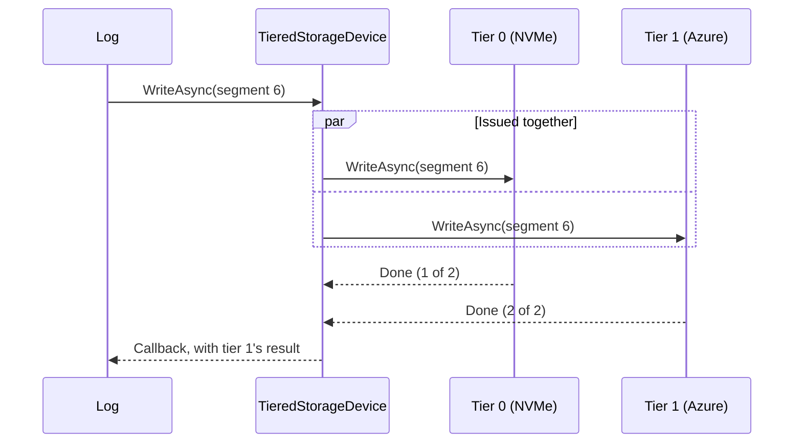
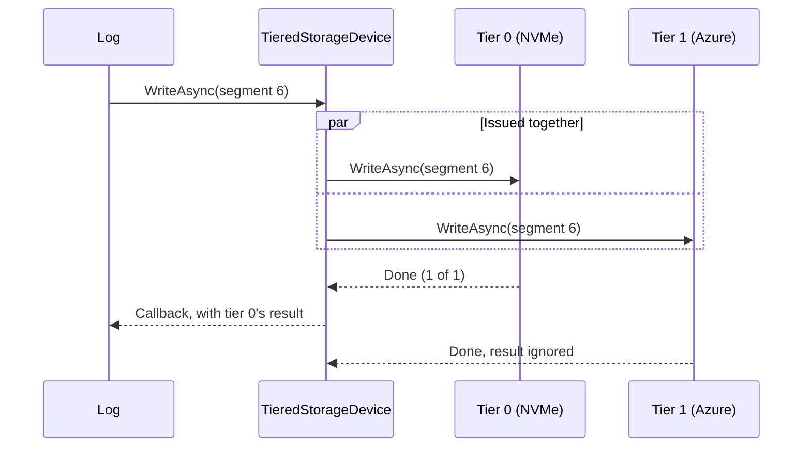
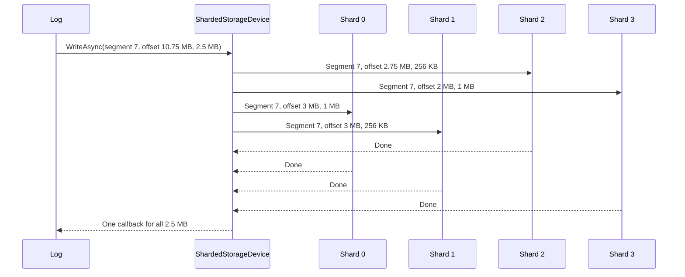
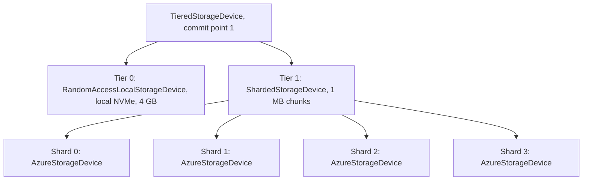

# Tiered and Sharded Storage Devices

Tsavorite has two storage devices that store nothing themselves, but compose other `IDevice`s:

- **`TieredStorageDevice`** layers devices from hot to cold, like a cache hierarchy. Every write goes to every tier, and a
  read goes to the hottest tier that still holds the data.
- **`ShardedStorageDevice`** stripes each segment across devices, like RAID 0, so that large reads and writes run on all
  of them in parallel.

Both are internal to `Tsavorite.core`, and only Tsavorite's tests construct them; Garnet does not use them. Either can be
a component of the other.

## Segments and capacity

A device stores a log's address space in **segments** of a fixed power-of-two size, which the log sets through
`IDevice.Initialize`. A file device keeps one file per segment. Every read and write names a segment and an offset within
it. A device tracks:

- `StartSegment`: the lowest segment it holds. Truncation advances it, and removes the segments below it.
- `EndSegment`: the highest segment written so far.

A device that enforces a **capacity**, which must be a multiple of its segment size, does so as it writes. When a write
reaches a new segment, the device truncates its own oldest segments, keeping that segment and `Capacity / SegmentSize`
earlier ones. Not every device does this:

| Device | Enforces its capacity |
| --- | --- |
| `LocalStorageDevice`, `RandomAccessLocalStorageDevice`, `ManagedLocalStorageDevice` | Yes |
| `LocalMemoryDevice` | Yes, keeping one segment fewer |
| `NativeStorageDevice`, `AzureStorageDevice` | No |
| `TieredStorageDevice`, `ShardedStorageDevice` | No; their components may (see below) |

By default, `Devices.CreateLogDevice` creates a `LocalStorageDevice` on Windows and a `NativeStorageDevice` on Linux x64.

## Tiered storage device

```csharp
// Tier 0: local NVMe, holding the newest segments. A RandomAccess device enforces its capacity on every platform, and
// recoverDevice restores which segments it holds after a restart.
var hot = Devices.CreateLogDevice("/mnt/nvme/aof/aof.log", DeviceType.RandomAccess, capacity: 4L << 30, recoverDevice: true);

// Tier 1: Azure page blobs, holding the whole log
var cold = new AzureStorageDevice(connectionString, "garnet", "aof", "aof.log");

// Commit point 1: a write completes when both tiers have it
var device = new TieredStorageDevice(1, hot, cold);

var log = new TsavoriteLog(new TsavoriteLogSettings
{
    LogDevice = device,
    SegmentSizeBits = 30,       // 1 GB segments
    LogCommitDir = commitDir,   // Required: the device's FileName is not a path
});
```

The devices are listed from hot to cold. The **commit point** is the index of the tier at which a write counts as
persistent.

### Writes

A write is issued, in parallel, to every tier from the hottest one that holds its segment through the coldest. Its
callback fires when every tier up to and including the commit point has finished. Writes to tiers past the commit point
are not tracked: the caller learns nothing about them.

With commit point 1, as above:



With commit point 0, the write completes at the NVMe's latency:



Choose the commit point by durability:

- If tier 0 is not durable, such as a VM's temporary disk, make the commit point the first durable tier, here tier 1.
  Commits then take the cloud's latency, but reads of recent segments still come from the NVMe.
- Commit point 0 suits a durable tier 0, with the cloud as a best-effort copy. A failed write to the cloud is never
  reported, so the data it left out is lost once tier 0 evicts that segment.

### Reads

A read goes, unchanged, to the hottest tier whose `StartSegment` is at most the segment. There is no fallback: if that
tier fails or lacks the data, the read returns what it got. A read from a colder tier does not copy the segment into a
hotter one.

### How tiers come to hold different segments

Every write reaches every tier, yet the tiers diverge:

1. **Capacity.** Each tier that enforces a capacity evicts its own oldest segments as the log grows. A small hot tier keeps
   a short window of recent segments, and a larger or unbounded cold tier keeps more.
2. **Unreported failures.** A failed write to a tier past the commit point leaves that tier without the data, and nothing
   reports it.

### Example: residency over time

In the configuration above, segments are 1 GB, tier 0 has 4 GB and so keeps the segment being written plus 4 earlier
ones, and tier 1 is unbounded:

| The log has written through segment | Tier 0 holds | Tier 1 holds | A read of segment 2 goes to |
| --- | --- | --- | --- |
| 4 | 0–4 | 0–4 | Tier 0 |
| 5 | 1–5: reaching segment 5 evicts segment 0 | 0–5 | Tier 0 |
| 7 | 3–7 | 0–7 | Tier 1, since tier 0's `StartSegment` is 3 |
| 11 | 7–11 | 0–11 | Tier 1 |

With the log through segment 11:

| Segment | 0 | 1 | 2 | 3 | 4 | 5 | 6 | 7 | 8 | 9 | 10 | 11 |
| --- | --- | --- | --- | --- | --- | --- | --- | --- | --- | --- | --- | --- |
| Tier 0 (NVMe) | | | | | | | | ● | ● | ● | ● | ● |
| Tier 1 (Azure) | ● | ● | ● | ● | ● | ● | ● | ● | ● | ● | ● | ● |
| Reads go to tier | 1 | 1 | 1 | 1 | 1 | 1 | 1 | 0 | 0 | 0 | 0 | 0 |

### Truncation

The log truncates the composite device, which advances its own `StartSegment` and removes each segment below it. A
segment is removed from every tier from the hottest that still holds it through the coldest, and the removal completes
when all of them have finished. The tiers' own `StartSegment`s do not move, which is harmless: the log never reads below
its begin address.

Continuing the example, truncating the log to segment 9 removes segments 0–6 from tier 1 only, since tier 0 has already
evicted them, and segments 7 and 8 from both tiers.

Removing every segment above a given one, which [clearing](#clearing-above-the-tail) does, is different: each tier lists
the segments it holds and removes those above the one given, whatever its `StartSegment` says.

### Errors

- The write callback reports the error code and byte count of whichever tier, up to the commit point, finished last. An
  error from a tier that finished earlier is lost, and reads of that segment still go to that tier.
- Errors from tiers past the commit point are ignored.
- Neither writes nor reads are retried on another tier.

### Other properties

| Property | Value |
| --- | --- |
| `Capacity` | The largest tier's capacity, or unspecified if the coldest tier is unbounded. Only the coldest tier may be unbounded (a debug assertion). The tiers hold overlapping data, so this is a maximum, not a sum. The composite does not enforce it; each tier enforces its own. |
| `SectorSize` | The largest tier's, since each request goes unchanged to the tiers |
| Segment size | `Initialize` gives every tier the composite's segment size and epoch |
| `FileName` | A description of the tiers and the commit point, not a path. It includes each tier's `FileName`, and an `AzureStorageDevice`'s includes its connection string. |

### Limitations

- **Which segments a tier holds is known only in memory**, as its `StartSegment`, and it is lost in two cases. A read of
  a segment that a hot tier evicted then goes to that tier and finds no data.
  - After a restart, unless the tier is a `LocalStorageDevice`, `RandomAccessLocalStorageDevice` or
    `ManagedLocalStorageDevice` created with `recoverDevice: true`, which sets it from the segment files it finds.
  - After `TsavoriteLog.Reset` or `TsavoriteLog.Initialize`, which reset the device. That sets every tier's
    `StartSegment` to 0, so that the log that follows is written to every tier from segment 0. `Reset` discards the log's
    data, so this does not affect it. `Initialize` keeps the data below the new tail, and a read of it in a segment that the
    hot tier evicted finds nothing.
- **A write must reach tier 0.** Its callback waits for every tier up to the commit point, but a write to a segment that
  tier 0 has already evicted is not sent to tier 0, so the callback never fires. A log writes near its tail, which tier 0
  holds.

## Sharded storage device

```csharp
// Four shards, one per local NVMe drive
var shards = new IDevice[]
{
    Devices.CreateLogDevice("/mnt/nvme0/aof/aof.log"),
    Devices.CreateLogDevice("/mnt/nvme1/aof/aof.log"),
    Devices.CreateLogDevice("/mnt/nvme2/aof/aof.log"),
    Devices.CreateLogDevice("/mnt/nvme3/aof/aof.log"),
};

// Stripe in 1 MB chunks
var device = new ShardedStorageDevice(new UniformPartitionScheme(1L << 20, shards));

var log = new TsavoriteLog(new TsavoriteLogSettings
{
    LogDevice = device,
    SegmentSizeBits = 30,       // 1 GB segments; each shard's are 256 MB
    PageSizeBits = 22,          // 4 MB pages: a full-page flush writes one chunk to each shard
    LogCommitDir = commitDir,   // Required: the device's FileName is empty
});
```

A sharded device takes an `IPartitionScheme`, which maps a range of a segment to a shard and a range of that shard's copy
of the segment. `UniformPartitionScheme` is the only implementation.

### Layout

`UniformPartitionScheme` deals each segment's chunks to the shards in turn. In the example, chunk *k* of segment *n*,
at offset *k* MB, goes to shard *k* mod 4, at offset ⌊*k* / 4⌋ MB of that shard's segment *n*. Each shard holds a quarter
of every segment, so `Initialize` gives each shard a segment size of 256 MB.

| Offset in segment *n* | 0 MB | 1 MB | 2 MB | 3 MB | 4 MB | 5 MB | 6 MB | 7 MB | 8 MB | … | 1023 MB |
| --- | --- | --- | --- | --- | --- | --- | --- | --- | --- | --- | --- |
| Chunk | 0 | 1 | 2 | 3 | 4 | 5 | 6 | 7 | 8 | … | 1023 |
| Shard | 0 | 1 | 2 | 3 | 0 | 1 | 2 | 3 | 0 | … | 3 |
| Offset in the shard's segment *n* | 0 MB | 0 MB | 0 MB | 0 MB | 1 MB | 1 MB | 1 MB | 1 MB | 2 MB | … | 255 MB |

So shard 0's segment *n* holds chunks 0, 4, 8, …, 1020 of segment *n*, in that order; shard 1's holds chunks 1, 5, 9, …,
1021; and so on.

### Splitting a request

A request is cut at chunk boundaries, and each piece goes to its shard. The pieces are issued one after another without
waiting, so they run in parallel. One callback reports the whole request once every piece has finished. Reads are split
the same way.

For example, a commit flushes the 2.5 MB from offset 10.75 MB to 13.25 MB of segment 7:

| Piece | Offsets in segment 7 | Chunk | Shard | Offsets in the shard's segment 7 | Length |
| --- | --- | --- | --- | --- | --- |
| 1 | 10.75–11 MB | 10 | 2 | 2.75–3 MB | 256 KB |
| 2 | 11–12 MB | 11 | 3 | 2–3 MB | 1 MB |
| 3 | 12–13 MB | 12 | 0 | 3–4 MB | 1 MB |
| 4 | 13–13.25 MB | 13 | 1 | 3–3.25 MB | 256 KB |



### Requirements

- The chunk size must be a power of two and a whole number of sectors on every shard (debug assertions). The composite's
  sector size is the largest of the shards'.
- Each shard's segment size is the log's, divided among the shards and rounded up to whole chunks. Like every device's,
  it must be a power of two, or the shard's `Initialize` throws. With power-of-two segment and chunk sizes, a
  power-of-two number of shards always works. With 3 shards, for example, a 1 GB segment of 1 MB chunks would give each
  shard ⌈1024 / 3⌉ = 342 chunks, so `Initialize` throws.
- The segment size must be at least the chunk size. A segment with fewer chunks than there are shards leaves some shards
  unused.

### Errors

- The callback reports the total bytes transferred, or 0, meaning unknown, if any piece reported 0. Its error code is
  that of a failed piece, if any.
- If issuing a piece throws, the later pieces are not issued. The callback still fires once, after the issued pieces
  finish, and reports an error: normally `uint.MaxValue`, with the exception.
- There is no redundancy: losing any shard loses part of every segment.

### Removal, truncation and Reset

- Removing a segment removes it from every shard, and completes when all have finished. Truncation does this for each
  segment it drops. Removing every segment above a given one has each shard remove its own.
- `Reset` resets every shard.
- The composite's capacity is unspecified, and it does not evict. A shard with a capacity evicts its own segments without
  the composite knowing, so leave the shards' capacities unspecified.

## Composing the two

Each composes any `IDevice`s, so they nest:

- **A sharded tier**, such as a cold tier striped across several Azure page blobs for bandwidth. A sharded device's
  capacity is unspecified, so it can only be the coldest tier.
- **Tiered shards**, each with its own NVMe cache in front of cloud storage.



With 1 GB segments, the tiered device gives both tiers 1 GB segments, and the sharded tier gives each page blob 256 MB
segments.

## Clearing above the tail

`TsavoriteLog.PrepareToAppend`, and recovery when asked to, clear the device above the tail, so that a later recovery
cannot adopt old data there (see [Appending after recovery](./tsavoritelog-commits.md#appending-after-recovery)). Clearing
has the device remove the segments above the tail's segment, with `TryRemoveSegmentsAbove`, and zeroes any data it finds
above the tail in the tail's own segment.

Both composite devices remove those segments by having each tier or shard remove its own. Each lists the segments it
holds, so a tier's `StartSegment` does not matter. Tsavorite's file devices, `NativeStorageDevice`, `LocalMemoryDevice`
and `AzureStorageDevice` can all list their segments. If a component cannot, the others still remove theirs, but the
composite reports that it could not, and clearing then zeroes everything it finds above the tail.

To find data in the tail's segment, clearing reads through the device. On a tiered device, each read goes to the hottest
tier that claims the segment:

- If that tier holds old data there, clearing zeroes it, on every tier.
- If that tier evicted the segment before a reset, a colder tier's old data in it is not found. It is not read later
  either: the hot tier keeps claiming the segment until it evicts it again, which it does only once the log has rewritten
  the whole segment on every tier.

## Tests

| Test | Covers |
| --- | --- |
| `BasicStorageTests.TieredWriteRead`, `ShardedWriteRead` (`test.hlog`) | Writing and reading back |
| `BasicStorageTests.ShardedReadCompletesWhenLaterShardThrows`, `ShardedWriteCompletesWhenLaterShardThrows` (`test.hlog`) | One callback when issuing a piece throws |
| `DeviceTests.IDevice_Reset_ForgetsTheTruncatedSegments` (`test.hlog`) | After `Reset`, truncation removes segments again, on each kind of device including both composites |
| `DeviceTests.TieredDevice_RemoveSegmentAsync_CompletesWhenAFasterTierEvictedTheSegment` (`test.hlog`) | Removing a segment that a hot tier has evicted |
| `DeviceTests.TieredDevice_TryRemoveSegmentsAbove_RemovesThemFromEveryTier`, `ShardedDevice_TryRemoveSegmentsAbove_RemovesThemFromEveryShard` (`test.hlog`) | Removing every segment above a given one from each tier or shard, including a hot tier that evicted lower segments |
| `LogClearAboveTailTests.ClearingAfterResetRemovesTheOldSegmentsFromEveryTier` (`test.hlog`) | Clearing a reset log on a tiered device whose hot tier evicted segments |
| `IndexCheckpointIoTests.ShardedCheckpointIsNotReportedAsShort` (`test.recovery`) | Byte counts summed across shards |
