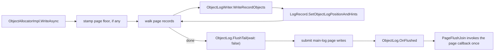

# Object-log serialization

This document describes the file format and code paths used by Tsavorite's `ObjectAllocator` to persist and reload a
record's out-of-line pieces:

- an overflow key;
- an overflow value; or
- a serialized object value.

> **Status:** the object log is written and read through `ObjectLog` (section 12). Sections 3-9 describe its record
> format and the flush, read, and recovery flows over it; section 12.10 summarizes the format. Version 7 checkpoints use
> an older format and are read by `LegacyObjectLogReader` (section 7.5).

The hybrid log stores the record header, inline fields, objectId slots, optionals, and the object-log position. The
object log stores the bytes referenced by those slots. The two logs are written and read together, but their metadata
has deliberately separate responsibilities:

- The effective `RecordDataHeader.KeyLength` and `RecordDataHeader.ValueLength` properties describe physical fields in
  the hybrid-log record. They always return an exact inline length or the 4-byte objectId-slot size.
- For an overflow key, the raw 10-bit RDH KeyLength field is free because `KeyIsInline` is false. A flushed record uses
  it for the high bits of the key slot's page-count hint without changing the effective property or record layout.
- The high 9 bits of an objectId slot carry an initial read hint for the object-log extent the record's position
  addresses: the key's slot when the key is overflow, otherwise the value's.
- `KeyIsExactSize` / `ValueIsExactSize` bits in the object-log position word select whether that 9-bit value is an
  exact byte length or a page-count hint.
- A 4-byte length prefix carries the exact length of every extent that is not exact-size, and a directory carries the
  exact length of every chunk it lists (section 12.10).

Inline values never enter the object log. Migration and replication use an independent network record format; see
[Migration / Replication record layout](../migration-replication-record-layout.md).

> **Keep this document in sync with the code.** The primary implementation files are:
>
> - `libs/storage/Tsavorite/cs/src/core/Allocator/RecordDataHeader.cs` - hybrid-log field kinds and physical field lengths.
> - `libs/storage/Tsavorite/cs/src/core/Allocator/ObjectIdMap.cs` - objectId index/hint bit allocation.
> - `libs/storage/Tsavorite/cs/src/core/Allocator/LogRecord.cs` / `LogRecord_cv7.cs` - metadata stamping/decoding,
>   objectId-map assignment, and legacy decoding.
> - `libs/storage/Tsavorite/cs/src/core/Allocator/ObjectAllocatorImpl.cs` - page flush, disk read, scan, and recovery orchestration.
> - `libs/storage/Tsavorite/cs/src/core/Allocator/PageHeader.cs` - the page header's object-log floor.
> - `libs/storage/Tsavorite/cs/src/core/Allocator/AllocatorBase.cs` - partial-sector images and recovery flush requests.
> - `libs/storage/Tsavorite/cs/src/core/Allocator/ObjectSerialization/ObjectLog.cs` - the log-structured substrate; see section 12.
> - `libs/storage/Tsavorite/cs/src/core/Allocator/ObjectSerialization/ObjectLogWriter.cs` / `ObjectLogReader.cs` - writing and
>   reading a record's components; see section 12.10.
> - `libs/storage/Tsavorite/cs/src/core/Allocator/ObjectSerialization/ObjectLogReadAhead.cs` - reading ahead through a page's
>   records' extents; see section 12.10.
> - `libs/storage/Tsavorite/cs/src/core/Allocator/ObjectSerialization/ObjectLogExtent.cs` - extent framing and read hints.
> - `libs/storage/Tsavorite/cs/src/core/Allocator/ObjectSerialization/ObjectLogDirectory.cs` - directory entry, record
>   header, and layout arithmetic; see section 12.9.
> - `libs/storage/Tsavorite/cs/src/core/Allocator/ObjectSerialization/ObjectLogPositionInfo.cs` - position word layout and
>   format flags.
> - `libs/storage/Tsavorite/cs/src/core/Allocator/ObjectSerialization/LegacyObjectLogReader.cs` / `LegacyObjectLogPosition.cs` /
>   `CircularDiskReadBuffer.cs` / `DiskReadBuffer.cs` - reading a version 7 object log.
> - `libs/storage/Tsavorite/cs/src/core/Allocator/OverflowByteArray.cs` - owned overflow storage.
> - `libs/storage/Tsavorite/cs/src/core/Index/Recovery/Recovery.cs` - recovery passes, snapshot-region flushes, and
>   up-conversion.
> - `libs/storage/Tsavorite/cs/src/core/Index/CheckpointManagement/RecoveryInfo.cs` - checkpoint format versions.

---

## 1. Record and object-log mental model

A fully inline record is self-contained:

```text
+=======================================================================+
| RecordInfo | RecordDataHeader | namespace | inline key | inline value |
|            |                  |           |            | optionals    |
+=======================================================================+
```

A record with any out-of-line component replaces that component's inline bytes with a 4-byte objectId slot and adds
an 8-byte object-log position to its optional area:

```text
HYBRID LOG RECORD
+================================================================================+
| RecordInfo | RDH | namespace | key field | value field | ETag/expiry | obj-pos |
+================================================================================+
                               |             |
                  inline bytes or i32        +-- inline bytes or i32 objectId
                  objectId

OBJECT LOG, at obj-pos
  one out-of-line component that fits one chunk (HasDirectory clear):
  +------------------------------+------------------------------------------+
  | int32 length, if > 511 bytes | overflow key, overflow value, or object  |
  +------------------------------+------------------------------------------+

  otherwise (HasDirectory set), the record's top directory record:
  +------------------------------+--------+---------+-------------------------+
  | int32 length, if > 511 bytes | header | entries | final data, if combined |
  +------------------------------+--------+---------+-------------------------+
```

A record's out-of-line components form one stream, key first. When the record has one out-of-line component and it fits
one chunk, the position addresses that component's extent. Otherwise, including whenever the record has both an
overflow key and an out-of-line value, the position addresses the record's top directory record, which lists the
address and exact length of every chunk (section 4). The object log has no record-level framing, and consecutive
records' extents are not necessarily contiguous, so a reader obtains each record's location from that record's
object-log position word rather than deriving it from the preceding record.

The objectId has two roles at different times:

1. In memory, its low bits index the page's `ObjectIdMap`, which owns the `OverflowByteArray` or `IHeapObject`.
2. In a flushed record image, the high bits of the slot that sizes the record's extent also carry an initial object-log
   read hint. The low index bits remain intact, so a live-page flush can stamp a hint without changing which object the
   slot resolves to.

Every in-memory lookup uses `ObjectIdMap.GetIndex()` and therefore masks away the hint bits.

---

## 2. Effective RDH lengths and raw overflow-key metadata

`RecordDataHeader` (RDH) is one atomically published 8-byte word. Its relevant fields are:

```text
bit(s)   field
 0       KeyIsInline
 1       ValueIsInline
 2       ValueIsObject
 6..13   FillerWords
14..23   KeyLength       (10 bits)
24..47   ValueLength     (24 bits)
```

### 2.1 Exact meaning of `KeyLength` and `ValueLength`

The effective length properties always describe the physical key/value fields in the hybrid-log record:

| Field kind | Physical field contents | RDH length |
|---|---|---|
| Inline key | key bytes | exact key byte length |
| Overflow key | one 4-byte objectId | `ObjectIdMap.ObjectIdSize` (4) |
| Inline value | value bytes | exact value byte length |
| Overflow value | one 4-byte objectId | `ObjectIdMap.ObjectIdSize` (4) |
| Object value | one 4-byte objectId | `ObjectIdMap.ObjectIdSize` (4) |

The `KeyLength` and `ValueLength` property getters enforce this interpretation:

- for an inline field, return the raw RDH field;
- for an out-of-line field, return `ObjectIdMap.ObjectIdSize`.

Consequently, `GetKeyFieldInfo`, `GetValueFieldInfo`, `ActualSize`, `AllocatedSize`, optional-field placement,
`ObjectLogPosition` placement, record scans, and filler calculations never depend on the serialized object-log size.
Changing an overflow payload from 1 KB to 500 MB does not change the hybrid-log record's physical field size.

For an inline key, raw RDH KeyLength and effective `KeyLength` are the same exact byte count. For an overflow key,
effective `KeyLength` remains 4, but the raw field has no physical-layout consumer. When the key's slot sizes a
length-prefixed extent, the flushed record therefore uses those 10 raw bits as the high portion of the extent's 4 KB
page count (section 3.3); otherwise they hold 4. Assigning the recovered key to an `ObjectIdMap` restores the raw field
to 4; the effective property remains 4 before and after restoration.

### 2.2 What object-log code must never do

Current-format object-log flush and read paths do not:

- put an overflow/object byte length into a raw RDH length field;
- use raw RDH ValueLength as object-log metadata;
- use raw RDH KeyLength for an overflow key except as the high page-count bits;
- derive authoritative object-log framing from either RDH field; or
- rewrite RDH lengths after deserializing an object, except to restore/assert the physical 4-byte objectId slot.

This also keeps the file-IO format independent of the migration/replication format. Network serialization may add
component length prefixes outside the inline record image, but it leaves RDH lengths unchanged.

### 2.3 Legacy exception

Checkpoint version 7 uses an older split length encoding: the raw RDH field holds the low length bits and the objectId
slot holds the next 32 bits. `LogRecord_cv7.cs` decodes it, and recovery selects that decoder from the checkpoint
version. Version 7 records also set object-log position bit 63, which current code does not read.

The legacy decoder interprets both raw fields according to that older layout. Current-format code uses
`GetKeyLengthRaw()` only for the overflow-key page-count high bits and does not use `GetValueLengthRaw()` as an
object-log hint.

---

## 3. ObjectId size hints and position flags

### 3.1 ObjectId slot layout

Each objectId slot is one 32-bit integer:

```text
31                       23 22                              0
+--------------------------+--------------------------------+
| initial-read hint (9 b)  | ObjectIdMap index (23 b)       |
+--------------------------+--------------------------------+
```

| Bits | Name | Meaning |
|---|---|---|
| 0..22 | index | Index into the record page's `ObjectIdMap` |
| 23..31 | size hint | Initial-read hint for the extent the record's position addresses (section 3.3) |

The 23-bit index is larger than the maximum index needed by a 128 MB page at the minimum record size. The high 9 bits
are therefore available for the disk-read hint without reducing the supported page population.

One slot sizes the extent: the key's slot when the key is overflow, since the extent is then the key alone or a
directory, and the value's slot otherwise. When the key's slot sizes it, the flush stamps a hint of zero into an
out-of-line value's slot.

`ObjectIdMap.StampSizeHint(slot, hint)` preserves the low index. `ObjectIdMap.GetIndex(slot)` masks the hint before
an in-memory lookup, and `ObjectIdMap.GetSizeHint(slot)` extracts the high 9 bits for disk IO.

### 3.2 Object-log position word

The optional 8-byte object-log position combines an address and format flags:

```text
63             62              61                 60                 59..0
+--------------+---------------+------------------+------------------+--------------+
| unused       | HasDirectory  | KeyIsExactSize   | ValueIsExactSize | address      |
+--------------+---------------+------------------+------------------+--------------+
```

| Bit | Meaning |
|---|---|
| 0..59 | Object-log address, about a 1 EB range (`ObjectLogPositionInfo.AddressMask`) |
| 60 | `ValueIsExactSize`: the value slot's hint is an exact byte length; meaningful when the key is not overflow |
| 61 | `KeyIsExactSize`: the key slot's hint is an exact byte length; meaningful when the key is overflow |
| 62 | `HasDirectory`: the position addresses the record's top directory record rather than a single extent (section 12.9) |
| 63 | Unused. Version 7 records set it; current code never reads it, and up-conversion rewrites the whole word |

The address is a flat `ObjectLog` logical address (section 12); device segmentation is not part of it. A version 7
position splits the same 60 bits into a segment id and an offset, which `LegacyObjectLogPosition` decodes for the
version 7 reader (section 7.5).

Only the exact-size flag of the slot that sizes the extent applies, so a reader takes that slot's hint and flag
together.

#### Stamped versus unstamped

The unstamped state sets all 60 address bits and leaves the flag bits unchanged; no allocation reaches that address
(section 12.7). `ObjectLogPositionInfo` owns this encoding: `Unstamp` sets it, `WordIsUnstamped` and `IsUnstamped` test
it, and callers do not compare a word against `NotSet` themselves.

`NotSet` is the unstamped marker with every flag bit clear, because a flag is a claim about a position and an unstamped
word makes no claims. `WordIsUnstamped` examines only the address bits, so a word with every bit set, as a version 7
image may hold, also reads as unstamped. Flag readers therefore reject an unstamped word rather than test their bit in
isolation, which is what `WordHasDirectory` does.

A record is unstamped whenever it holds components that are not in the object log. `InitializeRecord`,
`TrySetValueObject`, and the `KeyOverflow` and `ValueOverflow` setters unstamp it, as do `SetDeserializedValueObject`
and `OnObjectReadComplete` once a read has brought the components into memory. The position then describes nothing the
record still needs, and leaving it stamped would let a later flush that skips the record persist a position for bytes
it did not write. Unstamping preserves the flag bits, and a flush restamps the record when it writes its components.

A reader never reads from an unstamped position, since the bytes there belong to another record. A page walk
materializes such a record with `LogRecord.MaterializeObjectsWithoutReading`: overflow components become empty arrays,
and an object value is recorded as absent (null) without invoking the deserializer, because zero bytes carry no type
information. A Valid record with out-of-line components reaches disk unstamped when, for example, its flush had no
object log to write them to (section 5.1). The single-record pending read instead treats an unstamped record as a flush
defect and throws: it reads the record into a dedicated buffer, so the record reached disk without its object bytes.

#### Exact component lengths

A reader knows each component's exact length before it reads the component's bytes:

| Extent | Exact length from |
|---|---|
| Single exact extent | The hint, with its exact-size flag set |
| Single length-prefixed extent | The 4-byte length prefix |
| Directory | The sum of the component's entry lengths; `KeyEntryCount` divides the entries between key and value |

`ReadKey` and `ReadValueOverflow` therefore allocate one `OverflowByteArray` at its final length, and `ReadValueObject`
bounds the deserializer by the value's length. The reader's `Read` returns 0, end-of-stream, once that many bytes have
been delivered, so a deserializer that asks for more than it wrote never sees another record's bytes. A value of length
zero is recorded as absent (null) without invoking the deserializer.

### 3.3 Hint encoding

A hint describes the extent the position addresses: a single extent's payload, or a top directory record's payload,
which is its header, entries, and any combined final data. An extent whose payload is at most
`ObjectLogExtent.ExactCutoff` (511) bytes is exact and headerless; a larger one is length-prefixed (section 4.1).

| Slot | Exact flag | 9-bit hint | First read |
|---|---|---|---|
| Key | Set | Payload length, 0..511 | Exactly `hint` bytes |
| Key | Clear | Low 9 bits of a 19-bit 4 KB page count | `pageCount * 4 KB`, clamped |
| Value | Set | Payload length, 0..511 | Exactly `hint` bytes |
| Value | Clear | 1..510: a 4 KB page count | `hint * 4 KB`, clamped |
| Value | Clear | `ObjectLogExtent.LargeValueHint` (511): 511 or more pages | `ObjectLogExtent.LargeInitialRead` (4 MB + 4 bytes), clamped |

A page count is `ceil((LengthPrefixSize + payload) / 4 KB)`: it includes the 4-byte prefix
(`ObjectLogExtent.LengthPrefixSize`), in units of `RecordDataHeader.kFlushPageSize` (4 KB). "Clamped" means limited to
the bytes left on the extent's object-log page and below the log's tail; a length-prefixed extent never spans a page.

For a key whose exact flag is clear, the high 10 bits of the page count are in raw RDH KeyLength:

```text
pageCount = (rawRdhKeyLength << 9) | objectIdHint
firstRead = pageCount * 4 KB
```

The 19-bit count is exact and never saturates. An addressed extent is one allocation and so at most one object-log page,
which is 32,768 pages at the 128 MB maximum, far below `RecordDataHeader.kMaxOverflowKeyPageCount` (2^19 - 1), above
which `ComputeOverflowKeySizeHint` throws. No flag selects the split: whenever `KeyIsExactSize` is clear, raw RDH
KeyLength holds the high bits, zero below 512 pages. When it is set, raw RDH KeyLength holds the physical slot size,
`ObjectIdMap.ObjectIdSize` (4).

A value hint saturates at `LargeValueHint`, which means "large" rather than 511 pages. Its first read covers a full
write chunk (`IStreamBuffer.BufferSize`, 4 MB) and its prefix, so one IO reads any single extent the writer produces at
its default chunk size.

The first read covers the whole extent unless the extent is length-prefixed and longer than `LargeInitialRead`, such as
a top directory record whose entries and combined data exceed it. The prefix then gives the exact length, and a second
read on the same page fetches the rest.

A zero-length single component allocates nothing: the writer stamps the exact flag with a hint of zero, and the position
is the log's tail when the record was written. In a directory, a component with no entries has length zero.

### 3.4 Computing and stamping a hint

`ObjectLogWriter.FinishRecord` encodes the hint from the payload length of the extent it wrote:

- When the key is overflow, `ObjectLogExtent.EncodeKeyHint` (`RecordDataHeader.ComputeOverflowKeySizeHint`) returns the
  exact length and sets `KeyIsExactSize` for a payload of at most 511 bytes, keeping raw RDH KeyLength at
  `ObjectIdSize`; otherwise it splits the page count between the objectId hint (low 9 bits) and raw RDH KeyLength
  (high 10 bits).
- Otherwise `ObjectLogExtent.EncodeValueHint` (`RecordDataHeader.ComputeObjectIdValueSizeHint`) returns the exact length
  and sets `ValueIsExactSize`, or returns the page count, saturating at `LargeValueHint`.
- `HasDirectory` is set when the writer wrote a top directory record.

The result is an `ObjectLogWriteResult`: the position word with its address and flags, `KeySizeHint`,
`KeyRdhLengthBits`, `ValueSizeHint`, and `ValueObjectLength`, the number of bytes an object value serialized to.
`LogRecord.SetObjectLogPositionAndHints` then:

1. writes the position word;
2. for an overflow key, stamps `KeySizeHint` into the key's slot, keeping its index, and writes `KeyRdhLengthBits` into
   raw RDH KeyLength with one `SetDataHeader`; and
3. for an out-of-line value, stamps `ValueSizeHint` into the value's slot, which is zero when the key's slot sizes the
   extent.

Neither effective RDH length changes. Stamping raw RDH KeyLength is layout-neutral because `KeyLength` returns
`ObjectIdSize` whenever `KeyIsInline` is false, and in-memory readers resolve the same object because each slot keeps
its index bits.

### 3.5 Decoding a hint

`LogRecord.GetObjectLogRecordRef()` captures what a reader needs as an `ObjectLogRecordRef`: the position word with its
flags, which components are out of line, the key slot's hint and raw RDH KeyLength, and the value slot's hint. Its
`TopExtentInitialRead` decodes the first read with `ObjectLogExtent.KeyInitialRead` when the key is overflow and
`ObjectLogExtent.ValueInitialRead` otherwise, and the reader clamps it (section 6.1). A reader captures the reference
before it materializes any component, because assigning a component unstamps the record.

`LogRecord.GetObjectLogRecordStartPositionAndLengths` serves the version 7 paths: when the checkpoint version selects
the version 7 decode (`HybridLogRecoveryInfo.UsesDownlevelObjectLog`), it returns the record's position and exact split
lengths from `GetObjectLogRecordStartPositionAndLengths_cv7`.

---

## 4. Object-log byte layouts

The object log has no record-level framing: a reader finds a record's bytes only through its position word. The
structures below are what a position or a directory entry addresses; sections 12.9 and 12.10 give the rules that
produce them.

### 4.1 Single extent

A record whose only out-of-line component fits one chunk is written as a single extent, and its position has
`HasDirectory` clear.

At most 511 bytes, exact:

```text
+-------------------+
| payload           |
| hint bytes        |
+-------------------+
```

More than 511 bytes, length-prefixed:

```text
+-------------------+---------------------------+
| int32 length      | payload                   |
| 4 bytes           | length bytes              |
+-------------------+---------------------------+
```

The payload is the overflow key, the overflow value, or the serialized object, byte for byte. It is at most one chunk:
`IStreamBuffer.BufferSize` (4 MB), or the object-log page size less the prefix if that is smaller. A zero-length
component has no bytes, and its exact hint of zero says so.

### 4.2 Directory record

A record with more than one chunk, or with both an overflow key and an out-of-line value, gets a directory, and its
position addresses its top directory record with `HasDirectory` set. The top record is framed like any addressed
extent: exact when it is at most 511 bytes, length-prefixed otherwise.

```text
[int32 length, when longer than 511 bytes]
+-----------------------+-----------------------------+---------------------------------+
| DirectoryRecordHeader | DirectoryEntry x EntryCount | final data chunk, when          |
| 12 bytes              | 12 bytes each               | DirectoryIsCombined is set      |
+-----------------------+-----------------------------+---------------------------------+
```

| Header field | Bytes | Meaning |
|---|---|---|
| `EntryCount` | 4 | Entries in this record, including a spine link |
| `KeyEntryCount` | 4 | Overflow-key entries over the whole chain, excluding spine links |
| `Flags` | 4 | `DirectoryIsCombined`: the final data chunk follows the entries |

```text
DirectoryEntry
word0 (8 bytes): bits  0..59  address of the chunk's first data byte
                 bit      60  IsDirectory: the entry links to a spine record
                 bits 61..63  spare
word1 (4 bytes): bits  0..26  data length, biased by one
                 bits 27..31  spare
```

Entries list every component portion in stream order. A chunk holding the end of the key and the start of the value
has two entries with the same address; each entry after the first at an address starts where the previous one ends.
When `DirectoryIsCombined` is set, the last entries address the record's own data area, so reading the record also
reads that data.

### 4.3 Spine record

When the entries outgrow one record, at `MaxDirectoryRecordSize` (1 MB) or the object-log page size if smaller, the
writer writes them out as a spine record and starts a fresh list whose first entry links back to it with `IsDirectory`
set:

```text
+-----------------------+-----------------------------+
| DirectoryRecordHeader | DirectoryEntry x EntryCount |
| KeyEntryCount 0       | entry 0 may link to an      |
| no flags              | older spine record          |
+-----------------------+-----------------------------+
```

A spine record has no length prefix and no combined data; the link that addresses it holds its exact length. Only entry
0 of a directory record can be a link.

### 4.4 Data chunk

A data chunk is raw stream bytes, with no prefix, header, or padding. Only directory entries address it, and it never
spans an object-log page. The stream is the overflow key's bytes followed by the value's, so one chunk can hold the end
of the key and the start of the value.

### 4.5 Placement

A record's extents are allocated in stream order: data chunks as the stream fills them, a spine record whenever the
entry list fills, and the top directory record last. The top record's address, which the position holds, is therefore
the highest of the record's extents. For example, with default settings and no page cut, a 9 MB serialized object is
written as:

```text
ascending object-log addresses ->
| data chunk, 4 MB | data chunk, 4 MB | [length][header][3 entries][final 1 MB of data] |
                                       ^ position word (HasDirectory set)
```

Records follow one another in hybrid-log address order (section 12.8), each at or above the end of the previous
record's top extent. They are not necessarily contiguous: a page tail shorter than `MinPartialBytes` (64 KB) is left
unused when a chunk does not fit it, and an extent that the writer does not cut moves whole to the next page.

---

## 5. Flush and write flow

### 5.1 Page-level ordering and completion

`ObjectAllocatorImpl.WriteAsync` writes one page, or part of one, for ReadOnly, Snapshot, and recovery flushes:

1. stamp the page header's object-log floor where the flush type calls for it (section 5.4);
2. walk the records in address order, writing each eligible record's components with
   `ObjectLogWriter.WriteRecordObjects` and stamping the result with `LogRecord.SetObjectLogPositionAndHints`
   (sections 5.2 and 5.3);
3. if any record wrote object-log bytes, request the object log's flush without waiting:
   `ObjectLog.FlushTail(wait: false)` returns the tail the flush covers;
4. submit the page's device writes from the live page (section 5.6); and
5. join those writes and `ObjectLog.OnFlushed(tail, ...)` in a `PageFlushJoin`, which invokes the page's callback once,
   after every part has completed, with the first error any part reported.

The page callback is what advances `FlushedUntilAddress`, so the main log never covers a record whose object bytes are
not durable. The object log writes its own pages, so those writes overlap the main-log writes and no thread blocks on
them.



| Flush | Object log written |
|---|---|
| ReadOnly | The main object log, or during a version 7 up-conversion, its destination |
| Snapshot | The checkpoint's own `ObjectLog`, created at `WAIT_FLUSH` over its snapshot object-log device |
| Recovery, snapshot region | The main object log; components are copied from the checkpoint's object log (section 7.4) |
| Recovery, up-conversion | The up-conversion's destination (section 7.5) |
| Recovery, hybrid-log region | None; records are written verbatim (section 7.3) |

A flush to a `NullDevice` main log completes without writing. A ReadOnly or Snapshot flush with no object log, or whose
page's `ObjectIdMap` is empty, writes its span without walking the records. An allocator has no object log for ReadOnly
flushes when it has no object-log device, or when its object-log or main-log device is a `NullDevice`, as for the read
cache and the in-memory stores of iterators and compaction. Recovery never takes this inline path: records read from
disk hold positions rather than map indices, so a recovered page's map is empty whatever its records hold, and every
recovery flush must examine its records.

### 5.2 Per-record capture and stamping

`WriteAsync` resolves each record's objectId slots against the page's live `ObjectIdMap`. ReadOnly enters from an epoch
callback and suspends that hold for the flush, restoring it before it returns; Snapshot and recovery enter without
epoch protection. Suspending matters because writing a record can wait for an object-log page flush, and an epoch held
across IO stalls reclamation. It is safe because eviction is capped at `FlushedUntilAddress`, which cannot pass the page
until this flush's callback runs. Snapshot/ReadOnly ordering keeps `FlushedUntilAddress`, and therefore `HeadAddress`,
below the active Snapshot page on a real main-log device; for `NullDevice` the same watermark caps `HeadAddress`
directly. The page and its `ObjectIdMap` therefore stay resident for the whole flush.

For each record:

- An Invalid record, including a null one, writes nothing to the object log; the page write carries its inline image.
- In a Snapshot flush, a next-version record at or above `fuzzyRegionStartAddress` is left unchanged, and recovery
  rejects it (section 5.7).
- A fully inline record has nothing to write.
- In a ReadOnly or Snapshot flush, `LogRecord.TryGetOutOfLineComponents` first captures the overflow key and the
  overflow value or object, rooting them, and reports a slot that a concurrent operation has already freed rather than
  throwing. The flush then re-reads the live `RecordInfo`. Elision invalidates a record before it frees the record's
  heap, so a capture that lost its heap finds an Invalid record, which the flush skips as if it had been Invalid from
  the start. Otherwise `WriteRecordObjects(keyOverflow, valueOverflow, valueIsObject, valueObject)` writes the
  components and `SetObjectLogPositionAndHints` stamps the record.
- A recovery flush copies, re-serializes, or keeps each record's components, as section 7 describes.

### 5.3 Writing a record

`ObjectLogWriter` turns a record's components into extents; section 12.10 states the rules and section 12.9 the
directory format. One writer serves a page flush, record by record:

- `WriteRecordObjects` calls `BeginRecord`, then `AppendKey` for an overflow key and `AppendValue` for an overflow value
  or `Serialize` for an object, and ends with `FinishRecord`.
- The components form one stream, key first, staged in a buffer of `IStreamBuffer.BufferSize` (4 MB), or of the
  object-log page size less the length prefix if that is smaller, rented from `ArrayPool<byte>.Shared`. When nothing is
  staged, a source span longer than a chunk is written straight from the source.
- `EmitDataChunk` writes a full staging buffer, or a chunk-sized source span, as data chunks, one `ObjectLog.Allocate`
  each. It fills a page tail when the tail is at least `MinPartialBytes` (64 KB) and leaves a shorter tail unused.
- `FinishRecord` writes a single extent (`TryWriteSingleExtent`) when no chunk was emitted and the record has one
  component. A length-prefixed extent that does not fit the page tail is cut when both pieces would be at least
  `MinPartialBytes`: the tail takes the start of the stream as a data chunk, and the record gets a directory. An exact
  extent is never cut.
- Otherwise `WriteTopDirectoryRecord` writes the top directory record, combined with the staged final data when the
  whole extent fits one page, and after writing that data as data chunks when it does not. When the record's allocation
  is cut at a page end, the tail takes the start of the final data as a data chunk and the record moves to the next
  page.
- `WriteSpine` writes the entry list out as a spine record before it exceeds `MaxDirectoryRecordSize` (1 MB), or the
  object-log page size if smaller.
- Each allocation and the copy into it happen in one `ObjectLog.BeginScope` / `EndScope` (section 12.3). No epoch is
  held while staging or serializing.

An object value is serialized through the writer itself: the writer is the `IStreamBuffer` beneath a
`PinnedMemoryStream`, and the store's serializer (`CreateValueObjectSerializer`) is created on the writer's first
object, with `BeginSerialize` called once. Serializer writes reach `ObjectLogWriter.Write`, which appends them to the
value; `FlushAndReset` does nothing, because chunks are emitted as the stream fills them. A serialized size at or above
`IHeapObject.MaxSerializedObjectSize` (2^40 bytes) throws. An object slot that holds no object writes nothing for the
value, which is then a zero-length component.

Tests shrink the chunk size, `MinPartialBytes`, and `MaxDirectoryRecordSize` through the internal
`ObjectLogWriterSettings` to reach page cuts, directories, and spines with small data.

### 5.4 Page-header object-log floors

Each main-log page header holds `objectLogLowestPositionWord`, the page's floor: a main object-log address no greater
than any position that a record on this page, or on a later page, references. The main object log is written in page
order, so its tail before a page's records are written is such a bound (section 12.8). The floor is unstamped until a
flush stamps it. `PageHeader.Initialize` sets it to `NotSet` for a newly allocated page and for a page cleared from its
start, so a reused buffer page never presents a zeroed header, which would read as a floor of 0.

`WriteAsync` stamps the floor before it writes any of the page's records, with the destination object log's tail:

| Flush | Floor |
|---|---|
| ReadOnly | Stamped when the range includes the page's first record, also for an object-free page; an existing floor is kept |
| Snapshot | Never stamped: its tail is an address in the checkpoint's object log, and the later ReadOnly flush keeps an existing floor, so the stamp would reach the main log |
| Recovery | Overwritten only when the flush writes the page's objects into a new address space: an up-conversion, or a snapshot-region copy of a page that starts in the snapshot region. Otherwise the header read from the device stays |

Pass 2 resets the floor of a resident snapshot-region page that it loads from the checkpoint's object log
(`ResetRecoveredResidentPageHeader`), so the next flush that writes the page header stamps a main object-log floor.

Main-log truncation (`TruncateUntilAddressBlocking`, `RemoveSegment`) reads, from the device, the header of a page at or
below the new begin address (`ReadObjectLogFloor`). After truncating the main log, it calls `ObjectLog.Truncate(floor)`
when the floor is above the object log's `BeginAddress`; the floor bounds that page and every later one, so no retained
record loses its object bytes. The first two main-log pages and an unstamped floor yield -1, which truncates nothing.

### 5.5 Buffer and callback lifetime

- A writer serves one page flush. Its staging buffer and entry array are rented on first use and returned by `Dispose`
  in the flush's `finally`, after `EndSerialize` ends the object serializer.
- Each allocation's bytes are copied into the `ObjectLog`'s page ring within its scope, so the writer keeps no reference
  into the ring after `FinishRecord`; the ring's own flush writes those pages.
- A composed first sector (section 5.6) is a pooled sector buffer held by the flush result (`freeBuffer1`) and returned
  when the result is released.
- `PageFlushJoin` holds a sentinel part until every part is submitted, so an early completion cannot finish the join.
  `SubmitFlushPart` completes its part with an error when a submission throws, then rethrows to the issuer, and
  `snapshotDeviceWriteIssued` tells the issuer that the callback owns cleanup from then on. The page callback runs
  exactly once, which matters because a Snapshot page's callback releases the page's native snapshot-IO unit on its
  first invocation.
- `ObjectLog.OnFlushed` invokes its callback exactly once: at once when the address is already flushed, a flush below it
  has failed, or the log is disposed, and otherwise from the flush completion that reaches the address or fails below
  it. Disposing an object log fails its waiters, and the allocator disposes its object logs before its base, so those
  callbacks run against a live allocator.

### 5.6 Live-page writes and partial sectors

The main-log write always uses the allocator's live page; no page image is copied. Hint stamping preserves each
objectId's index and raw RDH KeyLength stamping is layout-neutral, but metadata non-destructiveness alone is not
sufficient. Recovery has exclusive access. Snapshot/ReadOnly coordination keeps the page resident and prevents those
modes from stamping the same page concurrently.

The no-copy path also requires `OnDispose` not to tear down flush-critical bytes before the asynchronous page write
finishes. `OnDispose` implementations must copy off cleanup state and defer clearing those bytes until that write
finishes. A record in a flush's frozen range (`IsFrozenForFlush`) keeps its heap and metadata until the flush completes:
a release there is marked `DeferredDispose` and run by the drain on flush completion, or by eviction.

The write covers whole sectors, `[RoundDown(start, sectorSize), RoundUp(end, sectorSize))`. A flush that writes the page
header, because its range includes the page's first record or it is an up-conversion, starts at the page's offset 0.

A front-partial ReadOnly flush starts after a prefix already written by the same monotonic flush sequence. The physical
write rounds down to the sector boundary, so it writes that prefix again, and it must not take the prefix from the live
page: a completed FoldOver recovers those records from the main log, and since they became durable they may have changed
in memory - elided, disposed, released by a CopyUpdate, or rewritten by recovery's object load. So the flush writes its
first sector from a pooled sector buffer holding the durable prefix followed by the live bytes from its own start. The
prefix comes from the `PartialSectorImage` the previous ReadOnly flush of that page kept of the sector it ended in, or,
when no image describes that sector (after recovery or a reset), from reading the sector back from the device. A prefix
that lies entirely below `BeginAddress` comes from the live page: nothing reads it, and it may never have been written,
because the flush of a range below `BeginAddress` is skipped. The rest of the span is written directly from the live
page. `AllocatorBase` holds this mechanism (`partialSectorImages`, `TryGetDurableSectorPrefix`,
`RecordPartialSectorImage`), and `SpanByteAllocator`'s ReadOnly flushes use it too, since superseding a record there
elides it or clears its optional fields in the live page.

Devices do not order overlapping writes, and the object allocator issues adjacent fragments without the `PendingFlush`
chaining `AllocatorBase` uses for the same reason. So a flush that starts mid-sector issues its writes only once
`FlushedUntilAddress` reaches its start (`WaitForWritesBelow`), which means the previous write of that sector has
completed. Otherwise that write could land last and replace the records this flush stamped there with their image from
before it.

Records below `FlushedUntilAddress` are therefore never written again from the live page, and `IsFrozenForFlush` covers
only `[FlushedUntilAddress, SafeReadOnlyAddress)`. If the logical endpoint is inside a sector, the write carries the live
bytes above it to the end of that sector. Nothing reads them: the next ReadOnly flush writes that sector again, and
recovery bounds its record walk by the unrounded endpoint.

### 5.7 Snapshot and ReadOnly page ordering

At `PREPARE`, `fuzzyRegionStartAddress` captures the exact tail that starts the fuzzy region and Snapshot publishes a
fresh coordination object in `Open`; ReadOnly remains unrestricted. At `WAIT_FLUSH`, coordination advances
monotonically through:

```text
Open -> CapturingCutoff -> DrainingCutoff -> Flushing -> Closed
```

The ReadOnly worker publishes each contiguous range's exclusive endpoint before sampling coordination.
`CapturingCutoff` pairs its state publication with that endpoint publication, captures
`readOnlyFlushCutoffAddress`, and enters `DrainingCutoff`. A range at or below the cutoff proceeds normally because
Snapshot explicitly waits for its `FlushedUntilAddress` publication. A later range waits until Snapshot drains the
cutoff cohort, captures stable `snapshotFileLogicalStartAddress`, and enters `Flushing`; it then obeys the page limit.
The cutoff drain does not hold the allocator installation lock, so an included ReadOnly worker can issue the IO being
awaited. Snapshot does not advance `ReadOnlyAddress`.

During `Flushing`, a fixed-size ring tracks only the bounded set of concurrently issued Snapshot pages. Its size is
`SnapshotFlushCoordinationWindowSize`: for the object allocator, 64 pages capped at its buffer size (section 9.7).
Callbacks may complete out of order, but `readOnlyFlushPageLimit` advances only across the contiguous completed prefix.
ReadOnly page `P` may serialize only while `P < readOnlyFlushPageLimit`; it waits only if it catches an unfinished
Snapshot page. Completing a page immediately gives ReadOnly and eviction priority for that page. After every issued page
drains, coordination enters `Closed` and releases the final page.

Real-device non-object allocators do not install coordination and retain parallel Snapshot submission.
A non-object `NullDevice` uses a one-slot window only to cap `HeadAddress`, because it has no durable main-log fallback.
Outside an actual cutoff or page wait, ReadOnly performs only state, cutoff, and page-limit reads. It suspends epoch
protection only around a real wait. If Snapshot fails, the failure stops new issuance but coordination remains
restrictive until every already-issued page write drains and state becomes `Closed`.

For `NullDevice`, Head may advance behind completed Snapshot pages even though no main-log bytes are durable.
`mainLogRecoveryEndAddress` therefore remains the captured Snapshot start rather than the later HeadAddress; recovery reads
that evicted prefix from the snapshot file.

Snapshot serializes stable records into the snapshot object log and stamps their snapshot positions directly on the live
page. ReadOnly does not consume `ObjectLogPosition`; after Snapshot completes the page, ReadOnly resolves each object through
`ObjectIdMap`, serializes it to the main object log, and replaces the Snapshot position. No page-image copy or metadata
journal is required.

ReadOnly's image is not discardable. `mainLogRecoveryEndAddress` is the main log's `FlushedUntilAddress` at
`PERSISTENCE_CALLBACK`, capped at `recoveredTailAddress` because ReadOnly may by then have flushed later versions past the
checkpoint's tail. Recovery reads the main log below it, so a page that ReadOnly writes after Snapshot has
completed it, but before that sample, is recovered from ReadOnly's image. A `(v)` record superseded during the checkpoint
must therefore keep its `(v)` content for ReadOnly too, until the checkpoint completes - not only until Snapshot has
written its page.

Outside a checkpoint the superseded content is discardable. A CopyUpdate's new record is then in the source's version, so
it supersedes the source in every later checkpoint, and no completed checkpoint recovers a source at or above
`FlushedUntilAddress` from the main log. ReadOnly therefore writes either the pre-update image, if it serialized the value
before the CopyUpdate, or a null value. Only the record image itself must stay intact while the source is frozen for flush
(see [The same shape, without a checkpoint](state-machine.md#the-same-shape-without-a-checkpoint)).

Snapshot leaves fuzzy v+1 records unchanged. Recovery uses the exact persisted `fuzzyRegionStartAddress` as the fuzzy lower
boundary and invalidates such records before hashing overflow keys or reading payloads. RDH must still describe the record's
stable allocation so recovery can advance to the next record.

---

## 6. Read flow

`ObjectLogReader` reads a record's components from one `ObjectLog`, which `GetReadObjectLog` selects: the main object
log, or during Snapshot recovery the checkpoint's object log. No epoch is held while deserializing; `ObjectLog.Read`
takes its own scope for each read. The reader's callers are:

| Caller | Read-ahead | Sequence |
|---|---|---|
| Single-record pending read (`VerifyRecordFromDiskCallback`) | None | Section 9.2 |
| Page walk (`DeserializeObjectsOnPage`): page reads outside recovery Pass 1, such as scans, and recovery Pass 2 | When at least two records are read | Sections 7.2 and 9.4 |
| Recovery Pass 1 overflow-key hash (`ComputeRecoveryOverflowKeyHash`) | None | Sections 7.1 and 9.3 |
| Snapshot-region copy (`CopyRecordTo`, within `WriteAsync`) | When at least two records are read | Sections 7.4 and 9.5 |

The pending read and the page walk share `ObjectAllocatorImpl.ReadRecordObjects(reader, ref logRecord, requestedKey)`:

1. capture `GetObjectLogRecordRef()`, because assigning a component unstamps the record;
2. `BeginRecord` reads the top extent and any directory (sections 6.1 and 6.2);
3. for an overflow key, assign `KeyOverflow = ReadKey()`; when a requested key is given and differs, return false
   without reading the value;
4. assign the value, `ValueOverflow = ReadValueOverflow()` or `SetDeserializedValueObject(ReadValueObject())`
   (sections 6.3 and 6.4);
5. call `OnObjectReadComplete()` (section 6.6); and
6. on an exception, call `OnDeserializationError`, which converts the record's out-of-line fields to inline so its
   disposal releases nothing. `EndRecord` runs in every case.

### 6.1 Top extent

`BeginRecord` refuses an unstamped record and one with no out-of-line component, and treats a record with both an
overflow key and an out-of-line value but no directory as corrupt. It reads the extent the position addresses, sized by
the key's slot when the key is overflow and by the value's slot otherwise:

- Exact: one read of exactly `hint` bytes, or none for a zero-length component.
- Length-prefixed: one read of the decoded first read (section 3.3), clamped to the bytes left on the extent's page and
  below the log's tail. The prefix must exceed `ExactCutoff` (511) and fit within those bytes. When the extent is
  longer than the first read, a second read on the same page fetches the rest.

The extent stays in the reader's `topBuffer`. Without a directory, its payload is the record's one component; with one,
`ParseDirectory` follows.

### 6.2 Directory parse and validation

`ParseDirectory` decodes the top record, walks the spine backward from it, and validates every entry before it reads
any data:

- every record's `EntryCount` is positive and its entries fit the record, its combined flag agrees with whether bytes
  follow the entries, and only its entry 0 is a link;
- a spine record has `KeyEntryCount` zero and no combined data, and one read fetches it, sized by its link;
- a link points backward from the record that holds it, no lower than `BeginAddress`, and its extent lies within
  `[BeginAddress, TailAddress)` and one page;
- each data entry stays within its address's page, and one outside the combined data lies within
  `[BeginAddress, TailAddress)`; and
- `KeyEntryCount` is at most the number of data entries, is nonzero exactly when the key is overflow, and leaves no
  value entries when the value is inline.

The data entries are then flattened, oldest record first, into stream order with effective addresses: the first entry
at an address starts there, and each later entry at the same address starts where the previous one ends. The first
`KeyEntryCount` entries are the key's and the rest are the value's, and their sums are `KeyLength` and `ValueLength`. A
violation throws a `TsavoriteException` that names the record's address.

### 6.3 Overflow components

`ReadKey` and `ReadValueOverflow` allocate one `OverflowByteArray` at the component's exact length
(`OverflowByteArray.AllocateData`) and fill it in place. A single extent's payload is copied from `topBuffer`. With a
directory, an entry in the combined data is copied from `topBuffer`, and any other entry is read straight into its
slice of the array: one read per entry, served by the read-ahead when it holds the bytes and by `ObjectLog.Read`
otherwise (section 12.4). An overflow value longer than `int.MaxValue` bytes is corrupt.

### 6.4 Object values

`ReadValueObject` returns null for a value of length zero without invoking the deserializer, and rejects a length at or
above `IHeapObject.MaxSerializedObjectSize`. Otherwise the store's deserializer reads the value as a stream through a
`PinnedMemoryStream` over the reader; the deserializer is created on the reader's first object, and `BeginDeserialize`
runs once. `Read` serves the single extent's payload from `topBuffer`, or the value's entries one at a time: an entry in
the combined data from `topBuffer`, and any other entry read into a pooled `chunkBuffer`. It returns 0 once the value's
exact length has been delivered (section 3.2), and the deserializer never sees a length prefix or a directory byte.

### 6.5 Page-walk read-ahead

A page walk attaches an `ObjectLogReadAhead` to its reader (`ObjectLogReader.ReadAhead`). `StartPageReadAhead` creates
it when at least two of the walk's records have objects and a readable position; its range runs from the first such
record's position to the highest `position + TopExtentInitialRead` among them, clamped to the log's tail. Section 12.10
describes the mechanism:

- windows of up to `IStreamBuffer.BufferSize` (4 MB) that never span an object-log page, read by
  `ObjectLog.TryBeginRangeRead`, with up to `NumberOfDeserializationBuffers` (4) in flight or resident;
- a window at or above `HeadAddress` is copied from memory, and one below it is read from the device and stops at
  `HeadAddress`;
- the reader releases the bytes below each data entry it reads and, at `EndRecord`, the bytes below the end of the
  record's top extent, so the read-ahead drops the windows the walk has passed and starts new ones; and
- a read the windows cannot serve goes to `ObjectLog.Read`, so the read-ahead changes only the number of IOs.

The walk disposes the read-ahead in its `finally`, which waits for every window's read before returning its buffer.

### 6.6 Assignment to the `ObjectIdMap` and unstamping

Assigning a component replaces the flushed slot with a live map index (`ObjectIdMap.AllocateAndSet`) and unstamps the
record, preserving its flags:

| Assignment | Also |
|---|---|
| `KeyOverflow` setter | Restores raw RDH KeyLength to `ObjectIdSize` if it differs, clearing the page-count high bits |
| `ValueOverflow` setter | Restores raw RDH ValueLength to `ObjectIdSize` if it differs |
| `SetDeserializedValueObject` | Restores raw RDH ValueLength to `ObjectIdSize` if it differs; a null object takes a slot too |

`OnObjectReadComplete` then asserts that both raw lengths of out-of-line fields are `ObjectIdSize` and unstamps the
record. Recovery Pass 2 assigns into the page's own `ObjectIdMap`; single-record reads and other page reads use a
transient map. The flushed hint bits are never used as an index without `GetIndex()`.

---

## 7. Recovery flows

Recovery positions the object logs before it reads any record (section 12.11):

- For a version 8 checkpoint, `RestoreObjectLog` replaces the main object log with a fresh `ObjectLog`, restored with
  `ObjectLog.RestoreTail` to `objectLogBeginAddress` and `hlogEndObjectLogTail`; a checkpoint that recorded no end
  leaves it empty. A Snapshot whose main-log recovery range is empty references nothing in the main object log, so its
  begin address is set to that end.
- Snapshot recovery opens the checkpoint's object log at `snapshotEndObjectLogTail` (`OpenRecoverySnapshotObjectLog`)
  and closes it when the snapshot phase ends, on failure as well.

Every read validates against the restored `[BeginAddress, TailAddress)`, so the recorded ends bound recovery's reads.
A recovery call selects the object log by device: none for the main object log, or the checkpoint's object-log device.

### 7.1 Pass 1: index construction and overflow-key hashing

Pass 1 builds the index before any object is loaded, so an overflow key cannot be resolved through the page's
`ObjectIdMap`. `RecoverFromPage` hashes an inline key from the record and calls `ComputeRecoveryOverflowKeyHash` for an
overflow key, which:

1. creates an `ObjectLogReader` over the record's object log;
2. calls `BeginRecord`, whose first read covers the whole top extent, the key alone or a directory, because the key's
   page count is exact;
3. calls `ReadKey`, which reads only the key into one exact `OverflowByteArray`; and
4. pins the key while calling the store's `GetKeyHashCode64`.

Each key uses its own reader and no read-ahead. On a Snapshot page, a next-version record at or above
`fuzzyRegionStartAddress` is invalidated before its key is hashed, so its object bytes are never read. The Snapshot
Pass 1 scan begins at `mainLogRecoveryEndAddress`, so records in the preserved main prefix are neither rehashed nor
reported as snapshot reads a second time.

### 7.2 Pass 2: page object loading

`RecoveryLoadObjectsPass2` loads objects over the recovered range once, after the pages are read: at the end of a
FoldOver recovery, and after the snapshot phase of a Snapshot recovery. Without a size tracker it loads every resident
page. With one, it walks the pages from the top down within the memory budget:

1. `CalculatePageObjectSizes` estimates the page's object-log bytes from hints, as the span from its first object
   record's position to its last one's position plus that record's `TopExtentInitialRead`. On the boundary page it
   estimates the main and snapshot sides separately.
2. `FindHeadAddressCutoffOnPage` chooses how many lower pages to evict and, when that is not enough, which of this
   page's records to leave below the head, estimating each record by its `TopExtentInitialRead`.
3. `FlushIfNeededThenEvictPageForRecovery` evicts the lower pages. A snapshot-region page whose cutoff leaves records
   below the head is first flushed to the main log (section 7.4), so those records can be read back.
4. `LoadObjectsForRecoveryPass2` loads each range through `DeserializeObjectsOnPage` into the page's own `ObjectIdMap`,
   with a read-ahead (section 6.5), and `TrackRecoveredObjectRecord` adds each record's heap size to the size tracker.

The object log is selected per range. Pages below the boundary page, and snapshot-region pages already flushed to the
main log, read the main object log. The boundary page splits at `snapshotScanFromAddress`: the part below reads the
main object log and the part above reads the checkpoint's. A page loaded from the checkpoint's object log then has its
floor reset (section 5.4).

The walk stops at a page-extent guard: a zeroed `RecordDataHeader`, a non-positive record size, or a record that would
overrun the range, since a sector-aligned read can extend past the bytes a flush wrote. A Valid object record with no
readable position is materialized without reading (section 3.2) and adds nothing to the size tracker.

### 7.3 Recovery flush of hybrid-log-region records

When Pass 1 invalidates next-version records on a page read from the main log, `ProcessReadPageAndFlush` writes the page
back. That flush has no object log to write:

- A current-format record is written verbatim. Its position, objectId hints, and exact-size flags already describe
  durable bytes in the main object log, so the flush leaves them untouched and copies nothing.
- A version 7 record cannot reach this flush, because recovery up-converts every page of a version 7 checkpoint instead
  (section 7.5). The flush throws if one does, rather than persist a page that later releases cannot decode.

The page header keeps the floor it was read with. Recovery has exclusive access to these pages, so the flush writes the
live page directly.

### 7.4 Snapshot-region copy

Snapshot-region pages are read from the snapshot file without their objects, and their records' positions address the
checkpoint's object log. Before such a page is evicted (`FlushIfNeededThenEvictPageForRecovery`), or when Pass 2 leaves
some of its records below the head, `FlushSnapshotPageForRecovery` flushes it to the main log and waits for the flush:

1. `AsyncFlushPagesForRecovery` receives the checkpoint's object-log device and `snapshotScanFromAddress` as the
   boundary, so the flush reads from the recovery snapshot `ObjectLog`, writes to the main object log, and copies the
   records at or above the boundary.
2. A page that starts in the snapshot region has its floor overwritten with the main object log's tail (section 5.4).
3. For each record with objects, a reader over the checkpoint's object log, with a read-ahead over the page's extents,
   runs `BeginRecord`, then `CopyRecordTo(logWriter)`, which appends each component's bytes to the main object log's
   writer, then `EndRecord`.
4. `SetObjectLogPositionAndHints` restamps the record with the destination's position word and hints. The writer
   re-chunks the components for the destination, so the hints and flags change along with the address.
5. The flush stops at the recovered tail. Past it, the Snapshot's image of the tail page holds next-version records,
   which recovery does not process and whose value slots hold object ids rather than positions.

Objects are not deserialized, and each record's inline image keeps its size. Recovery then marks the page as flushed to
the main log, and Pass 2 reads it from the main object log. Main and snapshot positions are never mixed: every pass that
could see both splits the boundary page at `snapshotScanFromAddress`.

### 7.5 Version 7 recovery

A version 7 object log is a dense file: a record's overflow key, then its overflow value or serialized object, follow
one another with no framing, at a position split into segment and offset. The exact lengths are split between the raw
RDH length fields (low bits) and the objectId slots (the next 32 bits). Recovery selects this decode from the checkpoint
version (`HybridLogRecoveryInfo.UsesDownlevelObjectLog`), not from position bit 63. `LegacyObjectLogReader` reads the
file through `CircularDiskReadBuffer`, a ring of `NumberOfDeserializationBuffers` (4) buffers of
`IStreamBuffer.BufferSize` (4 MB), with lengths from `GetObjectLogRecordStartPositionAndLengths_cv7` and positions from
`LegacyObjectLogPosition`. It bounds a deserializer by the object's exact length, as the current reader does.

A version 7 object log cannot become a current one in place, so recovery up-converts it into a fresh `ObjectLog`:

- `VerifyRecoveryInfo` fails with `TsavoriteObjectLogUpgradeRequiredException` when the store has an object-log device
  but no `KVSettings.UpgradeObjectLogDevice`. A self-contained Snapshot, whose main object log holds no version 7 bytes
  (`hlogEndObjectLogTail` is 0), needs none: its conversion writes a fresh object log over the main device. A store with
  no object-log device has nothing to convert.
- `BeginObjectLogUpgrade` creates the destination, and recovery reads every page of the log from `beginAddress`,
  including pages this process has already flushed, since every record must be converted.
- `UpgradeObjectLogPageForRecovery` loads each hybrid-log-region page's objects with the version 7 decode and flushes
  the page. The flush re-serializes each record's resident components into the destination with `ObjectLogWriter`,
  restamps the record, overwrites the page's floor, and checks that the record's inline size is unchanged.
  `UpgradeSnapshotObjectLogPageForRecovery` does the same for snapshot-region pages, reading the checkpoint's version 7
  object log up to its recorded end. Pages are converted one at a time, in ascending order, before any can be evicted.
- `CompleteObjectLogUpgrade` makes the destination the live object log once every region is converted, and
  `LogAccessor.ObjectLogWasUpgraded` reports that it did. Garnet drives the conversion through its `--upgrade` option.

Pass 1 reads a version 7 overflow key through a `CircularDiskReadBuffer` that the caller reuses across keys.

---

## 8. Allocation and copy accounting

### 8.1 Write paths

| Path | Allocation | Byte copies before the device | Notes |
|---|---|---|---|
| Component bytes in spans up to a chunk | One staging buffer per writer, rented from `ArrayPool<byte>.Shared` | Source -> staging -> object-log page | Reused across the page's records |
| Source span longer than a chunk, with nothing staged | None | Source -> object-log page | Written chunk by chunk from the source |
| Object value | One serializer and `PinnedMemoryStream` per writer, created on its first object | Serializer writes are component bytes, as in the two rows above | The serialized object is never held whole |
| Directory entries | One entry array per writer, rented from `ArrayPool<DirectoryEntry>.Shared` | Entries -> directory record in the object-log page | |
| Object-log page | The `ObjectLog`'s page ring | None; the ring's own flush writes the page | |
| Main-log page | None | None; whole sectors from the live page | A front-partial ReadOnly flush composes its first sector in a pooled sector buffer |
| Page with no object log or an empty `ObjectIdMap` | No writer | None | Record walk skipped |

### 8.2 Read paths

| Path | Final allocation | Intermediate buffers | Copies |
|---|---|---|---|
| Top extent and spine | None | `topBuffer`, and a spine buffer returned after the walk, from `ArrayPool<byte>.Shared` | Source -> `topBuffer` |
| Directory | Entry address and length arrays from `ArrayPool` | One `DirectoryEntry[]` per directory record while parsing | |
| Overflow key or value | One `OverflowByteArray` at its exact length | None | `topBuffer` or source -> final array |
| Object value | The object the deserializer builds | `topBuffer`, or `chunkBuffer` from `ArrayPool` for an entry outside the top record | Buffer -> deserializer |
| Device read (`ObjectLog.Read`) | None | One sector-aligned buffer from the `ObjectLog`'s pool per read | Buffer -> destination |
| Read-ahead window | None | Up to `NumberOfDeserializationBuffers` (4) sector-aligned buffers of up to 4 MB from the `ObjectLog`'s pool | Window -> destination |
| Pass 1 key hash | One `OverflowByteArray` at the key's exact length | A reader per key | Pinned only while hashing |
| Snapshot-region copy | None | The source reader's buffers and the destination writer's staging buffer | Source buffer -> staging -> main object-log page |

A source is the object-log page for a resident address, a device read's buffer, or a read-ahead window. A reader reuses
its buffers across its records and returns them in `Dispose`.

### 8.3 Why objects stream

An overflow component's exact length is known before its bytes are read, so its array is allocated once and filled in
place. An object's serialized bytes stream through `IStreamBuffer` instead: the writer stages at most one chunk, and the
reader holds at most its top extent and one entry while the deserializer consumes the value. Neither side holds a whole
serialized object in one array, so a serialized object is bounded by `IHeapObject.MaxSerializedObjectSize` (2^40 bytes),
which both sides enforce, rather than by the 2 GB single-array limit.

---

## 9. Call sequences

Indentation is call depth. Component branches and lifetime changes are included where they occur.

### 9.1 Normal page flush

- `ObjectAllocatorImpl.OnPagesMarkedReadOnlyWorker()` -> `AsyncFlushPagesForReadOnly(from, until)` (ReadOnly), or
  `AllocatorBase.AsyncFlushPagesForSnapshot(snapshotObjectLog, ...)` -> `WriteAsyncToDeviceForSnapshot(...)` (Snapshot)
  - ReadOnly: `asyncResult.objectLog = FlushObjectLog`; `WaitForSnapshotPage(coordination, page)`
  - Snapshot: `asyncResult.objectLog` is the checkpoint's object log; the page goes to its offset in the snapshot file
  - `ObjectAllocatorImpl.WriteAsync(flushPage, ..., asyncResult, device, fuzzyStartLogicalAddress)`
    - `NullDevice` -> complete without writing
    - ReadOnly range from the page's first record -> `PageHeader.SetLowestObjectLogAddress(objectLog.TailAddress)`
    - no object log, or an empty `ObjectIdMap` -> write the span without walking the records
    - `epoch.TrySuspend()`
    - ReadOnly flush starting mid-sector -> `TryGetDurableSectorPrefix(...)`
    - `new ObjectLogWriter(objectLog, storeFunctions, objectLogWriterSettings)`
    - each Valid record with objects, except a Snapshot's fuzzy next-version records
      - `LogRecord.TryGetOutOfLineComponents(...)`, then re-read `Info.Valid`
      - `ObjectLogWriter.WriteRecordObjects(keyOverflow, valueOverflow, valueIsObject, valueObject)`
        - `BeginRecord`; `AppendKey`; `AppendValue`, or `Serialize` -> serializer -> `Write` -> `AppendValue`
          - full staging buffer -> `EmitStaged` -> `EmitDataChunk` -> `ObjectLog.Allocate`
          - long source span with nothing staged -> `EmitDataChunk`
          - `AddChunkEntries` -> `WriteSpine` when the entry list is full
        - `FinishRecord` -> `TryWriteSingleExtent` or `WriteTopDirectoryRecord`; encode the hint
      - `LogRecord.SetObjectLogPositionAndHints(in result)`
    - `ObjectLog.FlushTail(wait: false)` if any record wrote object-log bytes
    - ReadOnly -> `RecordPartialSectorImage(...)`; mid-sector start -> `WaitForWritesBelow(start)`
    - `new PageFlushJoin(callback, asyncResult)`
      - `SubmitFlushPart` for the composed first sector, if any, and for the rest of the whole-sector span
      - `ObjectLog.OnFlushed(tail, PageFlushJoin.PartCallback, join)`
      - `join.Complete(...)` releases the issuer's sentinel; the last part to complete invokes the page callback
    - `finally`: `epoch.Resume()` if suspended; dispose the writer

### 9.2 Single-record pending read

- `ObjectAllocatorImpl.VerifyRecordFromDiskCallback(ref ctx, ...)`
  - `AllocatorBase.VerifyRecordFromDiskCallback` -> false for an incomplete record, an Invalid record, or a mismatched
    inline key
  - inline record -> done
  - unstamped position -> throw; a record read from disk with out-of-line components must carry one
  - `new ObjectLogReader(GetReadObjectLog(null), storeFunctions)`, with no read-ahead
  - `ReadRecordObjects(reader, ref diskLogRecord.logRecord, ctx.requestKey)`
    - `GetObjectLogRecordRef()`
    - `BeginRecord(recordRef)` -> `ObjectLog.Read`, and a second read for a long length-prefixed extent
      - `HasDirectory` -> `ParseDirectory` -> one `ObjectLog.Read` per spine record
    - overflow key -> `KeyOverflow = ReadKey()` -> `KeysEqual(requestedKey, logRecord)`; mismatch -> return false
    - overflow value -> `ValueOverflow = ReadValueOverflow()`
    - object -> `SetDeserializedValueObject(ReadValueObject())`
    - `OnObjectReadComplete()`; on an exception, `OnDeserializationError(keyWasSet)`; `finally` -> `EndRecord()`
  - mismatched overflow key -> `prevAddressToRead` is the record's `PreviousAddress`

### 9.3 Recovery Pass 1

- `Recovery.RecoverFromPage(...)`, for a page from the main log or the snapshot file
  - snapshot page: next-version record at or above `fuzzyRegionStartAddress` -> `SetInvalid`, skip
  - inline key -> `storeFunctions.GetKeyHashCode64(logRecord)`
  - overflow key -> `ObjectAllocatorImpl.ComputeRecoveryOverflowKeyHash(in logRecord, ..., objectLogDevice, ...)`
    - version 8 -> `new ObjectLogReader(GetReadObjectLog(objectLogDevice), storeFunctions)`
      - `GetObjectLogRecordRef()` -> `BeginRecord` -> `ReadKey()`
      - pin the key -> `storeFunctions.GetKeyHashCode64(ConditionallyHoistedKey.CreatePinned(...))`
    - version 7 -> `LegacyObjectLogReader.ReadOverflowKeyHashCodeForRecovery(...)` through the caller's ring

### 9.4 Recovery Pass 2 / page load

- `Recovery.RecoveryLoadObjectsPass2(recoveryStatus, from, until, snapshotObjectLogDevice, snapshotBoundaryPage)`
  - with a size tracker, per page from the top down: `CalculatePageObjectSizes` -> `FindHeadAddressCutoffOnPage` ->
    `FlushIfNeededThenEvictPageForRecovery` for lower pages -> `FlushSnapshotPageForRecovery` when the cutoff leaves
    snapshot-region records below the head
  - `LoadPageObjects`: the main object log, the boundary page split at `snapshotScanFromAddress`, or the checkpoint's
    object log followed by `ResetRecoveredResidentPageHeader(page)`
    - `ObjectAllocatorImpl.LoadObjectsForRecoveryPass2(page, from, until, objectLogDevice, checkpointVersion, ...)`
      - `DeserializeObjectsOnPage(pagePhysicalAddress, maxOffset, objectIdMap, objectLogDevice, ..., minOffset)`
        - version 7 -> `DeserializeLegacyObjectsOnPage(...)` (section 7.5)
        - walk the records; stop at the page-extent guard
        - skip inline and Invalid records; unstamped -> `LogRecord.MaterializeObjectsWithoutReading()`
        - first readable record -> `new ObjectLogReader(GetReadObjectLog(objectLogDevice), storeFunctions)`;
          `reader.ReadAhead = StartPageReadAhead(...)`
        - `ReadRecordObjects(reader, ref logRecord, default(EmptyKey))` -> `TrackRecoveredObjectRecord`
        - `finally`: dispose the reader and the read-ahead
- page reads outside Pass 1: `ObjectAllocatorImpl.ReadAsync` -> `AsyncReadPageWithObjectsCallback` ->
  `DeserializeObjectsOnPage(..., transientObjectIdMap, objectLogDevice: null, ...)`

### 9.5 Snapshot recovery copy

- `Recovery.FlushSnapshotPageForRecovery(recoveryStatus, page)`
  - `AsyncFlushPagesForRecovery(snapshotScanFromAddress, page, 1, ..., objectLogRecoveryDevice,
    formerFlushedUntilAddress: snapshotScanFromAddress, untilAddress: snapshotUntilAddress)`
    - `asyncResult.objectLog = RecoveryFlushObjectLog`
    - `asyncResult.recoverySnapshotObjectLog = GetRecoverySnapshotObjectLog(objectLogRecoveryDevice)`
    - `ObjectAllocatorImpl.WriteAsync(...)`
      - page starting in the snapshot region -> `SetLowestObjectLogAddress(objectLog.TailAddress, force: true)`
      - each record with objects at or above `formerFlushedUntilAddress`
        - `GetObjectLogRecordRef()`
        - first such record -> `new ObjectLogReader(snapshotSourceLog, storeFunctions)`;
          `ReadAhead = StartPageReadAhead(snapshotSourceLog, ...)`
        - `BeginRecord` -> `CopyRecordTo(logWriter)` -> writer `BeginRecord`, `AppendKey`, `AppendValue`,
          `FinishRecord` -> `EndRecord`
        - `SetObjectLogPositionAndHints(in result)`
      - `ObjectLog.FlushTail(wait: false)`, page writes, `PageFlushJoin`
  - `WaitFlush(pageIndex)`; `snapshotPageFlushedToMain[pageIndex] = true`

### 9.6 Recovery-state flush of hybrid-log-region records

- `Recovery.ProcessReadPageAndFlush(...)` -> `ProcessReadPage` reports that it invalidated next-version records
  - `AsyncFlushPagesForRecovery(scanFromAddress, page, 1, ..., checkpointVersion)`: no snapshot device and no
    up-conversion, so `asyncResult.objectLog` is null
  - `ObjectAllocatorImpl.WriteAsync(...)`
    - no floor stamp and no writer
    - current-format record -> written verbatim, with its position, hints, and flags untouched
    - version 7 record -> throw

### 9.7 Snapshot checkpoint no-copy ordering

- Allocator configuration
  - `AllocatorBase.SnapshotFlushWindowSize` defaults to zero
  - `ObjectAllocatorImpl` sets it in its constructor to `DefaultSnapshotFlushWindowSize` (64 pages), capped by the
    allocator's resident page count (`BufferSize`)
  - `SnapshotFlushCoordinationWindowSize` uses that value for ObjectAllocator, one for a non-object
    `NullDevice` that needs Head/page-residency protection, or zero for a real-device non-object allocator
- `ObjectAllocatorImpl.OnPagesMarkedReadOnlyWorker()`
  - select the next contiguous ReadOnly range as
    `[LastIssuedFlushedUntilAddress, OngoingFlushedUntilAddress)`
  - publish the range's exclusive end into `LastIssuedFlushedUntilAddress` before issuing its page writes
  - callbacks advance `FlushedUntilAddress` only after the corresponding main-log and object-log writes are durable
- `SnapshotCheckpointSMTask.GlobalBeforeEnteringState(PREPARE)`
  - when `SnapshotFlushCoordinationWindowSize` is nonzero, create and publish
    `SnapshotFlushCoordination` in `Open`
  - when it is zero, do not create coordination; Snapshot retains parallel uncoordinated page submission
- `SnapshotCheckpointSMTask.GlobalBeforeEnteringState(WAIT_FLUSH)`
  - capture TailAddress as `recoveredTailAddress`
  - call `InstallSnapshotFlushCoordination(...)`
    - enter `CapturingCutoff`, then execute a memory barrier paired with the ReadOnly worker's
      `LastIssuedFlushedUntilAddress` publication
    - read `GetLastIssuedReadOnlyFlushAddress()`; for ObjectAllocator this returns
      `LastIssuedFlushedUntilAddress`
    - store that exclusive address as `readOnlyFlushCutoffAddress` and enter `DrainingCutoff`
    - classify each ReadOnly range by its already-published exclusive end:
      - `rangeEnd <= readOnlyFlushCutoffAddress`: the range belongs to the cutoff cohort, so it proceeds without
        page gating because Snapshot is waiting for it
      - `rangeEnd > readOnlyFlushCutoffAddress`: the range is not part of the cohort Snapshot is draining, so it
        waits until coordination enters `Flushing`
    - release the installation lock and wait until
      `FlushedUntilAddress >= readOnlyFlushCutoffAddress`; this is the cutoff drain, and it proves every range in
      the cohort has published durable completion
    - reacquire the installation lock, capture the resulting `FlushedUntilAddress` as the stable
      `snapshotFileLogicalStartAddress`, initialize `readOnlyFlushPageLimit` to its page, and enter `Flushing`
  - `AsyncFlushPagesForSnapshot(snapshotObjectLog, ..., snapshotFileLogicalStartAddress, recoveredTailAddress,
    fuzzyRegionStartAddress, ...)`, where `snapshotObjectLog` is the checkpoint's own `ObjectLog`
    - issue live Snapshot pages through the bounded completion window
    - mark out-of-order completions in fixed, reusable slots
    - advance `readOnlyFlushPageLimit` through the contiguous completed prefix; a post-cutoff ReadOnly range may
      flush page `P` only when `P < readOnlyFlushPageLimit`
    - enter `Closed` after every issued page drains

### 9.8 Version 7 up-conversion

- `Recovery.RecoverHybridLogAsync(...)`
  - `ObjectAllocatorImpl.BeginObjectLogUpgrade()` -> destination `ObjectLog` over the upgrade device, or a fresh main
    object log for a self-contained Snapshot
  - each page read: `ProcessReadPage` -> `UpgradeObjectLogPageForRecovery(...)`
    - `LoadObjectsForRecoveryPass2(...)` -> `DeserializeLegacyObjectsOnPage` ->
      `LegacyObjectLogReader.ReadRecordObjects`
    - `AsyncFlushPagesForRecovery(...)` -> `ObjectAllocatorImpl.WriteAsync(...)`
      - `SetLowestObjectLogAddress(destination tail, force: true)`
      - each record with objects: `TryGetOutOfLineComponents` -> `WriteRecordObjects` ->
        `SetObjectLogPositionAndHints`; throw if the inline size changed
    - `WaitFlush`; evict lower pages while over budget
  - FoldOver -> `CompleteObjectLogUpgrade()`
- `Recovery.RecoverHybridLogFromSnapshotFileAsync(...)`, for a Snapshot
  - each batch of snapshot-region pages -> `UpgradeSnapshotObjectLogPageForRecovery(...)`, which loads from the
    checkpoint's version 7 object log and flushes as above
  - `CompleteObjectLogUpgrade()`

---

## 10. Boundary and corruption-safety invariants

- A payload of 511 bytes is the largest exact extent and 512 bytes the smallest length-prefixed one, for single extents
  and top directory records alike.
- A page-count hint rounds up the whole extent, including its 4-byte length prefix.
- A key's page count is exact over 19 bits: low bits of 511 are ordinary data, and the count carries into raw RDH
  KeyLength at 512 pages.
- A value hint of 511 with the exact flag clear means "large": the first read is `LargeInitialRead`, clamped to the page
  and the tail.
- No allocation, extent, entry, or read spans an object-log page: `ObjectLog.Allocate` never returns one, the reader
  rejects an extent or entry that would, and `ObjectLog.Read` refuses one.
- A length prefix must exceed 511 and fit the bytes left on its page and below the log's tail.
- A directory is validated in full, spine included, before any data entry is read (section 6.2).
- A record with both an overflow key and an out-of-line value always has a directory.
- A device read that transfers fewer bytes than requested fails, and a failed read-ahead window falls back to
  `ObjectLog.Read`.
- An unstamped position is never read, and no allocation reaches the unstamped marker (section 12.7).
- Main and snapshot object-log positions are never mixed: recovery splits the boundary page at
  `snapshotScanFromAddress`, and a snapshot-region copy restamps the position and the hints.
- The main log's `FlushedUntilAddress` never covers a record whose object bytes are not durable.
- A page header's floor is a main object-log address no greater than any position on that page or a later one.
- A checkpoint records each object log's `FlushedUntilAddress`, sampled after the main log's recovery end.
- A version 7 object log is never rewritten in place.

The object-size boundary suites (`ObjectSizeBoundaryDiskIOTests`, `ObjectSizeBoundaryRecoveryTests`) sweep sizes across
the exact cutoff, sector and 4 KB boundaries, the value hint's saturation, and multi-chunk records, over pending reads,
Snapshot and FoldOver recovery, low-memory eviction, overflow keys with inline and overflow values, and object-log
segment crossings. `ObjectLogChunkFormatTests` cover framing, page cuts, directories, spines, corrupt structure, and
read-ahead; `ObjectLogDirectoryTests` cover the directory encoding.

---

## 11. Version and format separation

The current object-log format is checkpoint version 8. Its extents are exact or length-prefixed, with a directory for a
record of more than one chunk or of both an overflow key and an out-of-line value, and an overflow key's page-count hint
spans raw RDH KeyLength and the objectId hint.
Version 8 metadata records the main object log's begin address and durable end and the Snapshot object log's end,
carries the writing store's hybrid-log `pageSize` in the fifth address slot, and appends its `segmentSize`,
`objectLogSegmentSize`, and `objectLogPageSize` (see [Checkpoint Metadata](checkpoint-recovery.md)). Version 7 is the
only released downlevel format. Recovery selects its dedicated decoder from the checkpoint version; its metadata
duplicates `recoveredTailAddress` in the fifth slot and records no geometry, so those fields read as zero.

The following formats are separate and must not borrow each other's length semantics:

- hybrid-log effective RDH lengths: exact physical inline/objectId-slot lengths; raw overflow-key KeyLength additionally
  carries page-count high bits;
- object-log file: objectId initial-read hints, length prefixes, and directory entries;
- migration/replication wire record: explicit network component framing described in the companion document; and
- [AOF](../aof-record-layout.md): operation serialization, not a `DiskLogRecord` object-log image.

---

## 12. ObjectLog: the log-structured substrate

> **Status:** `ObjectLog` is the object log: the main object log, each Snapshot checkpoint's own object log, and recovery's
> up-conversion target are all `ObjectLog`s, written and read by the writer and reader in section 12.10. Sections 3-9
> describe the record format and the flows over it in detail; this section describes the substrate and the format's
> design.

### 12.1 What it is and why

The object log has been a file that the allocator addressed by segment and offset, extended by hand, and truncated by
deleting segments. `ObjectLog` replaces that with a log-structured store composed over `TsavoriteLogAllocatorImpl`,
which already provides concurrent allocation, a page ring, flushing, eviction, and truncation.

A further motivation is retiring `CacheSerializedObjectData`, which preserves a `(v)` record's image during a Snapshot
checkpoint by serializing it into a managed `byte[]` on the RMW thread - materializing the whole object in memory
exactly where that hurts most. Writing those bytes to the object log instead would need three things the old object log
could not do: concurrent allocation, stamping a record's position outside a flush, and a durability deadline later than
"now". All three fall out of the allocator.

`ObjectLog` **composes** the allocator rather than wrapping `TsavoriteLog` or sharing a base class with it. The overlap
with `TsavoriteLog` proper is about sixty lines of entry framing; the divergence is its entire commit, recovery,
iterator, and read surface.

### 12.2 No commit protocol, and no new files

`TryRecoverLatest` is off and `Commit()` is never called, so there are no commit files and no commit records in the
log. `info.dat` remains the sole authority on object-log tails: recovery reads a tail from checkpoint metadata and
positions the log with `ObjectLog.RestoreTail`. That loads only the page holding the tail, and only when the tail is
mid-page, because the first flush rewrites the sector the tail is in and must not write zeros over the recovered bytes
sharing it; everything below that page is read from the device on demand. Durability is a wait on
`FlushedUntilAddress`.

`hlog_objs[_<dbId>]`, `snapshot.obj.dat`, and `info.dat` keep their current paths and roles. The substrate change adds
no files on disk.

Device-level segmentation does not disappear; it simply stops being part of an address. `ObjectLogSettings.SegmentSizeBits`
is file segmentation for the device, and an object-log position becomes a flat logical address.

### 12.3 Scope discipline

Allocation and the fill that follows it must happen inside one `BeginScope` / `EndScope` pair, because a physical
address is stable only while the epoch is held.

A physical address must not be retained across a later `Allocate` on the same scope. An allocation that cannot be
satisfied has to wait for a flush, and it drops the epoch to let that flush and the page close make progress; after it
resumes, an earlier page may have been closed. Bytes already written there are safe - they are on the device by the
time the page is freed - but a pointer into them is not.

Two consequences that are easy to get wrong:

- **A failed flush must be detected on the wait path, not only on the retry path.** A failed flush never advances
  `FlushedUntilAddress`, so the page an allocation is waiting for can never be freed — and the failure also signals
  and *replaces* `flushEvent`. A waiter that checked only for disposal would wake, capture the fresh unsignalled
  event, and park forever. `ObjectLog` therefore checks for flush failure both before parking and after waking;
  checking only after waking misses a failure recorded before the waiter arrived.
- **Waiting for a flush while holding the epoch must drain it.** Flush completion runs from work queued on the epoch's
  drain list, so a holder that merely spun would block the progress it is waiting for. `WaitForFlush` drains when the
  calling thread holds the epoch and yields when it does not.

### 12.4 Reads

A read is served from memory when its address is at or above `HeadAddress`, and from the device otherwise. Both the
decision and the device submission happen under one epoch acquisition: range validation reads `BeginAddress` and
`TailAddress`, and the device read resolves a segment handle, so letting protection lapse between those steps would let
a concurrent `Truncate` retire the segment the read is about to resolve. Protection is released before awaiting
completion, since the rented buffer and its in-flight read belong to the call rather than to the page ring.

A device may report success having transferred fewer bytes than requested — a truncated or externally altered file does
exactly that. Because the read buffer is rented without clearing, copying the full request on a short read would return
whatever the previous tenant left behind, so a short read is treated as a failure.

### 12.5 Page-bounded allocation

An allocation never spans a page, because a read translates to one device extent and a device extent cannot cross a
page. `Allocate(numBytes, minPartialBytes, out allocatedLength)` is how a chunk is cut at a page end: when both the
page remainder and what is left over are at least `minPartialBytes`, the allocation is satisfied by the remainder and
the caller is told how much it actually received, then allocates the rest separately. When either side would be too
small, the whole allocation moves to the next page and the page tail is wasted.

**This is why chunk sizes are not derivable, and why a directory is required even in the sequential main log.** Once
the stream falls out of page alignment, a buffer writes what fits and continues at the start of the next page, so chunk
sizes alternate irregularly according to where within a page the record began. Reconstructing boundaries from a total
length plus page geometry would mean reproducing the writer's cutting decisions exactly - buffer sizing, entry-header
size, alignment rounding, page-tail handling - and would silently misread existing data if any of those changed. The
directory records what the writer did instead of re-deriving it.

### 12.6 Buffer and page sizing

`IStreamBuffer.BufferSize` is a plain 4 MB constant, and is the writer's default chunk size.

`KVSettings.ObjectLogPageSize`, `ObjectLogMemorySize`, and `ObjectLogSegmentSize` configure the object log's geometry
(in Garnet, `--objectlog-page-size`, `--objectlog-memory`, and `--objectlog-segment-size`). Every object log a store
opens uses it: the main object log, each Snapshot checkpoint's, and those that recovery and the up-conversion open.

The default page is 8 MB, twice the buffer: a full buffer usually fits with room to spare, so page-tail cuts are
occasional rather than near-universal. A page may range from 4 KB (`LogSettings.kMinPageSizeBits`) to 128 MB, and is no
larger than a segment, because a device write never spans a segment. A page size of zero takes the default, or the
segment size if that is smaller. The writer caps a chunk at the page size less its length prefix, so a page below the
buffer size still works, at the cost of more chunks and directory entries per record. Tests rely on this to reach
multi-chunk cases without 16 MB objects.

The default page count is eight: one writer fills the tail page while earlier pages flush, and eight pages let several
page flushes overlap the writer before an allocation must wait for one. `ObjectLogMemorySize` sets the count as memory
over page size, from four (`ObjectLog.MinPageCount`) to 2^30 (`ObjectLog.MaxPageCount`, which keeps the headroom of
section 12.7 within a 32-bit page number); zero takes the default count. Garnet's defaults are 64 MB of 8 MB pages. A
Snapshot checkpoint's object log has a ring of its own while the checkpoint runs, so object-log memory can double then.
Counting these rings in `LogSizeTracker` is separate work.

A checkpoint records the page and segment sizes, and recovery fails with `TsavoriteLogGeometryMismatchException` if
either differs from the store's configuration: a segment size decides which file an address resolves to, and a reader
assumes no extent spans a page. The memory size is not recorded, and may change between runs.

### 12.7 The address ceiling

Two independent ceilings bound an object-log address, and `ObjectLog` enforces the lower of them on every allocation's
end address:

- an object-log position must fit the address field of the position word, whose remaining bits are flags, so addresses
  stop below the all-ones value - which is itself excluded, being the unstamped marker; and
- the allocator's tail is a `PageOffset` whose page number is a signed 32-bit field, so it runs out after
  `int.MaxValue` pages.

**The page-number ceiling is always the binding one** at the page sizes this log permits: it reaches the 60-bit
position ceiling only at a page of 2^29 bytes, above `LogSettings.kMaxPageSizeBits`. At the 8 MB default the limit is
roughly 2^54 bytes, or 18 PB ever written. Both are checked through one value so a future page-size change cannot
quietly swap which one applies.

The page-number term also reserves headroom above the highest allocatable page rather than running to `int.MaxValue`.
The allocator computes `pageIndex + 1` and `BufferSize + GetPage(...)` on **signed 32-bit** page numbers while deciding
whether a page can be reused; near the limit those additions overflow and misclassify a page, and they happen inside
the allocator, below `ObjectLog`, where the ceiling check cannot observe them.

The ceiling is enforced **both before and after** the allocation. The allocator advances its tail before returning an
address, so a check that ran only afterwards would fail the call and still leave the tail past the ceiling — which a
later checkpoint would then record as the object-log tail. The post-allocation check stays authoritative, because the
pre-check races with concurrent allocators.

Exceeding it throws rather than wrapping, because truncating into the flag bits or wrapping the page number would be
silent corruption. The address space is monotonic over the log's lifetime — it counts every byte ever written, not
bytes live — so this is reached only after sustained writes over many years, and the remedy named in the exception is a
checkpoint, which starts a fresh object log.

### 12.8 Write order

Each object log is written in hybrid-log page order: the main object log by the single ReadOnly flush worker (and by
recovery, before the store opens), and the checkpoint (snapshot) object log by the Snapshot worker.

Addressing must not rely on that order, for the reason given in section 12.5, so a writer that interleaves with these
needs no format change. Truncation does rely on it: main-log truncation reads only the boundary page's
`PageHeader.objectLogLowestPositionWord` (its floor) and truncates the main object log below it, and that floor bounds
the object-log references of that page and every later page only while the main object log is written in page order. A
writer that breaks that order must keep that floor a lower bound.

### 12.9 The directory

A multi-chunk object records where its chunks are, rather than letting a reader discover them. **Position-word bit 62,
`HasDirectory`**, says which shape a position has, and the reader learns that before issuing any IO:

- **clear** — the common case — the position addresses a single extent holding the record's one out-of-line
  component: one IO sized by the record's hint (section 12.10); and
- **set** — the position addresses a *directory record* listing every chunk.

`HasDirectory` is read through `ObjectLogPositionInfo.WordHasDirectory`, which reports false whenever the position is
unstamped — a directory cannot exist without a position. This is what makes the flag safe to read on a word that came
from a downlevel image, where the unstamped marker was all-ones and every flag bit therefore appears set.

> **A record with both an overflow key and an out-of-line value always has a directory**, even when both fit one
> chunk, because nothing else records where the key ends and the value begins. "Fits one allocation" never implies
> `HasDirectory` is clear. A chunk holding the end of the key and the start of the value carries **two entries at the
> same address** — one per component, each with its own length — and a reader resolves an entry's offset as
> `address + sum(lengths of preceding entries sharing that address)`, and reads each entry on its own, so a shared
> chunk outside the top record takes two reads unless a page walk's read-ahead holds it. At most two entries can share
> an address, since there are only two components.

A `DirectoryEntry` is 12 bytes:

```text
word0: bits  0..59  address of the chunk's first DATA byte
       bit      60  IsDirectory
       bits 61..63  spare
word1: bits  0..26  data length, biased by one
       bits 27..31  spare
```

The address points at the chunk's first data byte, and a data chunk has no header, so a reader issues exactly `Length`
bytes with nothing to parse. **The benefit is not fewer IOs but the removal of a serial dependency**: in the old format read
*k+1* could not be sized until read *k*'s framing had been parsed, so a large object's reads were strictly serialized.
With the directory every read is known up front and the device queue can be saturated.

The address field is the same 60 bits as the position word, bounded by the same `ObjectLogPositionInfo.AddressMask`.
The length is **biased by one** because the largest possible chunk is a full page — `1 << kMaxPageSizeBits`, which does
not fit in that many bits — while a zero length is meaningless. Storing the length directly would reject exactly the
full-page chunk that a record starting on a page boundary produces.

A directory record is a `DirectoryRecordHeader` followed by its entries:

| Field | Meaning |
|---|---|
| `EntryCount` | Entries in **this** record |
| `KeyEntryCount` | Entries belonging to the overflow key, counted over the **whole chain**; zero in a spine record |
| `Flags` | `DirectoryIsCombined` |

**Entries cover every component portion**, in stream order. A mixed key/value chunk contributes two entries sharing
one address. `EntryCount` counts the entries immediately following this header, including a spine link when present;
it is not necessarily the physical chunk count. `KeyEntryCount` counts key entries across the flattened chain,
excluding spine links. Summing each component's data-entry lengths gives its exact size, so an `OverflowByteArray`
is allocated once at the right size (section 6.3).

**Initial-read hints remain.** With `HasDirectory` set, the hint describes the top directory record, including
combined data, rather than the component payload. Use the key slot when the key is out-of-line, otherwise the value
slot; the matching exact-size flag selects exact bytes versus a page-count hint. Clamp that read to the page and
known tail. Without a directory, the hint still describes the single component. A directory already covered by the
initial read, including its combined data, is cached rather than fetched again.

**Combined final record.** When the final chunk's remaining data and the accumulated directory fit one allocation
together, they are written as one record and `DirectoryIsCombined` is set; otherwise the directory is its own record.
There is no convergence problem in deciding this, because at that point both the remaining data size and the entry
count are known — the final chunk has not been appended. The last entry then addresses the record's own tail, which is
computable when the record is written because its address is known before it is filled, and a reader holding the record
takes those bytes locally instead of issuing another read. The entry is still correct and uniform.

**Multilevel directories are a backward spine.** When the entry list outgrows a record, it is written out, the list is
cleared, and the **first** entry of the fresh list points back at the record just written with `IsDirectory` set. Always
first and only, so decoding is trivial, depth is unbounded, and it costs no position-word bits and no format change. A
reader tests entry zero; no header flag is needed. At a 1 MB record and 12-byte entries one directory record holds about
87,000 entries, covering roughly 349 GB of 4 MB chunks, so a 1 TB object has about three.

**No entry ever spans a page.** Data chunks never need to, because the writer chooses its cut points and closes a chunk
at the page end. A directory record cannot be cut, so when it does not fit the remaining page it starts on the next one,
wasting a tail bounded by the minimum useful chunk. A directory larger than a whole page is handled by the spine, not by
splitting.

The spare bits in both words read back as zero, so a later format can claim them and tell old entries from new.

### 12.10 Extent framing, hints, and writing a record

`ObjectLogWriter` writes a record's out-of-line components to an `ObjectLog`, and `ObjectLogReader` reads them
back.

**Framing.** The extent a position addresses — a single component, or a top directory record — is exact or
length-prefixed:

- **Exact:** a payload of at most 511 bytes is stored headerless. The record's hint is its exact length, and the
  matching exact-size flag is set.
- **Length-prefixed:** a larger payload follows a 4-byte length. The hint is a 4 KB page count that sizes the first
  read, and the prefix gives the exact length.

Data chunks and spine records are reached only through directory entries, which hold exact lengths, so they carry no
prefix.

**Which hint.** The key slot sizes the extent whenever the key is overflow, since the extent is then the key alone or a
directory; otherwise the value slot does. A key's 19-bit page count is exact. A value's 9-bit hint is exact up to 510
pages, and 511 means "large": the first read covers a full chunk and its prefix, clamped to the page and the tail, and
the prefix gives the rest. A zero-length component allocates nothing, and its exact hint of zero says so.

**Writing.** A record's components form one stream, key first, staged in a pooled 4 MB buffer; a source span longer
than a chunk is emitted straight from the source. Each emitted chunk is one allocation:

- A data chunk fills a page tail exactly when the tail is at least `MinPartialBytes` (64 KB); a shorter tail is left
  unused.
- A single component that fits a chunk is one extent. A length-prefixed extent that does not fit the page tail, when
  both pieces would be at least `MinPartialBytes`, is cut: the tail takes the start of the stream as a data chunk, and
  the record gets a directory. An exact extent is never cut.
- Every other record gets a directory. Its top record carries the final data when they fit one allocation together, so
  a record with few chunks has its top record and final data read in one IO.
- A directory record holds at most `MaxDirectoryRecordSize` (1 MB); past that, its entries are written out as a spine
  record.

**Reading.** One IO reads the extent the position addresses. A directory's spine is walked backward, one read per spine
record, and every entry is validated before any data is read. Component lengths are then exact: an overflow array is
allocated once at its final size, and an object's deserializer is bounded by its own byte count. Each entry outside the
top record is one read.

**Reading a page's records.** A walk over the records of a main-log page read from disk - recovery's object load, a
scan, and the copy of a Snapshot's objects into the main object log during recovery - reads ahead instead of reading
each extent on its own. A flush writes a page's records to the object log in address order, so their extents lie
between the first record's position and the last one's, plus the last one's top extent, and the walk reads them in
ascending order. Within a record, the top extent comes first, then any spine records below it, then the data entries in
ascending order, all at or above the end of the previous record's top extent. `ObjectLogReadAhead` reads that range in
windows of up to 4 MB, never spanning an object-log page, with up to `NumberOfDeserializationBuffers` (4) of them in
flight or resident. It lets go of a window once the walk has passed it, at each data entry and at the end of each
record, and starts the next. A window at or above `HeadAddress` is copied from memory; one below it is read from the
device and stops at `HeadAddress`. The read-ahead only saves IOs: a read it cannot serve - outside the range, below what
was released, beyond the windows read so far, or in a window whose read failed - goes to `ObjectLog.Read`, so bytes out
of that order cost reads, never correctness. The first record's data chunks lie below the range and are read directly.
Disposing the read-ahead waits for its windows' reads before returning their buffers. A page with fewer than two records
to read gets no read-ahead, and a single-record pending read never does.

### 12.11 Page flushes, checkpoints, and recovery

**A page flush.** Each main-log page flush writes its records' components to the main `ObjectLog`, stamping each record
with the writer's position word and hints. A ReadOnly flush that writes a page's first record first stamps the page
header's floor: the object log's tail, which section 12.8 makes a lower bound for this page and every later one. It then
requests the object log's flush without waiting (`FlushTail(wait: false)`) and issues the page's own device writes. The
page completes once its device writes and that object-log flush have all completed, through one join that invokes the
page callback exactly once with the first error; the object log reports durability through `ObjectLog.OnFlushed`, so no
thread blocks on it. The main log's `FlushedUntilAddress` therefore never covers a record whose object bytes are not
durable.

A Snapshot flush stamps no floor. It writes the same live page before the ReadOnly flush does, and its tail is an address
in the checkpoint's object log, which bounds nothing in the main one; the ReadOnly flush keeps an existing floor, so a
Snapshot stamp would reach the main log. A page buffer cleared for reuse gets a fresh, unstamped header for the same
reason: a zeroed floor reads as a floor of 0.

**A checkpoint.** PREPARE records the main object log's begin address. A Snapshot checkpoint creates its own `ObjectLog`
over the checkpoint's object-log device, and its Checkpoint Flush writes there. At PERSISTENCE_CALLBACK, the main log's
recovery end is sampled first, and then each object log's durable end, its `FlushedUntilAddress`. A ReadOnly flush that
completed in between would otherwise put a page in the recovery range whose object bytes lie past the recorded end, where
appends after recovery would overwrite them. The main object log's tail is not recorded: a ReadOnly flush of a later page
may have appended bytes it has not yet flushed, which a crash would lose. The Snapshot's object log is complete at that
point, so its durable end is its tail, and it is disposed before its device.

**Recovery** creates a fresh main `ObjectLog` and restores it to the checkpoint's begin address and recorded end. When no
recovered record references the main object log - a Snapshot whose main-log range is empty - it restores with the begin
address at that end, so nothing is read from a device that may hold none of that log. Snapshot-region pages that
recovery flushes to the main log have their records' components copied from the checkpoint's object log into the main
one, and their floors restamped there. A version 7 checkpoint's objects are instead deserialized from the old format and
re-serialized into the current one.

**Replication** transfers each object log as a byte range of its file: the main object log from the start of the segment
holding its begin address to its recorded end, and the checkpoint's object log from its start to its recorded end. A log
that holds nothing gets an empty range, since its file may not exist. That includes a main object log first created
during the checkpoint, which records a begin address of zero.
