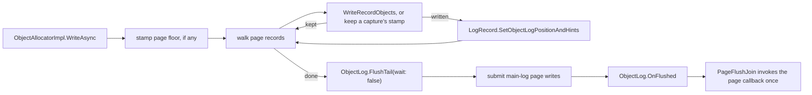

# Object-log serialization

This document describes the file format and code paths used by Tsavorite's `ObjectAllocator` to persist and reload a
record's out-of-line pieces:

- an overflow key;
- an overflow value; or
- a serialized object value.

> **Status:** every object log is an `ObjectLog` (section 12): the main object log, each Snapshot checkpoint's own
> object log, and recovery's up-conversion target. Sections 3-9 describe the record format and the flush, read, and
> recovery flows over them; section 12.10 summarizes the format, and section 13 describes how a Snapshot checkpoint
> keeps the `(v)` value of a record that a `(v+1)` CopyUpdate supersedes. Version 7 checkpoints use an older format and
> are read by `LegacyObjectLogReader` (section 7.5).

The hybrid log stores the record header, inline fields, objectId slots, optionals, and the object-log position. The
object log stores the bytes referenced by those slots. The two logs are written and read together, but their metadata
has deliberately separate responsibilities:

- The effective `RecordDataHeader.KeyLength` and `RecordDataHeader.ValueLength` properties describe physical fields in
  the hybrid-log record. They always return an exact inline length or the 4-byte objectId-slot size.
- For an overflow key, the raw 10-bit RDH KeyLength field is free because `KeyIsInline` is false. A stamped record uses
  it for the high bits of the key slot's page-count hint without changing the effective property or record layout.
- The high 9 bits of an objectId slot carry an initial read hint for the object-log extent the record's position
  addresses: the key's slot when the key is overflow, otherwise the value's.
- `KeyIsExactSize` / `ValueIsExactSize` bits in the object-log position word select whether that 9-bit value is an
  exact byte length or a page-count hint.
- A 4-byte length prefix carries the exact length of an extent a position addresses, a single extent or a top directory
  record, when it is not exact-size. Extents reached through a directory entry, data chunks and spine records, carry
  none: the entry holds the exact length of a component's portion of a chunk, or of a spine record (section 12.10).
- A main-log image's position is in the main object log, and a snapshot-file image's is in its checkpoint's object log.
  A main-log image with `RecordInfo.HasSnapshotObjectLogReference` set instead holds a Snapshot capture's position in
  that checkpoint's object log (section 13).

Inline values never enter the object log. Migration and replication use an independent network record format; see
[Migration / Replication record layout](../migration-replication-record-layout.md).

For the filesystem layout, checkpoint discovery, token selection, and overall recovery sequence, see
[Checkpoint and Recovery](checkpoint-recovery.md).

> **Keep this document in sync with the code.** The primary implementation files are:
>
> - `libs/storage/Tsavorite/cs/src/core/Allocator/RecordDataHeader.cs` - hybrid-log field kinds and physical field lengths, and the hint arithmetic.
> - `libs/storage/Tsavorite/cs/src/core/Allocator/ObjectIdMap.cs` - objectId index/hint bit allocation.
> - `libs/storage/Tsavorite/cs/src/core/Allocator/LogRecord.cs` / `LogRecord_cv7.cs` - metadata stamping/decoding, objectId-map assignment, and legacy decoding.
> - `libs/storage/Tsavorite/cs/src/core/Allocator/ObjectAllocatorImpl.cs` - page flush and publication, Snapshot captures and the release of superseded sources, disk read, scan, and recovery orchestration, including the main object log's tail discovery and reference repair.
> - `libs/storage/Tsavorite/cs/src/core/Allocator/PageHeader.cs` - the page header's object-log floor.
> - `libs/storage/Tsavorite/cs/src/core/Allocator/AllocatorBase.cs` - partial-sector images and recovery flush requests.
> - `libs/storage/Tsavorite/cs/src/core/Utilities/PageAsyncResultTypes.cs` - `PageFlushJoin`, which completes a page flush once its device writes and its object-log flush have completed.
> - `libs/storage/Tsavorite/cs/src/core/Allocator/ObjectSerialization/ObjectLog.cs` - the log-structured substrate, including recovery's read-only mode (`RecoveryReadOnly`, `GetReferencedExtentEnd`); see section 12.
> - `libs/storage/Tsavorite/cs/src/core/Allocator/ObjectSerialization/ObjectLogWriter.cs` / `ObjectLogReader.cs` - writing and reading a record's components; `ObjectLogWriter.cs` also holds the writer's chunking settings (`ObjectLogWriterSettings`); see section 12.10.
> - `libs/storage/Tsavorite/cs/src/core/Allocator/ObjectSerialization/ObjectLogReadAhead.cs` - reading ahead through a page's records' extents; see sections 6.5 and 12.10.
> - `libs/storage/Tsavorite/cs/src/core/Allocator/ObjectSerialization/ObjectLogReadAheadRange.cs` - choosing the range of a page's records that the read-ahead reads; see section 12.10.
> - `libs/storage/Tsavorite/cs/src/core/Allocator/ObjectSerialization/ObjectLogExtent.cs` - extent framing, hint encoding and decoding, and the write result and record reference (`ObjectLogWriteResult`, `ObjectLogRecordRef`).
> - `libs/storage/Tsavorite/cs/src/core/Allocator/ObjectSerialization/ObjectLogDirectory.cs` - directory entry, record header, and layout arithmetic; see section 12.9.
> - `libs/storage/Tsavorite/cs/src/core/Allocator/ObjectSerialization/ObjectLogPositionInfo.cs` - position word layout and format flags.
> - `libs/storage/Tsavorite/cs/src/core/Allocator/ObjectSerialization/LegacyObjectLogReader.cs` / `LegacyObjectLogPosition.cs` / `CircularDiskReadBuffer.cs` / `DiskReadBuffer.cs` - reading a version 7 object log.
> - `libs/storage/Tsavorite/cs/src/core/Allocator/OverflowByteArray.cs` - owned overflow storage, and a value array's publication claim, phase, owner, and sentinels; see section 13.10.
> - `libs/storage/Tsavorite/cs/src/core/Allocator/HeapObjectBase.cs` - an object's phase word: the publication claim, the phase, and the checkpoint tag; see section 13.
> - `libs/storage/Tsavorite/cs/src/core/Allocator/SerializationPhase.cs` - the phases a phase word holds; see section 13.1.
> - `libs/storage/Tsavorite/cs/src/core/Allocator/SupersededObjectValue.cs` - the placeholder a CopyUpdate leaves in its released source's value slot; see section 13.3.
> - `libs/storage/Tsavorite/cs/src/core/Index/Common/RecordInfo.cs` - the `HasSnapshotObjectLogReference` marker; see section 13.1.
> - `libs/storage/Tsavorite/cs/src/core/Index/Common/KVSettings.cs` - object-log device and geometry settings; see section 12.6.
> - `libs/storage/Tsavorite/cs/src/core/Index/Tsavorite/Implementation/InternalRMW.cs` / `Helpers.cs` - the CopyUpdate that captures and releases its superseded source; see sections 9.9 and 13.3.
> - `libs/storage/Tsavorite/cs/src/core/Index/Recovery/Recovery.cs` - recovery passes, snapshot-region flushes, and up-conversion.
> - `libs/storage/Tsavorite/cs/src/core/Index/CheckpointManagement/RecoveryInfo.cs` - checkpoint format versions and the object-log addresses a checkpoint records (`objectLogBeginAddress`, `hlogEndObjectLogTail`, `snapshotEndObjectLogTail`, `snapshotObjectLogStartAddress`).
> - `libs/storage/Tsavorite/cs/src/core/Index/CheckpointManagement/SnapshotFlushCoordination.cs` - Snapshot/ReadOnly page ordering; see section 5.7.
> - `libs/storage/Tsavorite/cs/src/core/Index/CheckpointManagement/SnapshotObjectLogState.cs` - a Snapshot checkpoint's capture admission, failure, tag, placeholder, overflow sentinel, and `L`; see section 13.
> - `libs/storage/Tsavorite/cs/src/core/Index/Checkpointing/HybridLogCheckpointSMTask.cs` / `SnapshotCheckpointSMTask.cs` - creating, sampling, and closing the object logs at checkpoint phases, and opening and closing a Snapshot's captures and recording `L`; see sections 12.11 and 13.6.

---

## 1. Record and object-log mental model

A fully inline record is self-contained:

```text
+============================================================================+
| RecordInfo | RecordDataHeader | ext. namespace | inline key | inline value |
|            |                  |                |            | optionals    |
+============================================================================+
```

The namespace byte is the top byte of the `RecordDataHeader` word; `ext. namespace` holds an extended namespace's
bytes, and occupies none otherwise.

A record with any out-of-line component replaces that component's inline bytes with a 4-byte objectId slot and adds
an 8-byte object-log position to its optional area:

```text
HYBRID LOG RECORD
+=====================================================================================+
| RecordInfo | RDH | ext. namespace | key field | value field | ETag/expiry | obj-pos |
+=====================================================================================+
                                    |             |
                       inline bytes or i32        +-- inline bytes or i32 objectId
                       objectId

OBJECT LOG, at obj-pos
  one out-of-line component written as a single extent (HasDirectory clear):
  +------------------------------+------------------------------------------+
  | int32 length, if > 511 bytes | overflow key, overflow value, or object  |
  +------------------------------+------------------------------------------+

  otherwise (HasDirectory set), the record's top directory record:
  +------------------------------+--------+---------+-------------------------+
  | int32 length, if > 511 bytes | header | entries | final data, if combined |
  +------------------------------+--------+---------+-------------------------+
```

A record's out-of-line components form one stream, key first. A record with one out-of-line component that fits one
chunk is written as a single extent, which the position addresses, unless the writer cuts that extent at an object-log
page end (section 5.3). Otherwise, including whenever the record has both an overflow key and an out-of-line value, the
position addresses the record's top directory record. It lists the address and exact length of each component's
portion of every chunk, the earliest through a chain of spine records when they outgrow one record, each linked by an
entry that holds its exact length (section 4). The object log has no record-level
framing, and consecutive records' extents are not necessarily contiguous, so a reader obtains each record's location
from that record's object-log position word rather than deriving it from the preceding record.

The objectId has two roles, which a live slot can hold at once:

1. In memory, its low bits index the page's `ObjectIdMap`, or, for a record read from disk at runtime, the transient
   map, which owns the `OverflowByteArray` or `IHeapObject`. After a CopyUpdate releases a superseded main-log record's
   value, the value's `ObjectIdMap` slot holds a placeholder (`SupersededObjectValue`), which `LogRecord.ValueObject`
   reads as null, or an overflow sentinel; the record's bytes are unchanged (section 13.3).
2. Once a flush or a Snapshot capture stamps the record, the high bits of the slot that sizes the record's extent also
   carry an initial object-log read hint. The low index bits stay intact, so stamping never changes which object the
   slot resolves to.

Every in-memory lookup uses `ObjectIdMap.GetIndex()` and therefore masks away the hint bits.

---

## 2. Effective RDH lengths and raw overflow-key metadata

`RecordDataHeader` (RDH) is one atomically published 8-byte word. Its relevant fields are:

```text
bit(s)   field
 0       KeyIsInline
 1       ValueIsInline
 2       ValueIsObject
 6..13   FillerWords
14..23   KeyLength       (10 bits)
24..47   ValueLength     (24 bits)
```

### 2.1 Exact meaning of `KeyLength` and `ValueLength`

The effective length properties always describe the physical key/value fields in the hybrid-log record:

| Field kind | Physical field contents | RDH length |
|---|---|---|
| Inline key | key bytes | exact key byte length |
| Overflow key | one 4-byte objectId | `ObjectIdMap.ObjectIdSize` (4) |
| Inline value | value bytes | exact value byte length |
| Overflow value | one 4-byte objectId | `ObjectIdMap.ObjectIdSize` (4) |
| Object value | one 4-byte objectId | `ObjectIdMap.ObjectIdSize` (4) |

The `KeyLength` and `ValueLength` property getters enforce this interpretation:

- for an inline field, return the raw RDH field;
- for an out-of-line field, return `ObjectIdMap.ObjectIdSize`.

Consequently, `GetKeyFieldInfo`, `GetValueFieldInfo`, `ActualSize`, `AllocatedSize`, optional-field placement,
`ObjectLogPosition` placement, record scans, and filler calculations never depend on the serialized object-log size.
Changing an overflow payload from 1 KB to 500 MB does not change the hybrid-log record's physical field size.

For an inline key, raw RDH KeyLength and effective `KeyLength` are the same exact byte count. For an overflow key,
effective `KeyLength` remains 4, but the raw field has no physical-layout consumer. When the key's slot sizes a
length-prefixed extent, the stamped record therefore uses those 10 raw bits as the high portion of the extent's 4 KB
page count (section 3.3); otherwise they hold 4. Assigning the recovered key to an `ObjectIdMap` restores the raw field
to 4; the effective property remains 4 before and after restoration.

### 2.2 What object-log code must never do

Current-format object-log flush and read paths do not:

- put an overflow/object byte length into a raw RDH length field;
- use raw RDH ValueLength as object-log metadata;
- use raw RDH KeyLength for an overflow key except as the high page-count bits;
- derive authoritative object-log framing from either RDH field; or
- rewrite RDH lengths after deserializing an object, except to restore/assert the physical 4-byte objectId slot.

Object-log and network serialization code never changes the raw RDH `ValueLength`, the value field's physical length.
An overflow key's raw `KeyLength` may change: a stamp writes the page-count high bits into it, and assigning the key
restores 4 (section 2.1). This also keeps the file-IO format independent of the migration/replication format. Network
serialization may add component length prefixes outside the inline record image; it sends the RDH as the source record
has it, and the receiver's assignment of an overflow key restores that key's raw `KeyLength`.

### 2.3 Legacy exception

Checkpoint version 7 uses an older split length encoding: the raw RDH field holds the low length bits and the objectId
slot holds the next 32 bits. `LogRecord_cv7.cs` decodes it, and recovery selects that decoder from the checkpoint
version. Version 7 records also set object-log position bit 63, which current code does not read.

The legacy decoder interprets both raw fields according to that older layout. Current-format code reads an overflow
key's raw RDH KeyLength only as the page-count high bits or to restore it to `ObjectIdSize`, and does not use
`GetValueLengthRaw()` as an object-log hint.

---

## 3. ObjectId size hints and position flags

### 3.1 ObjectId slot layout

Each objectId slot is one 32-bit integer:

```text
31                       23 22                              0
+--------------------------+--------------------------------+
| initial-read hint (9 b)  | ObjectIdMap index (23 b)       |
+--------------------------+--------------------------------+
```

| Bits | Name | Meaning |
|---|---|---|
| 0..22 | index | Index into the record page's `ObjectIdMap`, or, for a record read from disk at runtime, the transient map |
| 23..31 | size hint | Initial-read hint for the extent the record's position addresses (section 3.3) |

The 23-bit index is larger than the maximum index needed by a 128 MB page at the minimum record size. The high 9 bits
are therefore available for the disk-read hint without reducing the supported page population.

One slot sizes the extent: the key's slot when the key is overflow, since the extent is then the key alone or a
directory, and the value's slot otherwise. When the key's slot sizes it, the stamp writes a hint of zero into an
out-of-line value's slot.

`ObjectIdMap.StampSizeHint(slot, hint)` preserves the low index. `ObjectIdMap.GetIndex(slot)` masks the hint before
an in-memory lookup, and `ObjectIdMap.GetSizeHint(slot)` extracts the high 9 bits for disk IO.

### 3.2 Object-log position word

The optional 8-byte object-log position combines an address and format flags:

```text
63             62              61                 60                 59..0
+--------------+---------------+------------------+------------------+--------------+
| unused       | HasDirectory  | KeyIsExactSize   | ValueIsExactSize | address      |
+--------------+---------------+------------------+------------------+--------------+
```

| Bit | Meaning |
|---|---|
| 0..59 | Object-log address, about a 1 EB range (`ObjectLogPositionInfo.AddressMask`) |
| 60 | `ValueIsExactSize`: the value slot's hint is an exact byte length; meaningful when the key is not overflow |
| 61 | `KeyIsExactSize`: the key slot's hint is an exact byte length; meaningful when the key is overflow |
| 62 | `HasDirectory`: the position addresses the record's top directory record rather than a single extent (section 12.9) |
| 63 | Unused. Version 7 records set it; current code never reads it, and up-conversion rewrites the whole word |

The address is a flat `ObjectLog` logical address (section 12); device segmentation is not part of it. A version 7
position splits the same 60 bits into a segment id and an offset, which `LegacyObjectLogPosition` decodes for the
version 7 reader (section 7.5).

A main-log image's address is in the main object log, and a snapshot-file image's is in its checkpoint's object log. A
main-log image with `RecordInfo.HasSnapshotObjectLogReference` set holds a Snapshot capture's position in the
checkpoint's object log (section 13): recovery reads such an image's overflow key from that log and invalidates the
image outside `[L, M)`, a walk over a main-log page invalidates it and gives it empty components without reading, and
the single-record pending read skips it and follows `PreviousAddress`.

Only the exact-size flag of the slot that sizes the extent applies, so a reader takes that slot's hint and flag
together.

#### Stamped versus unstamped

The unstamped state sets all 60 address bits and leaves the flag bits unchanged; no allocation reaches that address
(section 12.7). `ObjectLogPositionInfo` owns this encoding: `Unstamp` sets it, `WordIsUnstamped` and `IsUnstamped` test
it, and callers do not compare a word against `NotSet` themselves.

`NotSet` is the unstamped marker with every flag bit clear, because a flag is a claim about a position and an unstamped
word makes no claims. `WordIsUnstamped` examines only the address bits, so a word with every bit set, as a version 7
image may hold, also reads as unstamped. `WordHasDirectory` therefore rejects an unstamped word itself rather than test
its bit in isolation. The exact-size flags are read only after the caller has rejected an unstamped word:
`ObjectLogReader.BeginRecord` throws, and page walks and recovery's tail discovery skip the record.

A record is unstamped when it is initialized and when a component is assigned to it; an in-place update leaves the word
as it was, and a flush that writes the record restamps it. `InitializeRecord`,
`TrySetValueObject`, and the `KeyOverflow` and `ValueOverflow` setters unstamp it, as do `SetDeserializedValueObject`
and `OnObjectReadComplete` once a read has brought the components into memory. The position then describes nothing the
record still needs, and leaving it stamped would let a later flush that skips the record persist a position for bytes
it did not write. `Unstamp` sets only the address bits and leaves the flag bits as they are. No reader depends on them:
each takes the record's `ObjectLogRecordRef` before it assigns any component (section 3.5). The
`ValueObject` setter stores `NotSet` instead, as do `TrySetETag`, `RemoveETag`, `TrySetExpiration`, and
`RemoveExpiration`, which move the position field; `NotSet` clears the flags as well. Either way, a flush restamps the
whole word when it writes the record's components.

A reader never reads from an unstamped position, which addresses no bytes: `BeginRecord` throws. A page walk
materializes such a record with `LogRecord.MaterializeObjectsWithoutReading`: overflow components become empty arrays,
and an object value is recorded as absent (null) without invoking the deserializer, because zero bytes carry no type
information. A Valid record with out-of-line components reaches disk unstamped when, for example, its flush had no
object log to write them to (section 5.1). The single-record pending read instead treats an unstamped record as a flush
defect and throws: it reads the record into a dedicated buffer, so the record reached disk without its object bytes.

#### Exact component lengths

A reader knows each component's exact length before it reads the component's bytes:

| Extent | Exact length from |
|---|---|
| Single exact extent | The hint, with its exact-size flag set |
| Single length-prefixed extent | The 4-byte length prefix |
| Directory | The sum of the component's entry lengths; `KeyEntryCount` divides the entries between key and value |

`ReadKey` and `ReadValueOverflow` therefore allocate one `OverflowByteArray` at its final length, and `ReadValueObject`
bounds the deserializer by the value's length. The reader's `Read` returns 0, end-of-stream, once that many bytes have
been delivered, so a deserializer that asks for more than it wrote never sees another record's bytes. A value of length
zero is recorded as absent (null) without invoking the deserializer.

### 3.3 Hint encoding

A hint describes the extent the position addresses: a single extent's payload, or a top directory record's payload,
which is its header, entries, and any combined final data. An extent whose payload is at most
`ObjectLogExtent.ExactCutoff` (511) bytes is exact and headerless; a larger one is length-prefixed (section 4.1).

| Slot | Exact flag | 9-bit hint | First read |
|---|---|---|---|
| Key | Set | Payload length, 0..511 | Exactly `hint` bytes |
| Key | Clear | Low 9 bits of a 19-bit 4 KB page count | `pageCount * 4 KB`, clamped |
| Value | Set | Payload length, 0..511 | Exactly `hint` bytes |
| Value | Clear | 1..510: a 4 KB page count | `hint * 4 KB`, clamped |
| Value | Clear | `ObjectLogExtent.LargeValueHint` (511): 511 or more pages | `ObjectLogExtent.LargeInitialRead` (4 MB + 4 bytes), clamped |

A page count is `ceil((LengthPrefixSize + payload) / 4 KB)`: it includes the 4-byte prefix
(`ObjectLogExtent.LengthPrefixSize`), in units of `RecordDataHeader.kFlushPageSize` (4 KB). A first read sized from a
hint can therefore run past the extent; the reader takes the extent's length from its prefix and ignores the rest.
"Clamped" means limited to the bytes left on the extent's object-log page and below the log's tail, so that a read never
asks for bytes past the end of the log's data: a device can return such a read short, and a short read fails
(section 12.4). A length-prefixed extent never spans a page. While recovery establishes the main object log's tail
(`ObjectLog.RecoveryReadOnly`, section 12.4), the log's tail is the checkpoint's recorded tail, below which every byte
is on the device, so a first read that ends at or below it is clamped only to the page. A first read that would pass it
is limited instead to the extent's exact end, which `ObjectLog.GetReferencedExtentEnd` first reads from the length
prefix, with a read of its own.

For a key whose exact flag is clear, the high 10 bits of the page count are in raw RDH KeyLength:

```text
pageCount = (rawRdhKeyLength << 9) | objectIdHint
firstRead = pageCount * 4 KB
```

The 19-bit count is exact and never saturates. An addressed extent is one allocation and so at most one object-log page,
which is 32,768 pages at the 128 MB maximum, far below `RecordDataHeader.kMaxOverflowKeyPageCount` (2^19 - 1), above
which `ComputeOverflowKeySizeHint` throws. No flag selects the split: whenever `KeyIsExactSize` is clear, raw RDH
KeyLength holds the high bits, zero below 512 pages. When it is set, raw RDH KeyLength holds the physical slot size,
`ObjectIdMap.ObjectIdSize` (4).

**Why a key's hint is exact only up to 511 bytes, as a value's is.** Raw RDH KeyLength and the key slot's 9-bit hint
could together hold an exact key length of up to 524,287 bytes. That is not done, because the gain is small and the
cost is a key-only path through framing that keys and values share:
- **The gain.** A key's page count is already exact, so its first read covers the extent and runs less than 4 KB past
  its end; an exact length would shorten that read, not save it. The one read it would save is the prefix read that a
  length-prefixed extent costs while recovery establishes the main object log's tail, and then only when its first read
  would pass the checkpoint's recorded tail (above): a key that an earlier recovery copied above it, or one that ends
  within 4 KB below it. Garnet keeps keys of up to 1,022 bytes inline by default
  (`KVSettings.DefaultMaxInlineKeySize`), so overflow keys are uncommon. When the value is also out of line, the key's
  slot sizes the top directory record rather than the key, so an exact key length would not apply.
- **The cost.** Keys and values share one framing path, which rests on one rule: a hint is exact exactly when its
  extent is headerless, which is exactly when the payload is at most 511 bytes. An exact key hint above 511 bytes must
  break that rule. Headerless key extents of up to 524,287 bytes would lose the length prefix, which catches a
  misaddressed read, and would make RDH bits authoritative framing (section 2.2). Keeping the prefix would give the key
  hint a third mode, and a new boundary at 524,288 bytes for every hint consumer and its tests.

A value hint saturates at `LargeValueHint`, which means "large" rather than 511 pages. Its first read covers a full
write chunk (`IStreamBuffer.BufferSize`, 4 MB) and its prefix, so one IO reads any single extent the writer produces at
its default chunk size.

The first read covers the whole extent unless the value's slot sizes it and it is longer than `LargeInitialRead`, such
as a top directory record whose entries and combined data exceed it. The prefix then gives the exact length, and a
second read on the same page fetches the rest. A key's page count is exact, so when the key's slot sizes the extent, the
first read covers it whatever its length.

A zero-length single component allocates nothing: the writer stamps the exact flag with a hint of zero, and the position
is the log's tail when the record was written. In a directory, an out-of-line value with no entries has length zero. An
overflow key always has entries: `ParseDirectory` treats a directory that lists none for an overflow key as corrupt.

### 3.4 Computing and stamping a hint

`ObjectLogWriter.FinishRecord` encodes the hint from the payload length of the extent it wrote:

- When the key is overflow, `ObjectLogExtent.EncodeKeyHint` (`RecordDataHeader.ComputeOverflowKeySizeHint`) returns the
  exact length and sets `KeyIsExactSize` for a payload of at most 511 bytes, keeping raw RDH KeyLength at
  `ObjectIdSize`; otherwise it splits the page count between the objectId hint (low 9 bits) and raw RDH KeyLength
  (high 10 bits).
- Otherwise `ObjectLogExtent.EncodeValueHint` (`RecordDataHeader.ComputeObjectIdValueSizeHint`) returns the exact length
  and sets `ValueIsExactSize`, or returns the page count, saturating at `LargeValueHint`.
- `HasDirectory` is set when the writer wrote a top directory record.

The result is an `ObjectLogWriteResult`: the position word with its address and flags, `KeySizeHint`,
`KeyRdhLengthBits`, `ValueSizeHint`, and `ValueObjectLength`, the number of bytes an object value serialized to.
`LogRecord.SetObjectLogPositionAndHints` then:

1. writes the position word;
2. for an overflow key, stamps `KeySizeHint` into the key's slot, keeping its index, and writes `KeyRdhLengthBits` into
   raw RDH KeyLength with one `SetDataHeader`; and
3. for an out-of-line value, stamps `ValueSizeHint` into the value's slot, which is zero when the key's slot sizes the
   extent.

Neither effective RDH length changes. Stamping raw RDH KeyLength is layout-neutral because `KeyLength` returns
`ObjectIdSize` whenever `KeyIsInline` is false, and in-memory readers resolve the same object because each slot keeps
its index bits.

Every writer stamps through `SetObjectLogPositionAndHints`: the position goes into the record's position word and the
size hints into its objectId slots (an overflow key's also into its RDH `KeyLength` bits). A ReadOnly or Snapshot flush
stamps through `StampFlushedRecord`, which also clears `RecordInfo.HasSnapshotObjectLogReference`. A Snapshot capture of
a CopyUpdate's source stamps the live record with a position in the checkpoint's object log, then sets the marker. A
flush that finds the active checkpoint's capture keeps that stamp and writes nothing (section 13.4). Recovery's copies
restamp the record and clear the marker (sections 7.4 and 13.7).

### 3.5 Decoding a hint

`LogRecord.GetObjectLogRecordRef()` captures what a reader needs as an `ObjectLogRecordRef`: the position word with its
flags, which components are out of line, the key slot's hint and raw RDH KeyLength, and the value slot's hint. Its
`TopExtentInitialRead` gives the first read's length, decoded with `ObjectLogExtent.KeyInitialRead` when the key is
overflow and `ObjectLogExtent.ValueInitialRead` otherwise; the page read-ahead (section 6.5) and Pass 2's size estimate
(section 7.2) use it. `ObjectLogReader.ReadTopExtent` decodes the same hint itself: it reads exactly `hint` bytes for an
exact extent, and clamps a page-count read to the page and the tail. While recovery establishes the main object log's
tail, one that would pass the checkpoint's recorded tail is clamped instead to the extent's exact end (section 6.1). A
reader captures the reference before it materializes any component, because assigning a component unstamps the record.

`LogRecord.GetObjectLogRecordStartPositionAndLengths` serves the version 7 paths: when the checkpoint version selects
the version 7 decode (`HybridLogRecoveryInfo.UsesDownlevelObjectLog`), it returns the record's position and exact split
lengths from `GetObjectLogRecordStartPositionAndLengths_cv7`. It also has a current-format branch, which returns
hint-decoded first reads rather than exact lengths; no current-format path calls it.

---

## 4. Object-log byte layouts

The object log has no record-level framing: a reader finds a record's bytes only through its position word. The
structures below are what a position or a directory entry addresses; sections 12.9 and 12.10 give the rules that
produce them.

### 4.1 Single extent

A record whose only out-of-line component fits one chunk is written as a single extent, and its position has
`HasDirectory` clear, unless the writer cuts a length-prefixed extent at a page end (section 5.3); the record then gets a
directory.

At most 511 bytes, exact:

```text
+-------------------+
| payload           |
| hint bytes        |
+-------------------+
```

More than 511 bytes, length-prefixed:

```text
+-------------------+---------------------------+
| int32 length      | payload                   |
| 4 bytes           | length bytes              |
+-------------------+---------------------------+
```

The payload is the overflow key, the overflow value, or the serialized object, byte for byte. It is at most one chunk:
`IStreamBuffer.BufferSize` (4 MB), or the object-log page size less the prefix if that is smaller. A zero-length
component has no bytes, and its exact hint of zero says so.

### 4.2 Directory record

A record with more than one chunk, or with both an overflow key and an out-of-line value, gets a directory, and its
position addresses its top directory record with `HasDirectory` set. The top record is framed like any addressed
extent: exact when it is at most 511 bytes, length-prefixed otherwise.

```text
[int32 length, when longer than 511 bytes]
+-----------------------+-----------------------------+---------------------------------+
| DirectoryRecordHeader | DirectoryEntry x EntryCount | final data chunk, when          |
| 12 bytes              | 12 bytes each               | DirectoryIsCombined is set      |
+-----------------------+-----------------------------+---------------------------------+
```

| Header field | Bytes | Meaning |
|---|---|---|
| `EntryCount` | 4 | Entries in this record, including a spine link |
| `KeyEntryCount` | 4 | Overflow-key entries over the whole chain, excluding spine links |
| `Flags` | 4 | `DirectoryIsCombined`: the final data chunk follows the entries |

```text
DirectoryEntry
word0 (8 bytes): bits  0..59  address of the chunk's first data byte
                 bit      60  IsDirectory: the entry links to a spine record
                 bits 61..63  spare
word1 (4 bytes): bits  0..26  data length, biased by one
                 bits 27..31  spare
```

Entries list every component portion in stream order. A chunk holding the end of the key and the start of the value
has two entries with the same address; each entry after the first at an address starts where the previous one ends.
When `DirectoryIsCombined` is set, the last entries address the record's own data area, so reading the record also
reads that data.

### 4.3 Spine record

When the entries outgrow one record, at `MaxDirectoryRecordSize` (1 MB) or the object-log page size if smaller, the
writer writes them out as a spine record and starts a fresh list whose first entry links back to it with `IsDirectory`
set:

```text
+-----------------------+-----------------------------+
| DirectoryRecordHeader | DirectoryEntry x EntryCount |
| KeyEntryCount 0       | entry 0 may link to an      |
| no flags              | older spine record          |
+-----------------------+-----------------------------+
```

A spine record has no length prefix and no combined data; the link that addresses it holds its exact length. Only entry
0 of a directory record can be a link.

### 4.4 Data chunk

A data chunk is raw stream bytes, with no prefix, header, or padding. Only directory entries address it, and it never
spans an object-log page. The stream is the overflow key's bytes followed by the value's, so one chunk can hold the end
of the key and the start of the value.

### 4.5 Placement

A record's extents are allocated in stream order: data chunks as the stream fills them, a spine record whenever the
entry list fills, and the top directory record last. The top record's address, which the position holds, is therefore
the highest of the record's extents. For example, with default settings and no page cut, a 9 MB serialized object is
written as:

```text
ascending object-log addresses ->
| data chunk, 4 MB | data chunk, 4 MB | [length][header][3 entries][final 1 MB of data] |
                                       ^ position word (HasDirectory set)
```

A flush writes records one after another in hybrid-log address order, each at or above the end of the previous record's
top extent. They are not necessarily contiguous: a page tail shorter than `MinPartialBytes` (64 KB) is left unused when
a chunk does not fit it, and an extent that the writer does not cut moves whole to the next page. In a checkpoint's
object log, captures that CopyUpdates write while the Snapshot flush runs can also fall between its records. Captures,
and recovery's copies of them, are written at other times and lie elsewhere (section 12.8).

---

## 5. Flush and write flow

### 5.1 Page-level ordering and completion

`ObjectAllocatorImpl.WriteAsync` writes one page, or part of one, for ReadOnly, Snapshot, and recovery flushes. A flush
**publishes** a record when it writes the record's out-of-line components to an object log and stamps the record with
their position and size hints; a Snapshot capture publishes a record the same way, and the value's phase word records
which writer last published it (section 13.1). Elsewhere, publishing an address or a word means making a new value
visible to other threads. For each page, `WriteAsync` does the following:

1. stamp the page header's object-log floor where the flush type calls for it (section 5.4);
2. walk the records in address order and publish each eligible record: write its components with
   `ObjectLogWriter.WriteRecordObjects` (section 5.3) and stamp it with `LogRecord.SetObjectLogPositionAndHints`, or
   keep its existing reference to the active checkpoint's capture (sections 5.2 and 13.4); a snapshot-region recovery
   flush copies the components with `ObjectLogReader.CopyRecordTo` instead (section 7.4);
3. if any record wrote object-log bytes, request the object log's flush without waiting:
   `ObjectLog.FlushTail(wait: false)` returns the tail the flush covers;
4. submit the page's device writes from the live page, except the first sector of a front-partial ReadOnly flush
   (section 5.6); and
5. join those writes and `ObjectLog.OnFlushed(tail, ...)` in a `PageFlushJoin`, which invokes the page's callback once,
   after every part has completed, with the first error any part reported.

The page callback is what advances `FlushedUntilAddress`, so the main log never covers a record whose main object-log
bytes are not durable. A record that keeps a capture's stamp references the checkpoint's object log, which
`PERSISTENCE_CALLBACK` flushes before the checkpoint's metadata is written. The object log writes its own pages, so
those writes overlap the main-log writes, and the page's completion
waits for them through `OnFlushed` rather than on a thread. Writing a record can still wait for the object log's page
ring to drain (section 5.2).



| Flush | Object log written |
|---|---|
| ReadOnly | The main object log, or during a version 7 up-conversion, its destination |
| Snapshot | The checkpoint's own `ObjectLog`, created at `PREPARE` over its snapshot object-log device; `(v+1)` CopyUpdates also write captures to it (section 13) |
| Recovery, snapshot region | The main object log; components are copied from the checkpoint's object log (section 7.4) |
| Recovery, up-conversion | The up-conversion's destination (section 7.5) |
| Recovery, hybrid-log region | None; records are written verbatim (section 7.3) |

A flush to a `NullDevice` main log completes without writing. A ReadOnly or Snapshot flush with no object log, or whose
page's `ObjectIdMap` is empty, writes its span without walking the records. An allocator has no object log for ReadOnly
flushes when it has no object-log device, or when its object-log or main-log device is a `NullDevice`, as for the read
cache and the in-memory stores of iterators and compaction. Recovery never takes this inline path: records read from
disk hold positions rather than map indices, so a recovered page's map is empty whatever its records hold, and every
recovery flush must examine its records.

### 5.2 Per-record publication and stamping

`WriteAsync` resolves each record's objectId slots against the page's live `ObjectIdMap`. ReadOnly enters from an epoch
callback and suspends that hold for the flush, restoring it before it returns; Snapshot and recovery enter without
epoch protection. Suspending matters because writing a record can wait for an object-log page flush, and an epoch held
across IO stalls reclamation. It is safe because eviction is capped at `FlushedUntilAddress`, which cannot pass the page
until this flush's callback runs. Snapshot/ReadOnly ordering keeps `FlushedUntilAddress`, and therefore `HeadAddress`,
below the active Snapshot page on a real main-log device; for `NullDevice` the same watermark caps `HeadAddress`
directly. The page and its `ObjectIdMap` therefore stay resident for the whole flush.

For each record:

- An Invalid record, including a null one, writes nothing to the object log; the page write carries its inline image.
- In a Snapshot flush, a next-version record at or above `fuzzyRegionStartAddress` is left unchanged, and recovery
  rejects it (section 5.7).
- A fully inline record has nothing to write.
- In a ReadOnly or Snapshot flush, `LogRecord.TryGetOutOfLineComponents` first takes the overflow key and the
  overflow value or object, rooting them, and reports a slot that a concurrent operation has already freed rather than
  throwing. The flush then re-reads the live `RecordInfo`. Elision invalidates a record before it frees the record's
  heap, so a flush that lost the record's heap finds an Invalid record, which it skips as if it had been Invalid from
  the start. Otherwise the flush publishes the record according to what its value slot holds (sections 9.1 and 13.4):
  - An object: the flush claims it, which waits out a Snapshot capture or a serializer that holds the claim, writes the
    components with `WriteRecordObjects(keyOverflow, valueOverflow, valueIsObject, valueObject)`, stamps the record, and
    leaves the object's phase naming the flush that published it: `READONLY_STAMPED`, or `SNAPSHOT_STAMPED` with the
    checkpoint's tag.
  - A superseded object, which is never claimed because the CopyUpdate's new record shares its collections and may
    have changed them, or the placeholder a CopyUpdate's release left in the slot: if the record is marked and the
    active Snapshot checkpoint captured it, the flush keeps the record's stamp, which locates the capture in that
    checkpoint's object log, and writes nothing. Otherwise it writes what a superseded object serializes as, a null
    value or the `(v)` bytes `CacheSerializedObjectData` cached, or, for a placeholder, an empty value, which reads back
    as null.
  - An overflow value: the flush claims the array, writes it, stamps the record, and records the publication in the
    array's phase unless a newer record that shares the array owns it. A sentinel in the slot, which a capture or a
    release left, is treated as the placeholder is: a marked record whose slot holds the active checkpoint's sentinel
    keeps its stamp, and any other is written as an empty value.
  - An overflow key alone is written, and the record stamped.

  Stamping (`StampFlushedRecord`) sets the position and hints with `SetObjectLogPositionAndHints` and clears the
  record's marker. A ReadOnly flush that keeps a capture's stamp records the record's address, which lowers `L`
  (section 13.6).
- A recovery flush copies, re-serializes, or keeps each record's components, as section 7 describes.

### 5.3 Writing a record

`ObjectLogWriter` turns a record's components into extents; section 12.10 states the rules and section 12.9 the
directory format. One writer serves a page flush, record by record; captures and recovery's reference repair use writers
of their own (section 5.5):

- `WriteRecordObjects` calls `BeginRecord`, then `AppendKey` for an overflow key and `AppendValue` for an overflow value
  or `Serialize` for an object, and ends with `FinishRecord`.
- The components form one stream, key first, staged in a buffer of `IStreamBuffer.BufferSize` (4 MB), or of the
  object-log page size less the length prefix if that is smaller, rented from `ArrayPool<byte>.Shared`. When nothing is
  staged, a source span longer than a chunk is written straight from the source.
- `EmitDataChunk` writes a full staging buffer, or a chunk-sized source span, as data chunks, one `ObjectLog.Allocate`
  each. It fills a page tail when the tail is at least `MinPartialBytes` (64 KB) and leaves a shorter tail unused.
- `FinishRecord` writes a single extent (`TryWriteSingleExtent`) when no chunk was emitted and the record has one
  component. A length-prefixed extent that does not fit the page tail is cut when both pieces would be at least
  `MinPartialBytes`: the tail takes the start of the stream as a data chunk, and the record gets a directory. An exact
  extent is never cut.
- Otherwise `WriteTopDirectoryRecord` writes the top directory record, combined with the staged final data when the
  whole extent fits one page, and after writing that data as data chunks when it does not. When the record's allocation
  is cut at a page end, the tail takes the start of the final data as a data chunk and the record moves to the next
  page.
- `WriteSpine` writes the entry list out as a spine record before it exceeds `MaxDirectoryRecordSize` (1 MB), or the
  object-log page size if smaller.
- Each allocation and the copy into it happen in one `ObjectLog.BeginScope` / `EndScope` (section 12.3). No epoch is
  held while a flush stages or serializes. A capture runs on its CopyUpdate's thread, which holds the store's epoch and
  the key's bucket lock.

An object value is serialized through the writer itself: the writer is the `IStreamBuffer` beneath a
`PinnedMemoryStream`, and the store's serializer (`CreateValueObjectSerializer`) is created on the writer's first
object, with `BeginSerialize` called once. Serializer writes reach `ObjectLogWriter.Write`, which appends them to the
value; `FlushAndReset` does nothing, because chunks are emitted as the stream fills them. A serialized size at or above
`IHeapObject.MaxSerializedObjectSize` (2^40 bytes) throws. An object slot that holds no object writes nothing for the
value, which is then a zero-length component.

Tests shrink the chunk size, `MinPartialBytes`, and `MaxDirectoryRecordSize` through the internal
`ObjectLogWriterSettings` to reach page cuts, directories, and spines with small data.

### 5.4 Page-header object-log floors

Each main-log page header holds `objectLogLowestPositionWord`, the page's floor: a main object-log address no greater
than any position that a record on this page, or on a later page, references. The main object log is written in page
order, so its tail before a page's records are written is such a bound (section 12.8). The floor is unstamped until a
flush stamps it. `PageHeader.Initialize` sets it to `NotSet` for a newly allocated page and for a page cleared from its
start, so a reused buffer page never presents a zeroed header, which would read as a floor of 0.

`WriteAsync` stamps the floor before it writes any of the page's records, with the destination object log's tail:

| Flush | Floor |
|---|---|
| ReadOnly | Stamped when the range includes the page's first record, also for an object-free page; an existing floor is kept |
| Snapshot | Never stamped: its tail is an address in the checkpoint's object log, and the later ReadOnly flush keeps an existing floor, so the stamp would reach the main log |
| Recovery | Overwritten only when the flush writes the page's objects into a new address space: an up-conversion, or a snapshot-region copy of a page that starts in the snapshot region. Otherwise the header read from the device stays |

Pass 2 resets the floor of a resident snapshot-region page that it loads from the checkpoint's object log
(`ResetRecoveredResidentPageHeader`), so the next flush that writes the page header stamps a main object-log floor.

A floor bounds main object-log positions only; a marked image's position is in a checkpoint's object log (section 13).
Recovery's reference repair (`CompleteMainObjectLogRecovery`, section 13.7) appends its copies at the main object log's
tail and repoints marked records on pages below `M` to them, so each new position lies above every floor already
stamped; it rewrites those pages with their headers unchanged.

Main-log truncation (`TruncateUntilAddressBlocking`, `RemoveSegment`) reads, from the device, the header of a page at or
below the new begin address (`ReadObjectLogFloor`). After truncating the main log, it calls `ObjectLog.Truncate(floor)`
when the floor is above the object log's `BeginAddress`; the floor bounds that page and every later one, so no retained
record loses its object bytes. The first two main-log pages and an unstamped floor yield -1, which truncates nothing.

### 5.5 Buffer and callback lifetime

- A writer serves one page flush. Its staging buffer and entry array are rented on first use and returned by `Dispose`
  in the flush's `finally`, after `EndSerialize` ends the object serializer.
- A capture writes through a writer its checkpoint keeps between captures (`SnapshotObjectLogState.RentCaptureWriter` /
  `ReturnCaptureWriter`), at most one per processor. The writer returns its staging buffer and entry array after each
  capture (`ReturnBuffers`) and keeps its serializer; `CloseAndDrain` disposes the kept writers at
  `PERSISTENCE_CALLBACK`, and a writer whose write threw is disposed at once. Recovery's reference repair uses one
  writer for all its pages.
- Each allocation's bytes are copied into the `ObjectLog`'s page ring within its scope, so the writer keeps no reference
  into the ring after `FinishRecord`; the ring's own flush writes those pages.
- A composed first sector (section 5.6) is a pooled sector buffer held by the flush result (`freeBuffer1`) and returned
  when the result is released.
- `PageFlushJoin` holds a sentinel part until every part is submitted, so an early completion cannot finish the join.
  `SubmitFlushPart` completes its part with an error when a submission throws, then rethrows to the issuer, and
  `snapshotDeviceWriteIssued` tells the issuer that the callback owns cleanup from then on. The page callback runs
  exactly once, which matters because a Snapshot page's callback releases the page's native snapshot-IO unit on its
  first invocation.
- `ObjectLog.OnFlushed` invokes its callback exactly once: at once when the address is already flushed, a flush below it
  has failed, or the log is disposed, and otherwise from the flush completion that reaches the address or fails below
  it. Disposing an object log fails its waiters, and the allocator disposes its object logs before its base, so those
  callbacks run against a live allocator.

### 5.6 Live-page writes and partial sectors

The main-log write uses the allocator's live page, except the first sector of a front-partial ReadOnly flush (below); no
page image is copied. Hint stamping preserves each
objectId's index and raw RDH KeyLength stamping is layout-neutral, but metadata non-destructiveness alone is not
sufficient. Recovery has exclusive access. Snapshot/ReadOnly coordination keeps the page resident and prevents those
modes from stamping the same page concurrently. A Snapshot checkpoint's capture rewrites a record's reference fields
only while no flush of that checkpoint has published the record (section 13.4).

The no-copy path also requires `OnDispose` not to tear down flush-critical bytes before the asynchronous page write
finishes. `OnDispose` implementations must copy off cleanup state and defer clearing those bytes until that write
finishes. A deleted record in a flush's frozen range (`IsFrozenForFlush`) keeps its heap and metadata until
`FlushedUntilAddress` passes it: its disposal is marked `DeferredDispose` and run by the drain on flush completion, the
drain at the end of a hold, or eviction. A CopyUpdate's release of its source does not wait:
`ReleaseCopyUpdatedSourceInPlace` points the value's `ObjectIdMap` slot at a placeholder (`SupersededObjectValue`) or a
sentinel (`OverflowByteArray.Released`), which changes no byte of the image (section 13.3).

The write covers whole sectors, `[RoundDown(start, sectorSize), RoundUp(end, sectorSize))`. A flush that writes the page
header, because its range includes the page's first record or it is an up-conversion, starts at the page's offset 0.

A front-partial ReadOnly flush starts after a prefix already written by the same monotonic flush sequence. The physical
write rounds down to the sector boundary, so it writes that prefix again, and it must not take the prefix from the live
page: a completed checkpoint recovers those records from the main log (a FoldOver, or a Snapshot below `M`), and they
may have changed in memory: elided or sealed, disposed, or rewritten by recovery's object load. So the flush writes its
first sector from a pooled sector buffer holding the durable prefix followed by the live bytes from its own start. The
prefix comes from the `PartialSectorImage` the previous ReadOnly flush of that page kept of the sector it ended in, or,
when no image describes that sector (after recovery or a reset), from reading the sector back from the device. A prefix
that lies entirely below `BeginAddress` comes from the live page: nothing reads it, and it may never have been written,
because the flush of a range below `BeginAddress` is skipped. The rest of the span is written directly from the live
page. `AllocatorBase` holds this mechanism (`partialSectorImages`, `TryGetDurableSectorPrefix`,
`RecordPartialSectorImage`), and `SpanByteAllocator`'s ReadOnly flushes use it too, since superseding a record there
elides it or clears its optional fields in the live page.

Devices do not order overlapping writes, and the object allocator issues adjacent fragments without the `PendingFlush`
chaining `AllocatorBase` uses for the same reason. So a ReadOnly flush starting mid-sector issues its writes only once
`FlushedUntilAddress` reaches its start (`WaitForWritesBelow`), which means the previous write of that sector has
completed. Otherwise that write could land last and replace the records this flush stamped there with their image from
before it.

Records below `FlushedUntilAddress` are therefore never written again from the live page, and `IsFrozenForFlush` covers
only `[FlushedUntilAddress, ReadOnlyAddress)`, or `[LastIssuedFlushedUntilAddress, ReadOnlyAddress)` on a `NullDevice`
main log. The upper bound is `ReadOnlyAddress`: an operation that sees a record at or above it held the epoch before the
read-only shift's bump, so the flush cannot start until that operation refreshes or suspends its epoch. If the logical
endpoint is inside a sector, the write carries the live
bytes above it to the end of that sector. Nothing reads them: the next ReadOnly flush writes that sector again, and
recovery bounds its record walk by the unrounded endpoint.

### 5.7 Snapshot and ReadOnly page ordering

At `PREPARE`, `fuzzyRegionStartAddress` captures the exact tail that starts the fuzzy region and Snapshot publishes a
fresh coordination object in `Open`; ReadOnly remains unrestricted. At `WAIT_FLUSH`, coordination advances
monotonically through:

```text
Open -> CapturingCutoff -> DrainingCutoff -> Flushing -> Closed
```

The ReadOnly worker publishes each contiguous range's exclusive endpoint before sampling coordination.
`CapturingCutoff` pairs its state publication with that endpoint publication, captures
`readOnlyFlushCutoffAddress`, and enters `DrainingCutoff`. A range at or below the cutoff proceeds normally because
Snapshot explicitly waits for its `FlushedUntilAddress` publication. A later range waits until Snapshot drains the
cutoff cohort, captures stable `snapshotFileLogicalStartAddress`, and enters `Flushing`; it then obeys the page limit.
The cutoff drain does not hold the allocator installation lock, so an included ReadOnly worker can issue the IO being
awaited. Snapshot does not advance `ReadOnlyAddress`.

During `Flushing`, a fixed-size ring tracks only the bounded set of concurrently issued Snapshot pages. Its size is
`SnapshotFlushCoordinationWindowSize`: for the object allocator, 64 pages capped at its buffer size (section 9.7).
Callbacks may complete out of order, but `readOnlyFlushPageLimit` advances only across the contiguous completed prefix:
completing the lowest unfinished page releases it, and every later page already completed, to ReadOnly and eviction;
completing any other page releases nothing yet. ReadOnly page `P` may serialize only while `P < readOnlyFlushPageLimit`,
so it waits while any Snapshot page at or below `P` is unfinished. With checkpoint throttling on
(`ThrottleCheckpointFlushDelayMs` of 0 or more; Garnet's default is 0, Tsavorite's -1), the Snapshot flush waits for
each page's write before issuing the next, so it has at most one page write in flight. After every issued page drains,
coordination enters `Closed` and releases the final page.

Real-device non-object allocators do not install coordination and retain parallel Snapshot submission.
A non-object `NullDevice` uses a one-slot window only to cap `HeadAddress`, because it has no durable main-log fallback.
Outside an actual cutoff or page wait, ReadOnly performs only state, cutoff, and page-limit reads. It suspends epoch
protection only around a real wait. If Snapshot fails, the failure stops new issuance but coordination remains
restrictive until every already-issued page write drains and state becomes `Closed`.

For `NullDevice`, Head may advance behind completed Snapshot pages even though no main-log bytes are durable.
`mainLogRecoveryEndAddress` therefore remains the captured Snapshot start rather than the later HeadAddress; recovery reads
that evicted prefix from the snapshot file.

Snapshot serializes stable records into the snapshot object log and stamps their snapshot positions directly on the live
page. ReadOnly does not consume `ObjectLogPosition`; after Snapshot completes the page, ReadOnly resolves each object through
`ObjectIdMap`, serializes it to the main object log, and replaces the Snapshot position. A record whose value the active
checkpoint captured is the exception: both flushes keep the capture's stamp and marker and write nothing for it, the
ReadOnly flush records the image's address, which lowers the checkpoint's `L`, and recovery repoints it into the main
object log (sections 13.4 and 13.7). No page-image copy or metadata journal is required.

Snapshot leaves fuzzy v+1 records unchanged. Recovery uses the exact persisted `fuzzyRegionStartAddress` as the fuzzy lower
boundary and invalidates such records before hashing overflow keys or reading payloads. RDH must still describe the record's
stable allocation so recovery can advance to the next record.

A record that a `(v+1)` CopyUpdate supersedes during the checkpoint keeps its `(v)` value for whichever of these images
recovery reads; section 13 describes how.

---

## 6. Read flow

`ObjectLogReader` reads a record's components from one `ObjectLog`: the main object log, or during Snapshot recovery the
checkpoint's object log. Reads select it by device with `GetReadObjectLog`; the Snapshot-region copy receives it from
the recovery flush, which takes it from `GetRecoverySnapshotObjectLog`. A marked record's stamp addresses a capture in a
checkpoint's object log (section 13.1), which only recovery reads. For a marked main-log record, Pass 1 hashes its
overflow key from, and the reference repair copies its components out of, the checkpoint's object log that recovery
opened (section 9.10); a record read from the snapshot file is read by the Snapshot-region copy and Pass 2 as the file's
other records are. A pending read skips a marked image read from the main log (section 9.2), and a page walk over the
main object log invalidates one (section 9.4). No epoch is held while deserializing; `ObjectLog.Read` takes its own
scope for each read. The reader's callers are:

| Caller | Read-ahead | Sequence |
|---|---|---|
| Single-record pending read (`VerifyRecordFromDiskCallback`) | None | Section 9.2 |
| Page walk (`DeserializeObjectsOnPage`): page reads outside recovery Pass 1, such as scans, and recovery Pass 2 | When at least two of the page's records are in its range | Sections 7.2 and 9.4 |
| Recovery Pass 1 overflow-key hash (`ComputeRecoveryOverflowKeyHash`) | None | Sections 7.1 and 9.3 |
| Snapshot-region copy (`CopyRecordTo`, within `WriteAsync`) | When at least two of the page's records are in its range | Sections 7.4 and 9.5 |
| Reference repair (`CopyRecordTo`, within `CompleteMainObjectLogRecovery`) | None | Sections 9.10 and 13.7 |

The pending read and the page walk share `ObjectAllocatorImpl.ReadRecordObjects(reader, ref logRecord, requestedKey)`:

1. capture `GetObjectLogRecordRef()`, because assigning a component unstamps the record;
2. `BeginRecord` reads the top extent and any directory (sections 6.1 and 6.2);
3. for an overflow key, assign `KeyOverflow = ReadKey()`; when a requested key is given and differs, call
   `OnDeserializationError(keyWasSet)` (step 6) and return false without reading the value;
4. assign the value, `ValueOverflow = ReadValueOverflow()` or `SetDeserializedValueObject(ReadValueObject())`
   (sections 6.3 and 6.4);
5. call `OnObjectReadComplete()` (section 6.6); and
6. on an exception, call `OnDeserializationError`, which converts the record's out-of-line fields to inline so its
   disposal releases nothing. `EndRecord` runs in every case.

### 6.1 Top extent

`BeginRecord` refuses an unstamped record and one with no out-of-line component, and treats a record with both an
overflow key and an out-of-line value but no directory as corrupt. It reads the extent the position addresses, sized by
the key's slot when the key is overflow and by the value's slot otherwise:

- Exact: one read of exactly `hint` bytes, or none for a zero-length component.
- Length-prefixed: one read of the decoded first read (section 3.3), clamped to the bytes left on the extent's page and
  below the log's read end, `ReadEndAddress`, which is its tail. While recovery establishes the main object log's tail
  (`ObjectLog.RecoveryReadOnly`, section 12.4), the read end is `MaxExclusiveAddress`, and the log's tail is the
  checkpoint's recorded tail. A first read that ends at or below the recorded tail is clamped only to the page. One that
  would pass it is clamped instead to the extent's exact end, which `ObjectLog.GetReferencedExtentEnd` first reads from
  the prefix; that read calls `ObjectLog.Read` itself, so the reader's read-ahead does not serve it. The prefix must
  exceed `ExactCutoff` (511) and fit within those bytes. When the extent is longer than the first read, a second read on
  the same page fetches the rest.

The extent stays in the reader's `topBuffer`. Without a directory, its payload is the record's one component; with one,
`ParseDirectory` follows.

### 6.2 Directory parse and validation

`ParseDirectory` decodes the top record, walks the spine backward from it, and validates every entry before it reads
any data:

- every record's `EntryCount` is positive and its entries fit the record, its combined flag agrees with whether bytes
  follow the entries, and only its entry 0 is a link;
- a spine record has `KeyEntryCount` zero and no combined data, and one read fetches it, sized by its link;
- a link points backward from the record that holds it, no lower than `BeginAddress`, and its extent lies within
  `[BeginAddress, ReadEndAddress)` and one page; `ReadEndAddress` is the log's tail, or `MaxExclusiveAddress` under
  `RecoveryReadOnly` (section 6.1);
- each data entry stays within its address's page, and one outside the combined data lies within
  `[BeginAddress, ReadEndAddress)`; and
- `KeyEntryCount` is at most the number of data entries, is nonzero exactly when the key is overflow, and leaves no
  value entries when the value is inline.

The data entries are then flattened, oldest record first, into stream order with effective addresses: the first entry
at an address starts there, and each later entry at the same address starts where the previous one ends. The first
`KeyEntryCount` entries are the key's and the rest are the value's, and their sums are `KeyLength` and `ValueLength`. A
violation throws a `TsavoriteException` that names the object-log address of the record's top extent.

### 6.3 Overflow components

`ReadKey` and `ReadValueOverflow` allocate one `OverflowByteArray` at the component's exact length
(`OverflowByteArray.AllocateData`) and fill it in place. A single extent's payload is copied from `topBuffer`. With a
directory, an entry in the combined data is copied from `topBuffer`, and any other entry is read straight into its
slice of the array: one read per entry, served by the read-ahead when it holds the bytes and by `ObjectLog.Read`
otherwise (section 12.4). An overflow value longer than `int.MaxValue` bytes is corrupt.

### 6.4 Object values

`ReadValueObject` returns null for a value of length zero without invoking the deserializer, and rejects a length at or
above `IHeapObject.MaxSerializedObjectSize`. Otherwise the store's deserializer reads the value as a stream through a
`PinnedMemoryStream` over the reader; the deserializer is created on the reader's first object, and `BeginDeserialize`
runs once. `Read` serves the single extent's payload from `topBuffer`, or the value's entries one at a time: an entry in
the combined data from `topBuffer`, and any other entry read into a pooled `chunkBuffer`. It returns 0 once the value's
exact length has been delivered (section 3.2), and the deserializer never sees a length prefix or a directory byte.

### 6.5 Page-walk read-ahead

A page walk attaches an `ObjectLogReadAhead` to its reader (`ObjectLogReader.ReadAhead`). `StartPageReadAhead` passes
the positions of the walk's Valid records that have objects and a readable position, and no marker (section 12.8), to
`ObjectLogReadAheadRange`, which leaves out a zero-length extent and chooses the range in page order (section 12.10).
The range runs from the position of its first record to the highest `position + TopExtentInitialRead` among its
records, each clamped to its object-log page, and the whole clamped to the log's tail; it may have a hole. The walk
gets a read-ahead when at least two records are in the range. Section 12.10 describes the mechanism:

- windows of up to `IStreamBuffer.BufferSize` (4 MB) that never span an object-log page, read by
  `ObjectLog.TryBeginRangeRead`, with up to `NumberOfDeserializationBuffers` (4) in flight or resident;
- a window at or above `HeadAddress` is copied from memory, and one below it is read from the device and stops at
  `HeadAddress`;
- the reader releases the bytes below each data entry it reads and, at `EndRecord`, the bytes below the end of the
  record's top extent, so the read-ahead drops the windows the walk has passed and starts new ones, skipping the hole;
  it ignores a release beyond the range or within the hole, which comes from a record outside the range; and
- a read the windows cannot serve, including one into the hole, goes to `ObjectLog.Read`, so the read-ahead changes
  only the number of IOs, except that a read it serves is not checked by `ObjectLog.Read` (section 10).

The walk disposes the read-ahead in its `finally`, which waits for every window's read before returning its buffer.

### 6.6 Assignment to the `ObjectIdMap` and unstamping

Assigning a component replaces the flushed slot with a live map index (`ObjectIdMap.AllocateAndSet`) and unstamps the
record, preserving its flags:

| Assignment | Also |
|---|---|
| `KeyOverflow` setter | Restores raw RDH KeyLength to `ObjectIdSize` if it differs, clearing the page-count high bits |
| `ValueOverflow` setter | Restores raw RDH ValueLength to `ObjectIdSize` if it differs |
| `SetDeserializedValueObject` | Restores raw RDH ValueLength to `ObjectIdSize` if it differs; a null object takes a slot too |

`OnObjectReadComplete` then asserts that both raw lengths of out-of-line fields are `ObjectIdSize` and unstamps the
record. Recovery Pass 2 assigns into the page's own `ObjectIdMap`, as does a version 7 page's conversion (section 7.5);
single-record reads and other page reads use a transient map. The flushed hint bits are never used as an index without
`GetIndex()`.

---

## 7. Recovery flows

Recovery positions the object logs before it reads any record (section 12.11):

- For a version 8 checkpoint, `BeginMainObjectLogRecovery` calls `RestoreObjectLog`, which replaces the main object log
  with a fresh `ObjectLog`, restored with `ObjectLog.RestoreTail` to `objectLogBeginAddress` and `hlogEndObjectLogTail`;
  a checkpoint that recorded no end leaves it empty. A Snapshot whose main-log recovery range is empty references
  nothing in the main object log, so its begin address is set to that end. The log is then read-only for recovery
  (`RecoveryReadOnly`) until `CompleteMainObjectLogRecovery` restores its tail (section 9.10).
- For a version 8 Snapshot, recovery opens the checkpoint's object log at `snapshotEndObjectLogTail`
  (`OpenRecoverySnapshotObjectLog`) for each phase that reads it. The hybrid-log phase opens it when `[L, M)` is not
  empty, because main-log records there may reference captures in it (section 13.7), and closes it after the reference
  repair. The snapshot phase opens it again, and closes it when that phase ends, on failure as well.

Every current-format read validates against its log's `[BeginAddress, ReadEndAddress)`, and no read crosses an
object-log page. `ReadEndAddress` is the log's tail, except while the main object log is read-only for recovery, when it
is the address ceiling, `MaxExclusiveAddress`: an earlier recovery from the same checkpoint may have appended copies
above the recorded end, which main-log records now reference (section 13.7), so until `CompleteMainObjectLogRecovery`
sets the tail, after Pass 1 and, for a FoldOver, after Pass 2, a read is bounded by its page, and by the recorded end or
the extent it reads (section 6.1), rather than by the tail. `CompleteMainObjectLogRecovery` sets the tail to the end of
the highest reference if that is higher, and recovery's own appends follow it: the reference repair's copies and a
Snapshot recovery's snapshot-region copies (section 7.4) extend the main object log, and later reads are checked
against that live tail. A recovery call selects
the object log by device: none for the main object log, or the checkpoint's object-log device; Pass 1's hash of a
marked main-log record's key and the reference repair use the checkpoint's object log that recovery opened. Version 7
reads go through the legacy reader (section 7.5), which bounds a read of the checkpoint's object log by its recorded end
and a read of the main object log not at all.

A failed or cancelled recovery releases the checkpoint's object log and devices only after its IO completes, because
cancelling a wait does not cancel the reads and flushes it was waiting for. `RecoveryStatus` counts each page read and
flush issued against it (`BeginIO`) until its callback, or its issuer when the submit throws, retires it (`EndIO`), and
its `Dispose` waits for the count to drain (`WaitForOutstandingIO`). The hybrid-log phase waits the same way before it
rethrows, so a caller that disposes the store once recovery throws cannot free a page that a read is still filling.

### 7.1 Pass 1: index construction and overflow-key hashing

Pass 1 builds the index before any object is loaded, so an overflow key cannot be resolved through the page's
`ObjectIdMap`. On a page read from the main log it starts at `recoverFromAddress`, or at `L` when `[L, M)` is not empty
and `L` is lower, so that it inspects every record an earlier recovery's reference repair may have pointed past the
recorded end of the main object log (section 13.7); for the same reason `SetRecoveryPageRanges` reads the main log from
no higher than the higher of `beginAddress` and `L`. Before hashing, it:

- invalidates a marked image outside `[L, M)`, whose stamp addresses a checkpoint object log that this recovery does
  not read (section 13.7); the page is then written back (section 7.3); and
- for a version 8 record that it keeps, passes the record to `InspectRecoveryObjectLogReference`, which keeps the
  highest main-object-log reference of an unmarked record, from which `CompleteMainObjectLogRecovery` sets the main
  object log's tail (section 9.10).

It does not hash a record below `recoverFromAddress`. `RecoverFromPage` hashes an inline key from the record and calls
`ComputeRecoveryOverflowKeyHash` for an overflow key, which:

1. creates an `ObjectLogReader` over the record's object log: for a marked record, the checkpoint's object log that
   recovery opened (section 7), and otherwise the one `GetReadObjectLog` selects by device;
2. calls `BeginRecord`, whose first read covers the whole top extent, the key alone or a directory, because the key's
   page count is exact; while the main object log is read-only for recovery, a length-prefixed extent whose first read
   would pass the checkpoint's recorded tail has its prefix read first (`GetReferencedExtentEnd`), which costs a second
   read (section 6.1);
3. calls `ReadKey`, which reads only the key into one exact `OverflowByteArray`; and
4. pins the key while calling the store's `GetKeyHashCode64`.

Each key uses its own reader and no read-ahead. On a Snapshot page, a next-version record at or above
`fuzzyRegionStartAddress` is invalidated before its key is hashed, so its object bytes are never read. The Snapshot
Pass 1 scan begins at `mainLogRecoveryEndAddress`, so records in the preserved main prefix are neither rehashed nor
reported as snapshot reads a second time.

### 7.2 Pass 2: page object loading

`RecoveryLoadObjectsPass2` loads objects over the recovered range once, after the pages are read: at the end of a
FoldOver recovery, and after the snapshot phase of a Snapshot recovery. A version 7 up-conversion skips it, because
converting each page loads that page's objects (section 7.5), and only whole-page eviction holds such a recovery to
its memory budget. Without a size tracker Pass 2 loads every resident page. With one, it walks the pages from the top
down within the memory budget:

1. `CalculatePageObjectSizes` estimates the page's object-log bytes from hints, as the span from its first object
   record's position to its last one's position plus that record's `TopExtentInitialRead`. On the boundary page it
   estimates the main and snapshot sides separately.
2. `FindHeadAddressCutoffOnPage` chooses how many lower pages to evict and, when that is not enough, which of this
   page's records to leave below the head, estimating each record by its `TopExtentInitialRead`.
3. `FlushIfNeededThenEvictPageForRecovery` evicts the lower pages. A snapshot-region page whose cutoff leaves records
   below the head is first flushed to the main log (section 7.4), so those records can be read back.
4. `LoadObjectsForRecoveryPass2` loads each range through `DeserializeObjectsOnPage` into the page's own `ObjectIdMap`,
   with a read-ahead (section 6.5), and `TrackRecoveredObjectRecord` adds each record's heap size to the size tracker.

The object log is selected per range. Pages below the boundary page, and snapshot-region pages already flushed to the
main log, read the main object log. The boundary page splits at `snapshotScanFromAddress`: the part below reads the
main object log and the part above reads the checkpoint's. A page loaded from the checkpoint's object log then has its
floor reset (section 5.4).

A FoldOver's Pass 2 runs inside `RecoverHybridLogAsync`, before `CompleteMainObjectLogRecovery` restores the main object
log's append tail, so its reads run under `ObjectLog.RecoveryReadOnly` (section 6.1): `ObjectLog.Read` serves them all
with device IO, and a length-prefixed top extent whose first read would pass the checkpoint's recorded tail costs a read
of its prefix. A Snapshot's Pass 2 runs after it.

The walk stops at a page-extent guard: a zeroed `RecordDataHeader`, a non-positive record size, or a record that would
overrun the range, since a sector-aligned read can extend past the bytes a flush wrote. An Invalid record, including a
marked image that Pass 1 or the walk invalidated, and a Valid object record with no readable position are materialized
without reading (section 3.2) and add nothing to the size tracker.

### 7.3 Recovery flush of hybrid-log-region records

When Pass 1 invalidates a record on a page read from the main log, a next-version record or a marked image outside
`[L, M)`, `ProcessReadPageAndFlush` writes the page back. That flush has no object log to write:

- A current-format record is written verbatim. Its position, objectId hints, and exact-size flags already describe
  durable bytes, in the main object log or, for a marked record in `[L, M)`, in the checkpoint's object log, from which
  the reference repair copies them (section 9.10). So the flush leaves them untouched and copies nothing.
- A version 7 record cannot reach this flush, because recovery up-converts every page of a version 7 checkpoint instead
  (section 7.5). The flush throws if one does, rather than persist a page that later releases cannot decode.

The page header keeps the floor it was read with. Recovery has exclusive access to these pages, so the flush writes the
live page directly.

### 7.4 Snapshot-region copy

Snapshot-region pages are read from the snapshot file without their objects, and their records' positions address the
checkpoint's object log. Before such a page is evicted (`FlushIfNeededThenEvictPageForRecovery`), or when Pass 2 leaves
some of its records below the head, `FlushSnapshotPageForRecovery` flushes it to the main log and waits for the flush:

1. `AsyncFlushPagesForRecovery` receives the checkpoint's object-log device and `snapshotScanFromAddress` as the
   boundary, so the flush reads from the recovery snapshot `ObjectLog`, writes to the main object log, and copies the
   records at or above the boundary.
2. A page that starts in the snapshot region has its floor overwritten with the main object log's tail (section 5.4).
3. For each record with objects, a reader over the checkpoint's object log, with a read-ahead over the page's extents,
   runs `BeginRecord`, then `CopyRecordTo(logWriter)`, which appends each component's bytes to the main object log's
   writer, then `EndRecord`. Marked records, most of them captures, which lie below the page's other records there, are
   read directly.
4. `SetObjectLogPositionAndHints` restamps the record with the destination's position word and hints, and the flush
   clears its marker. The writer re-chunks the components for the destination, so the hints and flags change along
   with the address.
5. The flush stops at the recovered tail. Past it, the Snapshot's image of the tail page holds next-version records,
   which recovery does not process and whose value slots hold object ids rather than positions.

Objects are not deserialized, and each record's inline image keeps its size. Recovery then marks the page as flushed to
the main log, and Pass 2 reads it from the main object log. Main and snapshot positions are never mixed. Every pass that
could see both splits the boundary page at `snapshotScanFromAddress`, and below the boundary a position in a
checkpoint's object log carries the marker: Pass 1 reads such a record's overflow key from that log and invalidates one
outside `[L, M)`, `CompleteMainObjectLogRecovery` copies the rest into the main object log and clears their markers
(section 13.7), and a page walk of the main object log invalidates any it finds.

### 7.5 Version 7 recovery

A version 7 object log is a dense file: a record's overflow key, then its overflow value or serialized object, follow
one another with no framing, at a position split into segment and offset. The exact lengths are split between the raw
RDH length fields (low bits) and the objectId slots (the next 32 bits). Recovery selects this decode from the checkpoint
version (`HybridLogRecoveryInfo.UsesDownlevelObjectLog`), not from position bit 63. `LegacyObjectLogReader` reads the
file through `CircularDiskReadBuffer`, a ring of `NumberOfDeserializationBuffers` (4) buffers of
`IStreamBuffer.BufferSize` (4 MB), with lengths from `GetObjectLogRecordStartPositionAndLengths_cv7` and positions from
`LegacyObjectLogPosition`. It bounds a deserializer by the object's exact length, as the current reader does.

A version 7 object log cannot become a current one in place, so recovery up-converts it into a fresh `ObjectLog`:

- `VerifyRecoveryInfo` fails with `TsavoriteObjectLogUpgradeRequiredException` when the store has an object-log device
  but no `KVSettings.UpgradeObjectLogDevice`. A self-contained Snapshot, whose main object log holds no version 7 bytes
  (`hlogEndObjectLogTail` is 0), needs none: its conversion writes a fresh object log over the main device. A store with
  no object-log device has nothing to convert.
- `BeginObjectLogUpgrade` creates the destination, and recovery reads every page of the log from `beginAddress`,
  including pages this process has already flushed, since every record must be converted.
- `UpgradeObjectLogPageForRecovery` loads each hybrid-log-region page's objects with the version 7 decode and flushes
  the page. The flush re-serializes each record's resident components into the destination with `ObjectLogWriter`,
  restamps the record, overwrites the page's floor, and checks that the record's inline size is unchanged.
  `UpgradeSnapshotObjectLogPageForRecovery` does the same for snapshot-region pages, reading the checkpoint's version 7
  object log up to its recorded end. Each conversion flush stops where its loaded range does: the tail for FoldOver,
  `mainLogRecoveryEndAddress` for a Snapshot's main-log region, and the recovered tail for its snapshot region. Past
  that end, a sector or page can hold next-version records, whose value slots hold object ids rather than positions.
  Pages are converted one at a time, in ascending order, before any can be evicted.
- `CompleteObjectLogUpgrade` makes the destination the live object log once every region is converted, and
  `LogAccessor.ObjectLogWasUpgraded` reports that it did. Garnet drives the conversion through its `--upgrade` option.

Pass 1 reads a version 7 overflow key through a `CircularDiskReadBuffer` that the caller reuses across keys.

---

## 8. Allocation and copy accounting

### 8.1 Write paths

| Path | Allocation | Byte copies before the device | Notes |
|---|---|---|---|
| Component bytes in spans up to a chunk | One staging buffer per writer, rented from `ArrayPool<byte>.Shared` | Source -> staging -> object-log page; a cut at a page end also moves the staged bytes that remain to the start of the buffer | Reused across the page's records |
| Source span longer than a chunk, with nothing staged | None | Source -> object-log page | Written chunk by chunk from the source |
| Object value | One serializer and `PinnedMemoryStream` per writer, created on its first object | Serializer writes are component bytes, as in the two rows above | The serialized object is never held whole |
| Directory entries | One entry array per writer, rented from `ArrayPool<DirectoryEntry>.Shared` | Entries -> directory record in the object-log page | |
| Capture | The checkpoint's kept writer, or a new one; staging buffer and entry array rented per capture | Source -> staging -> the checkpoint's object-log page, as in the rows above | Serializer and stream kept across captures |
| Object-log page | The `ObjectLog`'s page ring | None; the ring's own flush writes the page | |
| Main-log page | A ReadOnly flush that ends mid-sector keeps a `PartialSectorImage` of that sector's written part; a front-partial ReadOnly flush composes its first sector in a pooled sector buffer | The end sector's written part -> image; the durable prefix, from the previous image, and the live bytes after it -> composed first sector | The rest of the span is written from the live page; without an image, the prefix is read back from the device into the sector buffer |
| Page with no object log or an empty `ObjectIdMap` | No writer | None | ReadOnly and Snapshot skip the record walk; recovery flushes always walk (section 5.1) |

### 8.2 Read paths

| Path | Final allocation | Intermediate buffers | Copies |
|---|---|---|---|
| Top extent and spine | None | `topBuffer`, and a spine buffer returned after the walk, from `ArrayPool<byte>.Shared` | Source -> `topBuffer`; a top extent longer than its first read may move that first read into a larger `topBuffer` |
| Directory | Entry address and length arrays from `ArrayPool` | One `DirectoryEntry[]` per directory record while parsing | |
| Overflow key or value | One `OverflowByteArray` at its exact length | None | `topBuffer` or source -> final array |
| Object value | The object the deserializer builds | `topBuffer`, or `chunkBuffer` from `ArrayPool` for an entry outside the top record | Source -> `chunkBuffer`, for an entry outside the top record; buffer -> deserializer |
| Device read (`ObjectLog.Read`) | None | One sector-aligned buffer from the `ObjectLog`'s pool per read | Buffer -> destination |
| Read-ahead window | None | Up to `NumberOfDeserializationBuffers` (4) sector-aligned buffers from the `ObjectLog`'s pool, each covering a window of up to 4 MB | Object-log page -> window, for a window at or above `HeadAddress`; window -> destination |
| Pass 1 key hash | One `OverflowByteArray` at the key's exact length | A reader per key | Pinned only while hashing |
| Snapshot-region copy | None | The source reader's buffers and the destination writer's staging buffer | Source buffer -> staging -> main object-log page |
| Reference repair | None | One sector-aligned buffer per main-log page from the allocator's pool; one reader and one writer for the whole repair, without read-ahead | Device -> page buffer; components copied as in the snapshot-region copy; repaired page buffer -> device after `FlushTail(wait: true)` |

A source is the object-log page for a resident address, a device read's buffer, or a read-ahead window. A reader reuses
its buffers across its records and returns them in `Dispose`.

### 8.3 Why objects stream

An overflow component's exact length is known before its bytes are read, so its array is allocated once and filled in
place. An object's serialized bytes stream through `IStreamBuffer` instead: the writer stages at most one chunk, and the
reader holds at most its top extent and one entry while the deserializer consumes the value. Neither side holds a whole
serialized object in one array, so a serialized object is bounded by `IHeapObject.MaxSerializedObjectSize` (2^40 bytes),
which both sides enforce, rather than by the 2 GB single-array limit.

---

## 9. Call sequences

Indentation is call depth. Component branches and lifetime changes are included where they occur. Section 13 gives the
reasons for the publication, capture, and repair steps; these sequences show where they happen. `S`, `M`, `L`, and `T`
are the addresses section 13.1 defines.

### 9.1 Normal page flush

- `ObjectAllocatorImpl.OnPagesMarkedReadOnlyWorker()` -> `AsyncFlushPagesForReadOnly(from, until)` (ReadOnly), or
  `AllocatorBase.AsyncFlushPagesForSnapshot(snapshotObjectLog, ...)` -> `WriteAsyncToDeviceForSnapshot(...)` (Snapshot)
  - ReadOnly: `FlushObjectLog` and the range's coordination are read once per range; then per page,
    `WaitForSnapshotPage(coordination, page)`, `PrepareFlushAsyncResult`, which may skip the page, and
    `asyncResult.objectLog = objectLog`
  - Snapshot: `asyncResult.objectLog` is the checkpoint's object log; the page goes to its offset in the snapshot file
  - `ObjectAllocatorImpl.WriteAsync(flushPage, ..., asyncResult, device, fuzzyStartLogicalAddress)`
    - `NullDevice` -> complete without writing
    - ReadOnly range from the page's first record -> `PageHeader.SetLowestObjectLogAddress(objectLog.TailAddress)`
    - no object log, or an empty `ObjectIdMap` -> write the span without walking the records
    - `epoch.TrySuspend()`
    - ReadOnly flush starting mid-sector -> `TryGetDurableSectorPrefix(...)`
    - `new ObjectLogWriter(objectLog, storeFunctions, objectLogWriterSettings)`
    - the checkpoint whose captures the flush keeps: for a Snapshot flush, `ActiveSnapshotObjectLog` when its log is the
      flush's (`snapshotFlushState`); for a ReadOnly flush, `ActiveSnapshotObjectLog` as read for each marked record
    - each Valid record with objects, except a Snapshot's fuzzy next-version records
      - `LogRecord.TryGetOutOfLineComponents(...)`, then re-read `Info.Valid`: a record elided since is skipped
      - publish the record, by what its value slot holds (section 13.4)
        - an object -> `PublishFlushedObject`
          - `TryClaim(out priorWord)`, which waits out a capture or a serializer that holds the claim
          - not claimed, because the object is superseded
            - marked, and captured by the flush's checkpoint (`IsCapturedBy(priorWord, tag)`) -> keep the capture's
              stamp and write nothing; ReadOnly -> `NoteMainLogReference(address)`, which lowers `L`
            - otherwise -> write what a superseded object serializes as: a null value, or the `(v)` bytes
              `CacheSerializedObjectData` cached
          - claimed -> `BeginClaimedWrite`; write; stamp; `EndClaimedWrite`; `ReleaseClaim` with `READONLY_STAMPED` or
            `SNAPSHOT_STAMPED(tag)`, or with the phase it found if the write threw
        - a placeholder (`SupersededObjectValue`), which a CopyUpdate's release left -> `PublishSupersededObject`
          - marked, and the placeholder names the flush's checkpoint as the one that captured the object
            (`CapturingSnapshot`) -> keep the stamp, as above
          - otherwise -> write an empty value, which reads back as a null object
        - an overflow value -> `PublishFlushedOverflow`
          - a sentinel: marked, and the flush's checkpoint's `OverflowSentinel` -> keep the stamp, as above; otherwise
            write an empty value
          - otherwise -> `ClaimForPublication(out priorWord, out priorOwner)`; read the slot again: a different array ->
            release the claim and retry with it, a freed slot -> skip the record; write; stamp; unless a newer record
            owns the array, set its phase to `READONLY_STAMPED` or `SNAPSHOT_STAMPED(tag)` and its owner to this record;
            `ReleasePublicationClaim`
        - an overflow key alone -> write; stamp
      - write: `ObjectLogWriter.WriteRecordObjects(keyOverflow, valueOverflow, valueIsObject, valueObject)`
        - `BeginRecord`; `AppendKey`; `AppendValue`, or `Serialize` -> serializer -> `Write` -> `AppendValue`
          - full staging buffer -> `EmitStaged` -> `EmitDataChunk` -> `ObjectLog.Allocate`
          - long source span with nothing staged -> `EmitDataChunk`
          - `AddChunkEntries` -> `WriteSpine` when the entry list is full
        - `FinishRecord` -> `TryWriteSingleExtent` or `WriteTopDirectoryRecord`; encode the hint
      - stamp: `StampFlushedRecord` -> `LogRecord.SetObjectLogPositionAndHints(in result)`; clear the marker
    - `ObjectLog.FlushTail(wait: false)` if any record wrote object-log bytes
    - ReadOnly -> `RecordPartialSectorImage(...)`; mid-sector start -> `WaitForWritesBelow(start)`
    - `new PageFlushJoin(callback, asyncResult)`
      - `SubmitFlushPart` for the composed first sector, if any, and for the rest of the whole-sector span
      - `ObjectLog.OnFlushed(tail, PageFlushJoin.PartCallback, join)`
      - `join.Complete(...)` releases the issuer's sentinel; the last part to complete invokes the page callback
    - `finally`: `epoch.Resume()` if suspended; dispose the writer

### 9.2 Single-record pending read

- `ObjectAllocatorImpl.VerifyRecordFromDiskCallback(ref ctx, ...)`
  - `AllocatorBase.VerifyRecordFromDiskCallback` -> false for an incomplete record, an Invalid record, or a mismatched
    inline key
  - marked image -> its components are in a checkpoint's object log, which only recovery reads:
    `OnDeserializationError(keyWasSet: false)` clears its out-of-line fields without freeing them, and
    `prevAddressToRead` is the record's `PreviousAddress`
  - inline record -> done
  - unstamped position -> throw; a record read from disk with out-of-line components must carry one
  - `new ObjectLogReader(GetReadObjectLog(null), storeFunctions)`, with no read-ahead
  - `ReadRecordObjects(reader, ref diskLogRecord.logRecord, ctx.requestKey)`
    - `GetObjectLogRecordRef()`
    - `BeginRecord(recordRef)` -> `ObjectLog.Read`, and a second read for a long length-prefixed extent
      - `HasDirectory` -> `ParseDirectory` -> one `ObjectLog.Read` per spine record
    - overflow key -> `KeyOverflow = ReadKey()` -> `KeysEqual(requestedKey, logRecord)`; mismatch ->
      `OnDeserializationError(keyWasSet)`, return false
    - overflow value -> `ValueOverflow = ReadValueOverflow()`
    - object -> `SetDeserializedValueObject(ReadValueObject())`
    - `OnObjectReadComplete()`; on an exception, `OnDeserializationError(keyWasSet)`; `finally` -> `EndRecord()`
  - mismatched overflow key -> `prevAddressToRead` is the record's `PreviousAddress`

### 9.3 Recovery Pass 1

- `Recovery.ProcessReadPage(...)` for a page read from the main log, or `ProcessReadSnapshotPage(...)` for one read from
  the snapshot file -> `RecoverFromPage(...)`
  - main-log page: the walk starts at `recoverFromAddress`, or at `L` when `[L, M)` is not empty and `L` is lower
  - main-log page: a marked image outside `[L, M)` -> `SetInvalid`, skip; the page is written back (section 9.6)
  - snapshot page: next-version record at or above `fuzzyRegionStartAddress` -> `SetInvalid`, skip
  - main-log page, current format, a record that is kept -> `ObjectAllocatorImpl.InspectRecoveryObjectLogReference`,
    which keeps the highest main-object-log position of an unmarked record (section 9.10)
  - a record below `recoverFromAddress` -> skip
  - inline key -> `storeFunctions.GetKeyHashCode64(logRecord)`
  - overflow key -> `ObjectAllocatorImpl.ComputeRecoveryOverflowKeyHash(in logRecord, ..., objectLogDevice, ...)`
    - version 8 -> `new ObjectLogReader(source, storeFunctions)`, where `source` is the checkpoint's object log that
      recovery opened for a marked record, whose stamp is a capture, and otherwise `GetReadObjectLog(objectLogDevice)`
      - `GetObjectLogRecordRef()` -> `BeginRecord` -> `ReadKey()`; while the main object log is read-only for
        recovery, `BeginRecord` first reads the prefix (`GetReferencedExtentEnd`) of a length-prefixed extent whose
        first read would pass the checkpoint's recorded tail
      - pin the key -> `storeFunctions.GetKeyHashCode64(ConditionallyHoistedKey.CreatePinned(...))`
    - version 7 -> `LegacyObjectLogReader.ReadOverflowKeyHashCodeForRecovery(...)` through the caller's ring
  - `FindOrCreateTag`; a next-version record at or above `fuzzyRegionStartAddress`, when next-version records are undone
    -> `SetInvalid`, and the bucket gets its `PreviousAddress` if that is below `recoverFromAddress`; otherwise the
    bucket gets the record's address

### 9.4 Recovery Pass 2 / page load

- `Recovery.RecoveryLoadObjectsPass2(recoveryStatus, from, until, snapshotObjectLogDevice, snapshotBoundaryPage)`, at
  the end of `RecoverHybridLogAsync` for FoldOver, while the main object log is still read-only for recovery, and in
  `RecoverHybridLogFromSnapshotFileAsync` for a Snapshot, after the reference repair (section 9.10)
  - with a size tracker, per page from the top down: `CalculatePageObjectSizes` -> `FindHeadAddressCutoffOnPage` ->
    `FlushIfNeededThenEvictPageForRecovery` for lower pages -> `FlushSnapshotPageForRecovery` when the cutoff leaves
    snapshot-region records below the head
  - `LoadPageObjects`: the main object log; the boundary page split at `snapshotScanFromAddress`; or the checkpoint's
    object log. After a split or a checkpoint-log load, `ResetRecoveredResidentPageHeader(page)`
    - `ObjectAllocatorImpl.LoadObjectsForRecoveryPass2(page, from, until, objectLogDevice, checkpointVersion, ...)`
      - `DeserializeObjectsOnPage(pagePhysicalAddress, maxOffset, objectIdMap, objectLogDevice, ..., minOffset)`
        - version 7 -> `DeserializeLegacyObjectsOnPage(...)` (section 7.5)
        - walk the records; stop at the page-extent guard
        - skip inline records; invalidate a main-log image that references a checkpoint's object log
        - Invalid or unstamped -> `LogRecord.MaterializeObjectsWithoutReading()`: empty components, so every slot on the
          page indexes its map, which a scan that includes closed records resolves
        - first readable record -> `new ObjectLogReader(GetReadObjectLog(objectLogDevice), storeFunctions)`;
          `reader.ReadAhead = StartPageReadAhead(...)`
          - from that record on, each Valid, unmarked, stamped record with objects ->
            `ObjectLogReadAheadRange.Add(in recordRef, log)`
          - `TryGetRange` -> `new ObjectLogReadAhead(log, start, end, ..., holeStart, holeEnd)`, or none when fewer than
            two records are in the range (section 12.10)
        - `ReadRecordObjects(reader, ref logRecord, default(EmptyKey))` -> `TrackRecoveredObjectRecord`
        - `finally`: dispose the reader and the read-ahead
- page reads outside Pass 1: `ObjectAllocatorImpl.ReadAsync` -> `AsyncReadPageWithObjectsCallback` ->
  `DeserializeObjectsOnPage(..., transientObjectIdMap, objectLogDevice: null, ...)`

### 9.5 Snapshot recovery copy

- `Recovery.RecoverHybridLogFromSnapshotFileAsync(...)` opens the checkpoint's object log at `snapshotEndObjectLogTail`
  (`OpenRecoverySnapshotObjectLog`), and closes it in its `finally`
- `Recovery.FlushSnapshotPageForRecovery(recoveryStatus, page)`
  - `AsyncFlushPagesForRecovery(snapshotScanFromAddress, page, 1, ..., objectLogRecoveryDevice,
    formerFlushedUntilAddress: snapshotScanFromAddress, untilAddress: snapshotUntilAddress)`
    - `asyncResult.objectLog = RecoveryFlushObjectLog`
    - `asyncResult.recoverySnapshotObjectLog = GetRecoverySnapshotObjectLog(objectLogRecoveryDevice)`
    - `ObjectAllocatorImpl.WriteAsync(...)`
      - page starting in the snapshot region -> `SetLowestObjectLogAddress(objectLog.TailAddress, force: true)`
      - each Valid record with objects at or above `formerFlushedUntilAddress`
        - `GetObjectLogRecordRef()`
        - first such record -> `new ObjectLogReader(snapshotSourceLog, storeFunctions)`;
          `ReadAhead = StartPageReadAhead(snapshotSourceLog, ...)`, which leaves out the page's marked records, which
          are read directly: most are captures, which lie below the page's other records
        - `BeginRecord` -> `CopyRecordTo(logWriter)` -> writer `BeginRecord`, `AppendKey`, `AppendValue`,
          `FinishRecord` -> `EndRecord`
        - `SetObjectLogPositionAndHints(in result)`; clear the marker
      - `ObjectLog.FlushTail(wait: false)`, page writes, `PageFlushJoin`
      - `finally`: also dispose the reader and its read-ahead
  - `WaitFlush(pageIndex)`; `snapshotPageFlushedToMain[pageIndex] = true`

### 9.6 Recovery-state flush of hybrid-log-region records

- `Recovery.ProcessReadPageAndFlush(...)` -> `ProcessReadPage` reports that Pass 1 invalidated a record on the page: a
  next-version record, or a marked image outside `[L, M)`
  - `AsyncFlushPagesForRecovery(scanFromAddress, page, 1, ..., checkpointVersion)`: no snapshot device and no
    up-conversion, so `asyncResult.objectLog` is null
  - `ObjectAllocatorImpl.WriteAsync(...)`
    - no floor stamp and no writer
    - current-format record -> written verbatim, with its position, hints, and flags untouched
    - version 7 record -> throw

### 9.7 Snapshot checkpoint no-copy ordering

- Allocator configuration
  - `AllocatorBase.SnapshotFlushWindowSize` defaults to zero
  - `ObjectAllocatorImpl` sets it in its constructor to `DefaultSnapshotFlushWindowSize` (64 pages), capped by the
    allocator's page ring size (`BufferSize`)
  - `SnapshotFlushCoordinationWindowSize` uses that value for ObjectAllocator, one for a non-object
    `NullDevice` that needs Head/page-residency protection, or zero for a real-device non-object allocator
- `ObjectAllocatorImpl.OnPagesMarkedReadOnlyWorker()`
  - select the next contiguous ReadOnly range as
    `[LastIssuedFlushedUntilAddress, OngoingFlushedUntilAddress)`
  - publish the range's exclusive end into `LastIssuedFlushedUntilAddress` before issuing its page writes
  - callbacks advance `FlushedUntilAddress` only after the corresponding main-log and object-log writes are durable
- `SnapshotCheckpointSMTask.GlobalBeforeEnteringState(PREPARE)`
  - `ObjectLog_OnPrepare()` records `objectLogBeginAddress`; `ObjectLog_OnPrepareSnapshot()` creates the checkpoint's
    object log and opens its captures (section 9.9)
  - when `SnapshotFlushCoordinationWindowSize` is nonzero, create and publish
    `SnapshotFlushCoordination` in `Open`
  - when it is zero, do not create coordination; Snapshot retains parallel uncoordinated page submission
- `SnapshotCheckpointSMTask.GlobalBeforeEnteringState(WAIT_FLUSH)`
  - capture TailAddress as `recoveredTailAddress`
  - the provisional start is `FlushedUntilAddress`, or `HeadAddress` on a `NullDevice` main log; if
    `recoveredTailAddress` is at or below it, it is `snapshotFileLogicalStartAddress`, the coordination is removed, and
    nothing is flushed
  - with coordination -> `InstallSnapshotFlushCoordination(...)`; without it, `snapshotFileLogicalStartAddress` is the
    provisional start
    - enter `CapturingCutoff`, then execute a memory barrier paired with the ReadOnly worker's
      `LastIssuedFlushedUntilAddress` publication
    - read `GetLastIssuedReadOnlyFlushAddress()`; for ObjectAllocator this returns
      `LastIssuedFlushedUntilAddress`
    - store that exclusive address as `readOnlyFlushCutoffAddress` and enter `DrainingCutoff`
    - classify each ReadOnly range by its already-published exclusive end:
      - `rangeEnd <= readOnlyFlushCutoffAddress`: the range belongs to the cutoff cohort, so it proceeds without
        page gating because Snapshot is waiting for it
      - `rangeEnd > readOnlyFlushCutoffAddress`: the range is not part of the cohort Snapshot is draining, so it
        waits until coordination enters `Flushing`
    - release the installation lock and wait until
      `FlushedUntilAddress >= readOnlyFlushCutoffAddress`; this is the cutoff drain, and it proves every range in
      the cohort has published durable completion
    - reacquire the installation lock, capture the resulting `FlushedUntilAddress`, or `HeadAddress` on a `NullDevice`
      main log, as the stable `snapshotFileLogicalStartAddress`, initialize `readOnlyFlushPageLimit` to its page, and
      enter `Flushing`
  - `recoveredTailAddress` at or below `snapshotFileLogicalStartAddress` -> remove the coordination and flush nothing
  - `AsyncFlushPagesForSnapshot(snapshotObjectLog, ..., snapshotFileLogicalStartAddress, recoveredTailAddress,
    fuzzyRegionStartAddress, ...)`, where `snapshotObjectLog` is the checkpoint's own `ObjectLog`, created at `PREPARE`
    - issue live Snapshot pages through the bounded completion window
    - with checkpoint throttling on (`ThrottleCheckpointFlushDelayMs` of 0 or more), wait for each issued page's write,
      then sleep that many milliseconds, before issuing the next page
    - mark out-of-order completions in fixed, reusable slots
    - advance `readOnlyFlushPageLimit` through the contiguous completed prefix; a post-cutoff ReadOnly range may
      flush page `P` only when `P < readOnlyFlushPageLimit`
    - enter `Closed` after every issued page drains

### 9.8 Version 7 up-conversion

- `Recovery.RecoverHybridLogAsync(...)`
  - `ObjectAllocatorImpl.BeginObjectLogUpgrade()` -> destination `ObjectLog` over the upgrade device, or a fresh main
    object log for a self-contained Snapshot
  - each page read: `ProcessReadPage` -> `UpgradeObjectLogPageForRecovery(...)`
    - `LoadObjectsForRecoveryPass2(...)` -> `DeserializeLegacyObjectsOnPage` ->
      `LegacyObjectLogReader.ReadRecordObjects`
    - `AsyncFlushPagesForRecovery(...)` -> `ObjectAllocatorImpl.WriteAsync(...)`
      - `SetLowestObjectLogAddress(destination tail, force: true)`
      - each record with objects: `TryGetOutOfLineComponents` -> `WriteRecordObjects` ->
        `SetObjectLogPositionAndHints`; throw if the inline size changed
    - `WaitFlush`; evict lower pages while over budget
  - FoldOver -> `CompleteObjectLogUpgrade()`
- `Recovery.RecoverHybridLogFromSnapshotFileAsync(...)`, for a Snapshot
  - each batch of snapshot-region pages -> `UpgradeSnapshotObjectLogPageForRecovery(...)`, which loads from the
    checkpoint's version 7 object log and flushes as above
  - `CompleteObjectLogUpgrade()`

### 9.9 Snapshot capture of a CopyUpdate source

- `SnapshotCheckpointSMTask.GlobalBeforeEnteringState(PREPARE)` -> `ObjectLog_OnPrepareSnapshot()`
  - `checkpointManager.GetSnapshotObjectLogDevice(token)`; `Initialize`
  - `CreateSnapshotObjectLog(device)`: the checkpoint's `ObjectLog`, or null over a `NullDevice`
  - `BeginSnapshotObjectLog(log)` -> `new SnapshotObjectLogState(log, tag)`, with the next checkpoint tag, wrapping at
    `MaxCheckpointTag`, published as `ActiveSnapshotObjectLog`; null without a log
- `InternalRMW.CreateNewRecordRMW(...)`: a CopyUpdate
  - object value of a main-log source in memory, whose new record is `(v+1)`, while the checkpoint still needs the
    source's `(v)` image (`CheckpointNeedsSourceImage`), the value is a `HeapObjectBase`, and `ActiveSnapshotObjectLog`
    is set -> `TryCaptureCopyUpdateSource(captures, sourceObject, ref source, address, ref newRecord)`
    - durable source: below `FlushedUntilAddress` on a real main-log device -> no capture
    - `ObjectAllocatorImpl.TryCaptureCopyUpdateSource(captures, ref source, address)`
      - `captures.TryBeginCapture()`; admission closed -> no capture
      - `TryGetOutOfLineComponents`; `TryClaim(out priorWord)`, which waits out a flush that holds the claim
      - `READONLY_STAMPED` -> no capture: the main-log image holds the `(v)` value
      - `SNAPSHOT_STAMPED(tag)` of this checkpoint -> set the marker; the record keeps the Snapshot flush's stamp
      - otherwise -> `BeginClaimedWrite`; `WriteCapture(captures, keyOverflow, default, valueIsObject: true,
        valueObject)`; `EndClaimedWrite`; `SetObjectLogPositionAndHints(in result)`; set the marker
        - `WriteCapture` -> `captures.RentCaptureWriter()`, or a new `ObjectLogWriter` over the checkpoint's object
          log -> `WriteRecordObjects` -> `ReturnBuffers` -> `captures.ReturnCaptureWriter(writer)`; a writer whose
          write threw is disposed
      - an exception -> `captures.RecordFailure(ex)`, which fails the checkpoint at `PERSISTENCE_CALLBACK`; the
        capture still reports success, so the CopyUpdate proceeds as for a captured source
      - `finally`: `ReleaseClaim` with `CAPTURED(tag)`, or `SERIALIZED` when nothing was captured;
        `captures.EndCapture()`
    - captured -> `HeapObjectBase.CompleteCapture(ref newRecord)`: the new record gets a clone unless the CopyUpdater
      set its value, and the object is superseded
  - object value not captured, inside a checkpoint or not -> `CacheSerializedObjectData(ref newRecord, ...)`: the new
    record gets a clone unless the CopyUpdater set its value, and the object is superseded, first caching its `(v)`
    bytes when its source is in memory, the new record is `(v+1)`, the checkpoint still needs the image, and no capture
    was attempted: a FoldOver or streaming checkpoint, or a Snapshot that publishes no capture state (section 13.3);
    bytes cached -> `NoteSerializedObjectCache(address)` widens the range a later `ClearSerializedObjectData` sweeps
  - overflow value of a main-log source in memory, whose new record is `(v+1)`, while the checkpoint still needs the
    source's `(v)` image and `ActiveSnapshotObjectLog` is set -> `TryCaptureCopyUpdateOverflowSource(captures,
    ref source, address, ref newRecord, out sourceKeepsArray)`
    - durable source -> no capture
    - the new record has its own array, because the value's length changed -> no capture; the source keeps its array
    - `ObjectAllocatorImpl.TryCaptureCopyUpdateOverflowSource(captures, ref source, address)`
      - `captures.TryBeginCapture()`; admission closed -> no capture
      - `valueOverflow.ClaimForPublication(out priorWord, out priorOwner)`
      - a ReadOnly flush published this record -> no capture
      - this checkpoint's Snapshot flush published this record -> set the marker
      - otherwise -> `WriteCapture(captures, keyOverflow, valueOverflow, valueIsObject: false, null)`;
        `SetObjectLogPositionAndHints(in result)`; set the marker
      - an exception -> `captures.RecordFailure(ex)`; no capture
      - `finally`: release the claim unless the capture keeps it through `PostCopyUpdater`; `captures.EndCapture()`
  - `PostCopyUpdater`; `finally`: overflow value captured -> `CompleteOverflowCapture(captures, ref source)`: the slot
    gets the checkpoint's `OverflowSentinel`, the source's share of the array's heap is credited, and the claim is
    released with phase `REST` and no owner
  - `PostCopyUpdater` succeeded -> `ReleaseSupersededSource(..., deleted: false, capturingSnapshot)` releases the
    source's value, unless a checkpoint still reads it: an object whose `(v)` bytes `CacheSerializedObjectData` cached,
    or an overflow array that still holds the `(v)` value. A captured overflow value was released above.
    - `ReleaseCopyUpdatedSourceInPlace(ref source, capturingSnapshot)`
      - object -> the slot gets the capturing checkpoint's `ObjectSentinel`, or `SupersededObjectValue.Released`; the
        object's heap is credited, and the object is disposed
      - overflow value -> the slot gets `OverflowByteArray.Released`, and the array's heap is credited
      - the record's bytes do not change, so a flush that is writing its page needs no wait
  - `PostCopyUpdater` returned `ExpireAndStop` -> the new record becomes a tombstone, and `ReleaseSupersededSource(...,
    deleted: true, capturingSnapshot)` disposes an in-memory source, or marks the disposal to run later while a flush or
    the checkpoint may still read the source; `WrongType` -> the source's value is kept
- `SnapshotCheckpointSMTask.GlobalBeforeEnteringState(PERSISTENCE_CALLBACK)`, after sampling `M`
  - `ObjectLog_OnSnapshotReferencesEnd()`: `L = M`; `captures.CloseAndDrain()` stops admission, waits for the captures
    in flight, and disposes the writers they kept; a recorded failure -> throw; `L = min(LowestMainLogAddress, M)`
  - `ObjectLog_OnPersistenceCallback()`: `hlogEndObjectLogTail` is the main object log's `FlushedUntilAddress`; the
    checkpoint's object log -> `FlushTail(wait: true)`, `snapshotEndObjectLogTail` is its `FlushedUntilAddress`, and it
    is disposed
- `REST`, or an abort -> `EndSnapshotObjectLog(captures)` unpublishes the capture state

### 9.10 Recovery: object-log positioning, tail discovery, and reference repair

- `TsavoriteKV.InternalRecoverAsync(recoveredICInfo, recoveredHLCInfo, ...)`
  - `SetRecoveryPageRanges`: for a Snapshot with `[L, M)` not empty, except when up-converting, the main log is read
    from no higher than the higher of `beginAddress` and `L`
  - `RecoveryOptions`: `snapshotReferenceStart` is `L`; `snapshotReferenceEnd` is `M` for a Snapshot, and 0 otherwise
  - `[L, M)` not empty, in a store with an object log -> `checkpointManager.GetSnapshotObjectLogDevice(token)`
  - version 8
    - `ObjectAllocatorImpl.BeginMainObjectLogRecovery(info)`
      - `RestoreObjectLog(begin, hlogEndObjectLogTail)`: a fresh main object log, where `begin` is
        `objectLogBeginAddress`, or that tail for a Snapshot whose main-log range is empty
      - `recoveryHighWaterReference = default`; `RecoveryReadOnly = true`: the log takes no appends, its tail is the
        recorded end, a single read is served by device IO and may reach past the recorded end, and a length-prefixed
        top extent's first read that would pass the recorded end is bounded by `GetReferencedExtentEnd`
    - with the device -> `Initialize`; `OpenRecoverySnapshotObjectLog(device, snapshotEndObjectLogTail)`
  - FoldOver -> `RecoverHybridLogAsync` (sections 9.3 and 9.4); version 8 -> `CompleteMainObjectLogRecovery(info,
    recoveryStatus.headAddress)`, which only restores the tail
  - Snapshot -> `RecoverHybridLogAsync` (section 9.3; objects are not loaded yet); version 8 ->
    `CompleteMainObjectLogRecovery(info, recoveryStatus.headAddress)`; then, for any version,
    `CloseRecoverySnapshotObjectLog()`; `RecoverHybridLogFromSnapshotFileAsync` (sections 9.4 and 9.5)
- `ObjectAllocatorImpl.CompleteMainObjectLogRecovery(info, residentHeadAddress)`
  - no main object log -> done
  - tail = the greatest of `hlogEndObjectLogTail`, the log's tail, and the end of the highest reference Pass 1 found
    (`GetReferencedExtentEnd`, which reads the length prefix of an extent that is not exact)
  - `RecoveryReadOnly = false`; `RestoreTail(BeginAddress, tail)`
  - FoldOver, or `L` at or above `M` -> done; no checkpoint object log open -> throw
  - `new ObjectLogReader(recoverySnapshotObjectLog, ...)`; `new ObjectLogWriter(mainObjectLog, ...)`
  - each main-log page from the higher of `beginAddress` and `L` up to `M`, resident or not
    - `ComputeAlignedReadExtent`; `bufferPool.Get`; `TryReadDevice(device, ...)` reads the page from the main log
    - each Valid marked record -> `GetObjectLogRecordRef()`; `reader.BeginRecord`; `CopyRecordTo(writer)`;
      `reader.EndRecord()`; `SetObjectLogPositionAndHints(in result)`; clear the marker. A resident record gets the
      same stamp, and its marker is cleared
    - any record copied -> `mainObjectLog.FlushTail(wait: true)`, then `TryWriteDevice(device, buffer, ...)` writes the
      page back, so the copies are durable before the page that references them
    - `buffer.Return()`

---

## 10. Boundary and corruption-safety invariants

- A payload of 511 bytes is the largest exact extent and 512 bytes the smallest length-prefixed one, for single extents
  and top directory records alike.
- A page-count hint rounds up the whole extent, including its 4-byte length prefix.
- A key's page count is exact over 19 bits: low bits of 511 are ordinary data, and the count carries into raw RDH
  KeyLength at 512 pages.
- A value hint of 511 with the exact flag clear means "large": the first read is `LargeInitialRead`, clamped to the page
  and the tail. While recovery establishes the main object log's tail, it is clamped only to the page if it then ends at
  or below the recorded tail, and otherwise to the extent's exact end.
- No allocation, extent, entry, or read spans an object-log page: `ObjectLog.Allocate` never returns one, the reader
  rejects a length-prefixed extent or a directory entry that would, and `ObjectLog.Read` refuses one. An exact top
  extent is checked only by that read; a page read-ahead serves a read from adjacent windows without that check, and
  never one that reaches into its hole.
- A length prefix must exceed 511 and fit the bytes left on its page and below the log's read end: its tail, or
  `MaxExclusiveAddress` while recovery establishes the main object log's tail.
- A directory is validated in full, spine included, before any data entry is read (section 6.2).
- A record with both an overflow key and an out-of-line value always has a directory.
- A device read that transfers fewer bytes than requested fails, and a failed read-ahead window falls back to
  `ObjectLog.Read`.
- An unstamped position is never read, and no allocation reaches the unstamped marker (section 12.7).
- Main and snapshot object-log positions are never mixed: recovery splits the boundary page at
  `snapshotScanFromAddress`, and a snapshot-region copy restamps the position and the hints and clears the marker; on a
  main-log page a position in a checkpoint's object log is marked (`RecordInfo.HasSnapshotObjectLogReference`), so
  recovery repairs or invalidates it and runtime reads skip it.
- The main log's `FlushedUntilAddress` never covers a record whose main object-log bytes are not durable. A marked
  image's capture is in its checkpoint's object log, which the checkpoint flushes at `PERSISTENCE_CALLBACK` before it
  completes; only that checkpoint's recovery reads it, and a runtime read skips it.
- A page header's floor is a main object-log address no greater than any main object-log position on that page or a
  later one.
- A checkpoint records each object log's `FlushedUntilAddress`, sampled after the main log's recovery end.
- Recovery appends nothing to the main object log until its tail is established: `ObjectLog.Allocate` throws under
  `RecoveryReadOnly` (section 12.4).
- A reference repair's copies are durable before the repaired page is written: `FlushTail(wait: true)` precedes the
  page write (section 13.7).
- A version 7 object log is never rewritten in place.

The object-size boundary suites (`ObjectSizeBoundaryDiskIOTests`, `ObjectSizeBoundaryRecoveryTests`) sweep sizes across
the exact cutoff, sector and 4 KB boundaries, the value hint's saturation, and multi-chunk records, over pending reads,
Snapshot and FoldOver recovery, low-memory eviction, overflow keys with inline and overflow values, and object-log
segment crossings. `ObjectLogChunkFormatTests` cover framing, page cuts, directories, spines, corrupt structure, and
read-ahead, including the range a page walk reads ahead through; `ObjectLogDirectoryTests` cover the directory encoding;
and `ObjectLogReadAheadTests` count the object-log reads that recovery and scans make.

---

## 11. Version and format separation

The current object-log format is checkpoint version 8. Its extents are exact or length-prefixed, with a directory for a
record of more than one chunk or of both an overflow key and an out-of-line value, and an overflow key's page-count hint
spans raw RDH KeyLength and the objectId hint.
Version 8 metadata records the main object log's begin address and durable end, the Snapshot object log's end, and the
lowest main-log address whose image can reference that log (`snapshotObjectLogStartAddress`, `L`, section 13.6),
carries the writing store's hybrid-log `pageSize` in the fifth address slot, and appends its `segmentSize`,
`objectLogSegmentSize`, and `objectLogPageSize` (see [Checkpoint Metadata](checkpoint-recovery.md#checkpoint-metadata)).
Version 7 is the only released downlevel format. Recovery selects its dedicated decoder from the checkpoint version; its
metadata duplicates `recoveredTailAddress` in the fifth slot and records no geometry, so those fields read as zero, and
no `L`, which reads as `mainLogRecoveryEndAddress`, an empty range.

The following formats are separate and must not borrow each other's length semantics:

- hybrid-log effective RDH lengths: exact physical inline/objectId-slot lengths; raw overflow-key KeyLength additionally
  carries page-count high bits;
- object-log file: objectId initial-read hints, length prefixes, and directory entries;
- migration/replication wire record: explicit network component framing described in the companion document; and
- [AOF](../aof-record-layout.md): operation serialization, not a `DiskLogRecord` object-log image.

---

## 12. ObjectLog: the log-structured substrate

> **Status:** `ObjectLog` is the object log: the main object log, each Snapshot checkpoint's own object log, and recovery's
> up-conversion target are all `ObjectLog`s, written and read by the writer and reader in section 12.10. Sections 3-9
> describe the record format and the flows over it in detail; this section describes the substrate and the format's
> design.

### 12.1 What it is and why

The object log has been a file that the allocator addressed by segment and offset, extended by hand, and truncated by
deleting segments. `ObjectLog` replaces that with a log-structured store composed over `TsavoriteLogAllocatorImpl`,
which already provides concurrent allocation, a page ring, flushing, eviction, and truncation.

`ObjectLog` also lets a `(v+1)` CopyUpdate write the `(v)` value it supersedes during a Snapshot checkpoint into the
checkpoint's object log (section 13). That needs concurrent allocation, stamping a record's position outside a flush, and a
durability deadline later than "now", all of which the allocator provides.

`ObjectLog` **composes** the allocator rather than wrapping `TsavoriteLog` or sharing a base class with it. The overlap
with `TsavoriteLog` proper is about sixty lines of entry framing; the divergence is its entire commit, recovery,
iterator, and read surface.

### 12.2 No commit protocol, and no new files

`ObjectLog` uses `TsavoriteLogAllocatorImpl` without `TsavoriteLog`'s commit layer, so there are no commit files and no
commit records in the log. `info.dat` records each object log's durable end. Recovery positions the checkpoint's object
log at its recorded end, and the main object log at the greater of its recorded end and the exact end of the highest
main-object-log reference among the recovered records, since an earlier recovery's repair can leave references past the
recorded end (section 12.11). It positions a log with `ObjectLog.RestoreTail`. That loads only the page holding the
tail, and only when the tail is mid-page, because the first flush rewrites the sector the tail is in and must not write
zeros over the recovered bytes sharing it; everything below that page is read from the device on demand. Durability is
a wait on `FlushedUntilAddress`.

`hlog_objs[_<dbId>]`, `snapshot.obj.dat`, and `info.dat` keep their current paths and roles. `ObjectLog` adds no files
on disk in steady state; up-converting a version 7 checkpoint also writes an upgrade object log (section 7.5).

Device-level segmentation does not disappear; it simply stops being part of an address. `ObjectLogSettings.SegmentSizeBits`
is file segmentation for the device, and an object-log position becomes a flat logical address.

### 12.3 Scope discipline

Every object log a store opens shares one `LightEpoch`, separate from the main log's; "the epoch" in this section is
that one. Allocation and the fill that follows it must happen inside one `BeginScope` / `EndScope` pair, because a
physical address is stable only while the epoch is held.

A physical address must not be retained across a later `Allocate` on the same scope. An allocation that cannot be
satisfied has to wait for a flush, and it drops the epoch to let that flush and the page close make progress; after it
resumes, an earlier page may have been closed. Bytes already written there are safe - they are on the device by the
time the page is freed - but a pointer into them is not.

Two consequences that are easy to get wrong:

- **A failed flush must be detected on the wait path, not only on the retry path.** A failed flush never advances
  `FlushedUntilAddress`, so the page an allocation is waiting for can never be freed — and the failure also signals
  and *replaces* `flushEvent`. A waiter that checked only for disposal would wake, capture the fresh unsignalled
  event, and park forever. `ObjectLog` therefore checks for flush failure both before parking and after waking;
  checking only after waking misses a failure recorded before the waiter arrived.
- **Waiting for a flush while holding the epoch must drain it.** A flush is issued by work queued on the epoch's
  drain list, so a holder that merely spun would block the progress it is waiting for. `WaitForFlush` drains when the
  calling thread holds the epoch; otherwise it yields briefly, then blocks on the allocator's flush event.

### 12.4 Reads

A read is served from memory when its address is at or above `HeadAddress`, and from the device otherwise. Both the
decision and the device submission happen under one epoch acquisition: range validation reads `BeginAddress` and
`TailAddress`, and the device read resolves a segment handle, so letting protection lapse between those steps would let
a concurrent `Truncate` retire the segment the read is about to resolve. Protection is released before awaiting
completion, since the rented buffer and its in-flight read belong to the call rather than to the page ring.

While recovery establishes the main object log's tail (`RecoveryReadOnly`, section 12.11), the log's tail is the
checkpoint's recorded end, but an image that an earlier recovery repaired can reference bytes past it (section 13.7).
So validation bounds a read by `MaxExclusiveAddress` instead of `TailAddress`, and `Read` serves every address with
device IO rather than from memory: memory holds only the page that contains the recorded end, read up to that end, so it
lacks those bytes. Recovery appends nothing in this mode, since its copies come after the tail is set; the log refuses
an append anyway, because one at the recorded end would overwrite those bytes. Every byte below the recorded end is on
the device, so a reader still clamps a length-prefixed top extent's first read only to its page when that read ends at
or below the recorded end (section 3.3). A first read that would pass the recorded end could come back short, which
fails (below), so for that extent the reader first reads the prefix (`GetReferencedExtentEnd`), with a read of its own
that the read-ahead does not serve, and then reads exactly the extent. Pass 1 and a FoldOver recovery's object load run
in this mode.

A device may report success having transferred fewer bytes than requested — a truncated or externally altered file does
exactly that. Because the read buffer is rented without clearing, copying the full request on a short read would return
whatever the previous tenant left behind, so a short read is treated as a failure.

### 12.5 Page-bounded allocation

An allocation never spans a page, because a read translates to one device extent and a device extent cannot cross a
page. `Allocate(numBytes, minPartialBytes, out allocatedLength)` is how a chunk is cut at a page end: when both the
page remainder and what is left over are at least `minPartialBytes`, the allocation is satisfied by the remainder and
the caller is told how much it actually received, then allocates the rest separately. When either side would be too
small, the whole allocation moves to the next page and the page tail is wasted. The writer applies this rule to single
extents and combined top records; a data chunk takes any page tail of at least `MinPartialBytes` (section 12.10).

**This is why chunk sizes are not derivable, and why a directory is required even in the sequential main log.** Once
the stream falls out of page alignment, a buffer writes what fits and continues at the start of the next page, so chunk
sizes alternate irregularly according to where within a page the record began. Reconstructing boundaries from a total
length plus page geometry would mean reproducing the writer's cutting decisions exactly - buffer sizing, entry-header
size, alignment rounding, page-tail handling - and would silently misread existing data if any of those changed. The
directory records what the writer did instead of re-deriving it.

### 12.6 Buffer and page sizing

`IStreamBuffer.BufferSize` is a plain 4 MB constant, and is the writer's default chunk size.

`KVSettings.ObjectLogPageSize`, `ObjectLogMemorySize`, and `ObjectLogSegmentSize` configure the object log's geometry
(in Garnet, `--objectlog-page-size`, `--objectlog-memory`, and `--objectlog-segment-size`). Every object log a store
opens uses it: the main object log, each Snapshot checkpoint's, and those that recovery and the up-conversion open.

The default page is 8 MB, twice the buffer: a full buffer usually fits with room to spare, so page-tail cuts are
occasional rather than near-universal. A page may range from 4 KB (`LogSettings.kMinPageSizeBits`) to 128 MB, and is no
larger than a segment, because a device write never spans a segment. A page size of zero takes the default, or the
segment size if that is smaller. The writer caps a chunk at the page size less its length prefix, so a page below the
buffer size still works, at the cost of more chunks and directory entries per record. Tests rely on this to reach
multi-chunk cases without 16 MB objects.

The default page count is eight: one writer fills the tail page while earlier pages flush, and eight pages let several
page flushes overlap the writer before an allocation must wait for one. `ObjectLogMemorySize` sets the count as memory
over page size, from four (`ObjectLog.MinPageCount`) to 2^30 (`ObjectLog.MaxPageCount`, which keeps the headroom of
section 12.7 within a 32-bit page number); zero takes the default count. Garnet's defaults are 64 MB of 8 MB pages. A
Snapshot checkpoint's object log has a ring of its own while the checkpoint runs, so object-log memory can double then.
`LogSizeTracker` does not count these rings.

A checkpoint records the page and segment sizes, and recovery fails with `TsavoriteLogGeometryMismatchException` if
either differs from the store's configuration: a segment size decides which file an address resolves to, and a reader
assumes no extent spans a page. The memory size is not recorded, and may change between runs.

### 12.7 The address ceiling

Two independent ceilings bound an object-log address, and `ObjectLog` enforces the lower of them on every allocation's
end address:

- an object-log position must fit the address field of the position word, whose remaining bits are flags, so addresses
  stop below the all-ones value - which is itself excluded, being the unstamped marker; and
- the allocator's tail is a `PageOffset` whose page number is a signed 32-bit field, so it runs out after
  `int.MaxValue` pages.

**The page-number ceiling is always the binding one** at the page sizes this log permits: it reaches the 60-bit
position ceiling only at a page of 2^29 bytes, above `LogSettings.kMaxPageSizeBits`. At the 8 MB default the limit is
roughly 2^54 bytes, or 18 PB ever written. Both are checked through one value so a future page-size change cannot
quietly swap which one applies.

The page-number term also reserves headroom above the highest allocatable page rather than running to `int.MaxValue`.
The allocator computes `pageIndex + 1` and `BufferSize + GetPage(...)` on **signed 32-bit** page numbers while deciding
whether a page can be reused; near the limit those additions overflow and misclassify a page, and they happen inside
the allocator, below `ObjectLog`, where the ceiling check cannot observe them.

The ceiling is enforced **both before and after** the allocation. The allocator advances its tail before returning an
address, so a check that ran only afterwards would fail the call and still leave the tail past the ceiling — where a
later flush would carry it into a checkpoint's recorded durable end. The post-allocation check stays authoritative,
because the pre-check races with concurrent allocators.

Exceeding it throws rather than wrapping, because truncating into the flag bits or wrapping the page number would be
silent corruption. The address space is monotonic over the log's lifetime — it counts every byte ever written, not
bytes live — so this is reached only after sustained writes over many years. A checkpoint does not reset the main
object log: recovery restores it at its recorded end, so its addresses continue. Only a Snapshot checkpoint's own object
log, or an up-conversion's destination, starts at the first valid address.

### 12.8 Write order

The flushes write each object log in hybrid-log page order: the main object log by the single ReadOnly flush worker
(and by recovery, before the store opens), and the checkpoint (snapshot) object log by the Snapshot worker. Two writers
interleave with them. A CopyUpdate thread writes a capture to the checkpoint's object log before the Snapshot flush
reaches the capture's page (section 13.3), so the capture lies below that page's other records; and recovery copies the
captures that the main log's marked images reference into the main object log at its tail (section 13.7), above every
other record of their pages. A page walk's read-ahead leaves captures out of its range and reads them directly; it
reads recovery's copies ahead when they form the larger run or end a page above a hole, and directly otherwise
(section 12.10).

Addressing must not rely on that order, for the reason given in section 12.5, so a writer that interleaves with the
flushes needs no format change. Truncation does rely on it: main-log truncation reads only the boundary page's
`PageHeader.objectLogLowestPositionWord` (its floor) and truncates the main object log below it, and that floor bounds
the object-log references of that page and every later page only while the main object log is written in page order. A
writer that breaks that order must keep that floor a lower bound. Recovery's copies of a Snapshot's captures (section 13)
do: they repoint records on pages below the main-log recovery end at bytes appended after every byte of that range.

### 12.9 The directory

A multi-chunk object records where its chunks are, rather than letting a reader discover them. **Position-word bit 62,
`HasDirectory`**, says which shape a position has, and the reader learns that before issuing any IO:

- **clear** — the common case — the position addresses a single extent holding the record's one out-of-line
  component: one IO sized by the record's hint (section 12.10); and
- **set** — the position addresses a *directory record* listing every chunk.

`HasDirectory` is read through `ObjectLogPositionInfo.WordHasDirectory`, which reports false whenever the position is
unstamped — a directory cannot exist without a position. This is what makes the flag safe to read on a word that came
from a downlevel image, where the unstamped marker was all-ones and every flag bit therefore appears set.

> **A record with both an overflow key and an out-of-line value always has a directory**, even when both fit one
> chunk, because nothing else records where the key ends and the value begins. "Fits one allocation" never implies
> `HasDirectory` is clear. A chunk holding the end of the key and the start of the value carries **two entries at the
> same address** — one per component, each with its own length — and a reader resolves an entry's offset as
> `address + sum(lengths of preceding entries sharing that address)`, and reads each entry on its own, so a shared
> chunk outside the top record takes two reads unless a page walk's read-ahead holds it. At most two entries can share
> an address, since there are only two components.

A `DirectoryEntry` is 12 bytes:

```text
word0: bits  0..59  address of the chunk's first DATA byte
       bit      60  IsDirectory
       bits 61..63  spare
word1: bits  0..26  data length, biased by one
       bits 27..31  spare
```

The address points at the chunk's first data byte, and a data chunk has no header, so a reader issues exactly `Length`
bytes with nothing to parse. **The benefit is not fewer IOs but the removal of a serial dependency**: in the old format read
*k+1* could not be sized until read *k*'s framing had been parsed, so a large object's reads were strictly serialized.
With the directory every read is known up front and the device queue can be saturated.

The address field is the same 60 bits as the position word, bounded by the same `ObjectLogPositionInfo.AddressMask`.
The length is **biased by one** because the largest possible chunk is a full page — `1 << kMaxPageSizeBits`, which does
not fit in that many bits — while a zero length is meaningless. Storing the length directly would reject exactly the
full-page chunk that a record starting on a page boundary produces.

A directory record is a `DirectoryRecordHeader` followed by its entries:

| Field | Meaning |
|---|---|
| `EntryCount` | Entries in **this** record |
| `KeyEntryCount` | Entries belonging to the overflow key, counted over the **whole chain**; zero in a spine record |
| `Flags` | `DirectoryIsCombined` |

**Entries cover every component portion**, in stream order. A mixed key/value chunk contributes two entries sharing
one address. `EntryCount` counts the entries immediately following this header, including a spine link when present;
it is not necessarily the physical chunk count. `KeyEntryCount` counts key entries across the flattened chain,
excluding spine links. Summing each component's data-entry lengths gives its exact size, so an `OverflowByteArray`
is allocated once at the right size (section 6.3).

**Initial-read hints remain.** With `HasDirectory` set, the hint describes the top directory record, including
combined data, rather than the component payload. Use the key slot when the key is out-of-line, otherwise the value
slot; the matching exact-size flag selects exact bytes versus a page-count hint. Clamp that read to the page and
known tail. Without a directory, the hint still describes the single component. A directory already covered by the
initial read, including its combined data, is cached rather than fetched again.

**Combined final record.** When the final chunk's remaining data and the accumulated directory fit one allocation
together, they are written as one record and `DirectoryIsCombined` is set; otherwise the directory is its own record.
There is no convergence problem in deciding this, because at that point both the remaining data size and the entry
count are known — the final chunk has not been appended. The final entries, one per component the final data holds, then
address the record's own data area, which is computable when the record is written because its address is known before
it is filled, and a reader holding the record takes those bytes locally instead of issuing another read. The entries are
still correct and uniform.

**Multilevel directories are a backward spine.** When the entry list outgrows a record, it is written out, the list is
cleared, and the **first** entry of the fresh list points back at the record just written with `IsDirectory` set. Always
first and only, so decoding is trivial, depth is unbounded, and it costs no position-word bits and no format change. A
reader tests entry zero; no header flag is needed. At a 1 MB record and 12-byte entries one directory record holds about
87,000 entries, covering roughly 341 GiB (366 GB) of 4 MB chunks, so a 1 TB object has about three.

**No entry ever spans a page.** Data chunks never need to, because the writer chooses its cut points and closes a chunk
at the page end. A spine record, or a top record with no final data, is never cut: when it does not fit the rest of the
page it starts on the next one, and the tail it skips can be nearly as long as the record, up to
`MaxDirectoryRecordSize`. A top record that carries final data is cut like a single extent: when both pieces would be
at least `MinPartialBytes`, the tail takes the start of the final data as a data chunk. A directory larger than a whole
page is handled by the spine, not by splitting.

The spare bits in both words read back as zero, so a later format can claim them and tell old entries from new.

### 12.10 Extent framing, hints, and writing a record

`ObjectLogWriter` writes a record's out-of-line components to an `ObjectLog`, and `ObjectLogReader` reads them
back.

**Framing.** The extent a position addresses — a single component, or a top directory record — is exact or
length-prefixed:

- **Exact:** a payload of at most 511 bytes is stored headerless. The record's hint is its exact length, and the
  matching exact-size flag is set.
- **Length-prefixed:** a larger payload follows a 4-byte length. The hint is a 4 KB page count that sizes the first
  read, and the prefix gives the exact length.

Data chunks and spine records are reached only through directory entries, which hold exact lengths, so they carry no
prefix.

**Which hint.** The key slot sizes the extent whenever the key is overflow, since the extent is then the key alone or a
directory; otherwise the value slot does. A key's 19-bit page count is exact. A value's 9-bit hint is exact up to 510
pages, and 511 means "large": the first read covers a full chunk and its prefix, clamped to the page and the tail, and
the prefix gives the rest. A zero-length component allocates nothing, and its exact hint of zero says so.

**Writing.** A record's components form one stream, key first, staged in a pooled 4 MB buffer; a source span longer
than a chunk is emitted straight from the source. Each emitted chunk is one allocation:

- A data chunk fills a page tail exactly when the tail is at least `MinPartialBytes` (64 KB); a shorter tail is left
  unused.
- A single component that fits a chunk is one extent. A length-prefixed extent that does not fit the page tail, when
  both pieces would be at least `MinPartialBytes`, is cut: the tail takes the start of the stream as a data chunk, and
  the record gets a directory. An exact extent is never cut.
- Every other record gets a directory. Its top record carries the final data when they fit one allocation together, so
  a record with few chunks has its top record and final data read in one IO, or in two when the value's slot sizes the
  extent and it is longer than `LargeInitialRead` (section 3.3).
- A directory record holds at most `MaxDirectoryRecordSize` (1 MB), or a page, if smaller; past that, its entries are
  written out as a spine record.

**Reading.** One IO reads the extent the position addresses; a second, on the same page, finishes a value-sized extent
longer than `LargeInitialRead`; while recovery establishes the main object log's tail, a length-prefixed extent whose
first read would pass the checkpoint's recorded tail first costs a read of its prefix (section 12.4). A directory's
spine is walked backward, one read per spine record, and every entry is validated before any data is read. Component
lengths are then exact: an overflow array is allocated once at its final size, and an object's deserializer is bounded
by its own byte count. Each entry outside the top record is one read.

**Reading a page's records.** A walk over the records of a main-log page read from disk - recovery's object load, a
scan, and the copy of a Snapshot's objects into the main object log during recovery - reads ahead instead of reading
each extent on its own. A flush writes a page's records to the object log in address order, so most of their extents
ascend in one range, and the walk reads them in that order. Within a record, the top extent comes first, then any spine
records below it, then the data entries in ascending order, all at or above the end of the previous record's top
extent. Some records lie elsewhere (section 12.8). Marked records are left out of the range: on a main-log page their
positions are in a checkpoint's object log, which the walk does not read, and on a snapshot-file page they are
captures, which lie below the page's other records in the checkpoint's object log. Recovery's copies of captures lie
above their page's other records,
and so do the records of a page whose upper part recovery copied from a Snapshot.

`ObjectLogReadAheadRange` takes the other records' positions in page order and keeps, in constant space, an ascending
run. A record above the run's last member joins it, and is a jump if it lies beyond the end of every member's first
read. A record that comes back below the latest jump, but above the member before it, shows that the jump and the
members since are outliers, such as recovery's copies, and the run gives them up; a record below the run's first member
gives up the whole run and starts it again; any other record lies among the run's members and is left out. The outliers
ascend too, so they form a second run, and the read-ahead reads through whichever run has more records. The run's
widest gap below a jump that is not a directory record, whose chunks would fill it, is a hole that no window reads, so
copies that end a page are read ahead without reading the bytes between them and the page's other records. The rules
see only the latest jump, so a block of copies with a jump of its own, at an object-log page boundary or a directory
copy, hides the come-back below it, and the rest of the page is read directly; that takes many or large copies of one
page. And when the jump to copies that end a page is a directory record, there is no hole below it, so an earlier copy
lies within the range, and its release drops the windows the page's later records need.

`ObjectLogReadAhead` reads the range in windows of up to 4 MB, never spanning an object-log page, with up to
`NumberOfDeserializationBuffers` (4) of them in flight or resident. It lets go of a window once the walk has passed it,
at each data entry and at the end of each record, and starts the next, skipping the hole. It ignores a release beyond
the range or within the hole, which comes from a record outside the range, so the windows stay where the range's
records need them. A window at or above `HeadAddress` is copied from memory; one below it is read from the device and
stops at `HeadAddress`. The read-ahead only saves IOs: a read it cannot serve - outside the range or reaching into its
hole, below what was released, beyond the windows read so far, or in a window whose read failed - goes to
`ObjectLog.Read`, so bytes out of that order cost reads, never correctness. The data chunks of the range's first record
lie below the range and are read directly. Disposing the read-ahead waits for its windows' reads before returning their
buffers. A page with fewer than two records in the range gets no read-ahead, and a single-record pending read never
does.

### 12.11 Page flushes, checkpoints, and recovery

**A page flush.** A page flush writes its records' components to its object log - a ReadOnly flush to the main
`ObjectLog`, a Snapshot flush to the checkpoint's - and stamps each record with the writer's position word and hints. A
record whose `(v)` value the active Snapshot checkpoint captured keeps the capture's position and marker, and the flush
writes nothing for it; a ReadOnly flush notes its address, and the lowest, capped at `M`, becomes `L` (section 13.6).
A ReadOnly flush that writes a page's first record first stamps the page header's floor: the object log's tail, which
section 12.8 makes a lower bound for this page and every later one. It then requests the object log's flush without
waiting (`FlushTail(wait: false)`) and issues the page's own device writes. The page completes once its device writes
and that object-log flush have all completed, through one join that invokes the page callback exactly once with the
first error; the object log reports durability through `ObjectLog.OnFlushed`, so no thread blocks on it. The main log's
`FlushedUntilAddress` therefore never covers a record whose main-object-log bytes are not durable; a capture becomes
durable when `PERSISTENCE_CALLBACK` flushes the checkpoint's object log, and recovery invalidates a marked image outside
its checkpoint's `[L, M)` (section 13.7).

A Snapshot flush stamps no floor. It writes the same live page before the ReadOnly flush does, and its tail is an address
in the checkpoint's object log, which bounds nothing in the main one; the ReadOnly flush keeps an existing floor, so a
Snapshot stamp would reach the main log. A page buffer cleared for reuse gets a fresh, unstamped header for the same
reason: a zeroed floor reads as a floor of 0.

**A checkpoint.** PREPARE records the main object log's begin address. A Snapshot checkpoint creates its own `ObjectLog`
over the checkpoint's object-log device at PREPARE, so its `(v+1)` CopyUpdates can capture into it (section 13), and its
Checkpoint Flush writes there. For a Snapshot checkpoint, at PERSISTENCE_CALLBACK, the main log's recovery end is
sampled first, then captures stop and their main-log ownership lower bound `L` is recorded, and then each object log's
durable end, its `FlushedUntilAddress`; a FoldOver records only the main object log's durable end. Sampling in this
order makes the recorded end cover the object bytes of every page in the recovery range, so the byte range replication
transfers holds them. The main object log's tail is not recorded: a ReadOnly flush of a later page
may have appended bytes it has not yet flushed, which a crash would lose. The Snapshot's object log is complete at that
point and is flushed, so its durable end is its tail, and it is disposed before its device.

**Recovery** creates a fresh main `ObjectLog` for read-only inspection using the checkpoint's begin address and recorded end. When no
recovered record references the main object log - a Snapshot whose main-log range is empty - it restores with the begin
address at that end, so nothing is read from a device that may hold none of that log. The normal main-log walk retains the
highest main-object-log reference. Its exact extent end and the recorded end establish the append tail before recovery
copies a Snapshot's marked values into it and durably repoints their records (section 13). Snapshot-region pages that
recovery flushes to the main log have their records' components copied from the checkpoint's object log into the main
one, and their floors restamped there. A version 7 checkpoint's objects are instead deserialized from the old format and
re-serialized into the current one.

**Replication** transfers each object log as a byte range of its file: the main object log from the start of the segment
holding its begin address to its recorded end, or, when `[L, M)` is not empty, to the live main object log's durable end
if that is higher, which covers the copies a recovery from this checkpoint appended, and the checkpoint's object log
from its start to its recorded end. A log that holds nothing
gets an empty range, since its file may not exist. A main object log first created during the checkpoint records a
begin address of zero, so if it holds objects, its range starts at zero.

---

## 13. Persisting superseded `(v)` values during a checkpoint

A checkpoint recovers version `v`. A `(v+1)` CopyUpdate (a read-copy-update) that supersedes a `(v)` record can leave
the new record sharing the superseded record's value:
- An object value: the new record gets a shallow clone, so `PostCopyUpdater` changes collections that the superseded
  record's object still references.
- An overflow value whose length is unchanged: `LogRecord.TryCopyFrom` gives the new record the superseded record's
  array, and `PostCopyUpdater` changes it.

A flush that wrote the superseded record afterwards would write `(v+1)` content as the `(v)` value. Inline values, and
overflow values whose length changes, are copied rather than shared, so they are not at risk.

This section describes how a Snapshot checkpoint keeps the `(v)` value of each superseded record it recovers. Section
13.1 defines the terms, section 13.2 gives the flow in pseudocode, and sections 13.3 to 13.9 fill in its details for
object values; section 13.10 gives the differences for overflow values. FoldOver and streaming snapshot checkpoints
instead cache an object's `(v)` serialized bytes on the superseded object (`CacheSerializedObjectData`); they have no
equivalent for a shared overflow value.

### 13.1 Terms and regions

**The superseded record.** `R` is a record in the main log, in memory, whose value is the object `O`. When a CopyUpdate
supersedes `R`, it gives the new record a clone of `O` and **marks `O` superseded**: from then on, serializing `O`
writes the `(v)` bytes `CacheSerializedObjectData` cached, if any, and otherwise a null value: what the object's
`WriteType(writer, isNull: true)` writes (in Garnet, the byte `GarnetObjectType.Null`), with no data.

Outside a checkpoint, the new record is in `R`'s version, so every later checkpoint that contains `R` also contains the
new record, which supersedes it, and no completed checkpoint recovers a record at or above `FlushedUntilAddress` from
the main log. `R`'s value is never recovered again, so right after `PostCopyUpdater` the CopyUpdate **releases** `O`: it
points `R`'s value slot in the page's `ObjectIdMap` at the shared released placeholder
(`SupersededObjectValue.Released`), credits `O`'s heap to the size tracker, and disposes `O`. `R`'s bytes do not change,
so the release does not wait for a ReadOnly flush that is writing `R`'s page (section 13.3; see [The same shape, without
a checkpoint](state-machine.md#the-same-shape-without-a-checkpoint)).

During a checkpoint of version `v`, `R` is a `(v)` record and the new record is in `(v+1)`, so the checkpoint recovers
`R`'s value, and `O` must not be released until that value is safe.

**The two flushes.** During a Snapshot checkpoint, two flushes write `R`:
- The **Snapshot flush** writes the pages from `S` to `T` (defined below) to the checkpoint's snapshot file
  (`snapshot.dat`), and their records' out-of-line components to the checkpoint's object log (`snapshot.obj.dat`).
- The **ReadOnly flush** writes pages to the main log as `ReadOnlyAddress` advances, and their records' components to
  the main object log.

Each flush writes a record's components to its own object log and then **stamps** the record: it writes their position
into the record's position word and their size hints into its objectId slots, in the page in memory. Then it writes the
live page to its own file. For a page at or above `S`, the ReadOnly flush stamps no record until the Snapshot flush has
written the page. So a record's image in the snapshot file holds a position in the checkpoint's object log, and its
image in the main log holds a position in the main object log, except that both images of a captured record keep the
capture's position (section 13.4).

**Publication.** `O`'s phase word (`HeapObjectBase.serializationPhaseInt`) records which writer last **published** `R`,
that is, wrote `O` to an object log and stamped `R`, and it serializes those writers. It is the field `Serialize`
already used, so it adds no memory to the object:
- `SERIALIZING` is the **claim**. A flush or a capture holds it from its object-log write through its last stamp. A
  superseded `O` is never claimed.
- `SNAPSHOT_STAMPED(k)`: the Snapshot flush of checkpoint `k` published `R`. `k` is the checkpoint's **tag**, a
  sequence number assigned at `PREPARE` and held in the word's high bits.
- `READONLY_STAMPED`: a ReadOnly flush published `R`.
- `CAPTURED(k)`: checkpoint `k` captured `O`, and `O` is superseded.
- `SERIALIZED`: `O` is superseded without a capture.
- `REST`: no writer has published `R`.

**Addresses.**

| Name | Meaning |
|---|---|
| FUA | The main log's `FlushedUntilAddress`. The pages below it, and the main-object-log bytes their records reference, are durable. A marked image's capture is durable once `PERSISTENCE_CALLBACK` flushes the checkpoint's object log. |
| `S` | `snapshotFileLogicalStartAddress`, where the Snapshot flush starts. It is fixed in `WAIT_FLUSH`, after the ReadOnly flushes issued before that point complete, and equals FUA at that moment, so everything below `S` is durable. On a `NullDevice` main log it is `HeadAddress`. |
| `M` | `mainLogRecoveryEndAddress`. `PERSISTENCE_CALLBACK` **samples** it: it reads FUA, capped at `T`. On a `NullDevice` main log it is `S`, capped at `T`. |
| `L` | `snapshotObjectLogStartAddress`, the lowest marked main-log image belonging to this checkpoint, capped at `M`. It is a hybrid-log address and may be below `S`. |
| `T` | `recoveredTailAddress`, the tail when `WAIT_FLUSH` begins. Every `(v)` record is below it. |

**Regions.** Recovery reads the main log below `M`, and the snapshot file from `M` to `T`:

```text
BeginAddress                  S                           M                           T
     | written by the ReadOnly |  written by the Snapshot   |  written by the Snapshot   |
     | flush only              |  flush, then by ReadOnly   |  flush; ReadOnly writes it |
     |                         |  before M is sampled       |  after M is sampled        |
     |<------------- recovered from the main log ---------->|<--- from the snapshot ---->|
```

`[S, M)` is the **overlap**: both flushes write it during the checkpoint, and recovery reads ReadOnly's image of it.
Where `M` falls is decided only when it is sampled: a record at or above `S` lands below `M` if `FlushedUntilAddress`
passes it before `PERSISTENCE_CALLBACK`, which needs the ReadOnly writes of its page and of every page below it to
complete.

**Captures.**
- A **capture** is `R`'s `(v)` components, its overflow key if it has one and `O`, written by the CopyUpdate to the
  checkpoint's object log before `PostCopyUpdater` runs.
- The source record itself stores the capture's position and size hints, and its **marker**,
  `RecordInfo.HasSnapshotObjectLogReference`, says the stamp is a position in the capturing checkpoint's object log.
- Checkpoint-level state admits captures until `PERSISTENCE_CALLBACK`, tracks failure and in-flight work, and records
  `L`. It contains no per-record table or serialized index.

### 13.2 The flow

The blocks below run concurrently. The CopyUpdate makes the same decision whenever it runs; what each image of `R` ends
up holding depends on when it runs relative to the two flushes (section 13.5).

```text
PREPARE
    create the checkpoint's object log, assign the checkpoint's tag k, and open capture admission

CopyUpdate of R by a (v+1) operation, while the checkpoint is in progress
    if capture admission is open and R is not durable:        // R >= FUA, or a NullDevice main log
        claim O                                               // waits out a flush that holds the claim
        switch O's phase:
            READONLY_STAMPED:                                 // the main-log image holds (v)
                O = SERIALIZED
            SNAPSHOT_STAMPED(k):                              // R's stamp is already (v) in k's object log
                set R's marker
                O = CAPTURED(k)
            otherwise:                                        // no flush of k has published R
                pos = write R's overflow key, if any, and O to k's object log     // O still holds (v)
                stamp R with pos, then set R's marker
                O = CAPTURED(k)
    else:
        O = SERIALIZED
    give the new record a clone of O                          // shares O's collections
    PostCopyUpdater changes the new record's object, and so O's collections
    if PostCopyUpdater succeeds:
        point R's value slot at k's placeholder if O is CAPTURED(k), else at the released placeholder, and release O   // section 13.3
    // if it expires the key, R is released as deleted (section 13.3)
    // A shared overflow value is captured the same way, and R then gives up the array (section 13.10).

Snapshot flush of k, in WAIT_FLUSH: each page from S to T
    for each (v) record R on the page that has out-of-line components:
        if R is marked, and O is CAPTURED(k) or R's slot holds k's placeholder:  keep R's stamp
        else if O is superseded, or R's slot holds a placeholder:               write a null or empty value, stamp R, clear R's marker
        else:                                 claim O, write O, stamp R, clear R's marker; O = SNAPSHOT_STAMPED(k)
    write the live page to the snapshot file

ReadOnly flush of a page, whenever ReadOnlyAddress advances
    if the page is at or above S:                             // flushes issued before S is fixed are below it
        wait until the Snapshot flush has written the page
    for each record R on the page that has out-of-line components:
        if R is marked, and O is CAPTURED(a) or R's slot holds a's placeholder, for the active checkpoint a:
            keep R's stamp, and lower a's L to R
        else if O is superseded, or R's slot holds a placeholder:               write a null or empty value, stamp R, clear R's marker
        else:                                 claim O, write O, stamp R, clear R's marker; O = READONLY_STAMPED
    write the live page to the main log                       // FUA passes the page once it is durable

PERSISTENCE_CALLBACK
    M = min(FUA, T)                                           // S on a NullDevice main log
    stop accepting captures, and wait for the captures in progress
    if a capture failed: fail the checkpoint
    record L, capped at M, in the metadata
    flush the checkpoint's object log, and write the metadata

Recovery from the checkpoint
    recover main-log record images and retain the highest main-object-log reference during pass 1
    establish its exact end from its hint or length prefix, and restore the safe append tail
    copy selected marked records in [L, M) to that tail, flush copies, then persist repointing and cleared markers
    recover the snapshot suffix [M, T) and load the final resident objects
```

### 13.3 What a CopyUpdate does with the superseded object

A CopyUpdate captures `O` whenever `R` is not durable yet and no ReadOnly flush has written it (section 13.4): a flush may
still write `R` after `PostCopyUpdater`, and the CopyUpdate cannot tell which image recovery will read, because `M` is
sampled later.

**Nothing may change the shared value before `PostCopyUpdater`.** The capture runs after `CopyUpdater` and the new
record's insertion, and before `PostCopyUpdater`, and it writes what `O` holds at that point. So a `CopyUpdater` must
not change anything it shares with the source: one that sets the new record's value to a clone of `O` must not change
the clone, whose collections are `O`'s. Garnet's object `CopyUpdater` leaves the value unset, so the clone is made after
the capture, and makes every change in `PostCopyUpdater`. That also leaves the source untouched when the insertion fails
and the operation retries.

**A durable `R` is not captured, and the CopyUpdate releases `O` right after `PostCopyUpdater`.** The ReadOnly flush
serialized `O` before the CopyUpdate, and recovery reads that image: `R` stays below `M`, because FUA only advances and
every `(v)` record is below `T`. Neither flush writes `R` again, so the release is safe:
- If `S` is not fixed yet, `R` is below FUA, which is at most `S`, and the Snapshot flush starts at `S`.
- If `S` is fixed and `R` is at or above it, the ReadOnly flush wrote `R`'s page after the Snapshot flush had.
- The next ReadOnly flush starts at FUA. It writes the sector holding FUA again, but takes the bytes below FUA from what
  the previous flush wrote, not from the page in memory.

**Records below `S` are captured only before `S` is fixed.** Once `S` is fixed, everything below it is durable. Before
then, a ReadOnly flush issued during the checkpoint may still be writing a record that ends up below `S`.

**When `PostCopyUpdater` succeeds, the CopyUpdate releases `O` right after it, captured or not, without changing `R`'s
bytes.** It points `R`'s value slot in the page's `ObjectIdMap` at a placeholder (`SupersededObjectValue`), credits
`O`'s heap to the size tracker, and disposes `O`. A captured `R` gets its checkpoint's own placeholder; any other `R`
gets the shared released placeholder. Nothing reads `O`'s content again: `O` is marked superseded before
`PostCopyUpdater`, so a flush that already holds `O` writes a null value for it, or keeps the capture's stamp
(section 13.4). Changing only the slot keeps `R` a well-formed object record while the flushes may still write it:
- `R`'s value field, position and hints are unchanged in the page in memory, so a flush writing that page at the same
  time writes the same bytes.
- A flush that reads the slot after the release finds the placeholder. On a marked `R`, its own checkpoint's placeholder
  says the stamp is that checkpoint's capture, which the flush keeps, as it does when it finds the capture through `O`'s
  phase. Any other placeholder makes it write an empty object value, which reads back as null, as a superseded object's
  null value does. The placeholder never reaches the store's value serializer.
- Recovery stamps the main-log image of a captured `R` with the position of the capture's copy (section 13.7), which
  needs `R` to still be an object record.
- The slot is not freed, so no other record takes it while a flush may still look it up.

So such a release never waits for a flush or a checkpoint, on a real main-log device or a `NullDevice`. A reader of
a superseded record, such as a scan that includes closed records, finds no value object: `LogRecord.ValueObject` reads a
placeholder as null.

**When `PostCopyUpdater` expires the key** (`RMWAction.ExpireAndStop`), the new record becomes a tombstone and `R` is
released as deleted. That disposal changes `R`'s bytes, so it is deferred while a ReadOnly flush may write `R`, and, for
a captured `R` or one the checkpoint still needs, until `FlushedUntilAddress` passes `R`, or until the checkpoint ends
on a `NullDevice` main log; meanwhile `R` keeps `O`, which is already superseded. When `PostCopyUpdater` fails with
`RMWAction.WrongType`, `R`'s value is not released.

**Captures apply to `HeapObjectBase` values while the checkpoint's object log is published**
(`ActiveSnapshotObjectLog`); a checkpoint whose object-log device is a `NullDevice` publishes none. Otherwise the
CopyUpdate caches the `(v)` bytes with `CacheSerializedObjectData`, as for FoldOver, and `R` keeps `O`.

**A FoldOver or streaming checkpoint's source keeps `O`.** Those checkpoints do not capture: `CacheSerializedObjectData`
caches the `(v)` bytes in `O`, which the FoldOver flush or the streaming scan writes, so `R` keeps `O` until eviction.

**After the checkpoint stops accepting captures,** no CopyUpdate needs one (section 13.6), so `O` is released as outside
a checkpoint.

**Read-cache and disk sources are not captured.** A record in the read cache, or one that a pending operation read from
disk, is a copy of a durable main-log record.

**A capture that fails** does not fail the CopyUpdate. The checkpoint fails at `PERSISTENCE_CALLBACK`.

### 13.4 How the flushes and a capture publish `R`

**Both flushes keep a captured `R`'s stamp.** The Snapshot flush writes it into its snapshot image. The ReadOnly flush
writes it, with the marker, into its main-log image, and lowers the checkpoint's `L`. Neither serializes the shared
object again.

**The claim serializes the publishers.** A flush and a capture each write `O` to an object log and stamp `R`. Each holds
`O`'s claim from its object-log write through its last stamp, so one finishes before the other starts, and `R` never
ends up with one writer's position and another's hints or marker. The store's value serializer calls back
`IHeapObject.Serialize` inside the publisher's write; it runs under the publisher's claim, which a thread-static field
identifies. Any other `Serialize` claims `O` for its own write and leaves the phase as it found it. A CopyUpdate never
changes `O` while it is claimed: the capture, and the marking of `O` as superseded, wait for the claim.

**A capture never changes a record that a device write may be reading.** Both flushes write the live page, so a device
can read `R`'s position word and hints until the write completes. A capture therefore rewrites them only while no flush
of its checkpoint has published `R`, which `O`'s phase tells it:
- After checkpoint `k`'s Snapshot flush published `R` (`SNAPSHOT_STAMPED(k)`), `R`'s stamp is already `(v)` in `k`'s
  object log. The capture only sets the marker, which is one `RecordInfo` word that a device sees whole.
- After a ReadOnly flush published `R` (`READONLY_STAMPED`), the main-log image holds `(v)`, and so does the snapshot
  image if `R` is at or above `S`. The capture does nothing.
- A ReadOnly flush writes a page at or above `S` only after the Snapshot flush's write of that page has completed, and
  the Snapshot flush writes nothing below `S`. So neither flush writes a page while the other's write of it is in flight.

**The tag tells one checkpoint's publication from another's.** A marker can outlive its checkpoint while `R` stays
unflushed in the mutable region, and an object that checkpoint `k`'s Snapshot flush published can be updated in place
after `k` and then captured by a later checkpoint. So a capture marks only after its own checkpoint's Snapshot flush, and
a flush keeps `R`'s stamp only for the active checkpoint's capture. A stale capture's `R` is superseded, and the flush
writes it with a null value. Tags wrap at `HeapObjectBase.MaxCheckpointTag`.

**A ReadOnly flush reads the active checkpoint only after finding the capture.** A checkpoint can start while the flush
walks the page, and capture `R` before the flush reaches it. If the capturing checkpoint has ended by the time the flush
reaches `R`, it no longer needs this image: the flush had not completed when that checkpoint sampled `M`, so the
checkpoint recovers `R` from its snapshot file.

### 13.5 Timing cases

Each row is one order of the CopyUpdate and the flushes; by section 13.4, every interleaving is one of them.

**`R` below `S`.** Only the ReadOnly flush writes `R`, and recovery reads it from the main log.

| The CopyUpdate runs | Capture | Main-log image | Recovery reads |
|---|---|---|---|
| before the ReadOnly flush writes `R` | yes | marked capture reference | the capture, copied |
| after the ReadOnly flush writes `R`, before its write completes | no | `(v)` | the main-log image |
| after the ReadOnly flush's write completes | no | `(v)` | the main-log image |

**`R` at or above `S`.** The Snapshot flush writes `R` first, and the ReadOnly flush writes it after the Snapshot flush
has written its page. Recovery reads the main log if `FlushedUntilAddress` passes `R` before `M` is sampled, and the
snapshot file otherwise.

| The CopyUpdate runs | Capture | Snapshot image | Main-log image | Recovery reads, `R` below `M` | Recovery reads, `R` at or above `M` |
|---|---|---|---|---|---|
| before the Snapshot flush writes `R` | yes | the capture | marked capture reference | the capture, copied | the capture |
| after the Snapshot flush writes `R`, before the ReadOnly flush does | the marker only | `(v)` | marked reference to the Snapshot flush's `(v)` | the Snapshot flush's `(v)`, copied | the Snapshot flush's `(v)` |
| after the ReadOnly flush writes `R`, before its write completes | no | `(v)` | `(v)` | the main-log image | the Snapshot flush's `(v)` |
| after the ReadOnly flush's write completes | no | `(v)` | `(v)` | the main-log image | the Snapshot flush's `(v)`, if a lower page's ReadOnly write was still pending when `M` was sampled |

- **Neither the CopyUpdate nor the ReadOnly flush can tell whether `R` will land below `M`.** That is decided when `M`
  is sampled, so every `R` that no ReadOnly flush has written is captured, or marked. Only main-log images that keep a
  marked reference lower `L`.
- **In the first table, captures come only from CopyUpdates before `S` is fixed** (section 13.3).
- **When the Snapshot flush has already written `R`,** its image holds `(v)`, and the marker lets the ReadOnly flush keep
  that stamp, so recovery copies the Snapshot flush's `(v)` if `R` lands below `M`.
- **When the ReadOnly flush has already written `R`,** its image holds `(v)`, and the CopyUpdate leaves `R`'s stamp alone.
  Its release of `O` changes only `R`'s slot, so it does not wait for that flush's write, which the device may still be
  reading.
- **On a `NullDevice` main log,** `M` is `S` and the ReadOnly flush writes no object data. Every captured record that
  the checkpoint recovers is read from the snapshot file.

### 13.6 Ending captures and recording ownership

At `PERSISTENCE_CALLBACK`, after sampling `M`, the checkpoint **stops accepting captures**: a CopyUpdate after this
point takes no capture and releases `O`. The checkpoint waits for the captures already in progress. No later CopyUpdate
needs a capture:
- If `R` is below `M`, the ReadOnly flush's write of `R`'s page completed before the sample, so the flush serialized `O`
  before any later CopyUpdate.
- If `R` is at or above `M`, the Snapshot flush completed before `PERSISTENCE_CALLBACK`, so it wrote `O`, or kept `R`'s
  capture, before any later CopyUpdate.

Closed checkpoint-level admission stays published until completion or abort, so CopyUpdates in that interval release
their sources. There is no per-record table or index to persist.

The metadata records `snapshotObjectLogStartAddress`, or `L`: the lowest main-log image published with this checkpoint's
snapshot reference, capped at `M`. The ownership range is empty when `L == M`. It can start below `S` when a CopyUpdate
captures a source and the ReadOnly flush writes its marked image before `WAIT_FLUSH` samples `S`.
Captures at or above `M` need no main-log repair: recovery reads their record images from the snapshot file.
A `NullDevice` main log likewise has no marked main-log images to repair.

Finally the checkpoint flushes its object log and records the log's durable end (`snapshotEndObjectLogTail`).

### 13.7 Recovering captures

Recovery first walks main-log record images and repairs the index without loading full objects. A marked record in
`[L, M)` reads any required overflow key from the selected snapshot; a marked record outside that range is obsolete
and is invalidated before key access, and Pass 2 gives it empty components (section 9.4).

During the same walk, recovery retains the highest main-object-log position and its hints, not the last hybrid-log
record. Snapshot-relative positions are excluded. The highest reference can belong to a record already repaired by
an earlier recovery, beyond the original metadata tail. An exact hint supplies its extent end; otherwise recovery reads
the length prefix. The top directory extent is written after its chunks and spine, so its end bounds the complete
record. No value deserialization or separate tail-discovery pass is needed.

Recovery then establishes the main-object-log append tail at the greater of that exact end and the metadata tail.
It reads each page of `[L, M)`, from `BeginAddress` if that is higher, from the main-log device, resident or not; copies
each Valid marked record's serialized components to the main object log; restamps the record and clears its marker, in
the page image and, for a record still resident after the main-log pass, in memory. Objects are not deserialized.
Copies are flushed before the repaired page and cleared markers are persisted.

The checkpoint metadata stays unchanged. On another recovery, durable repaired references raise the discovered append
tail and protect their copies; still-marked references are copied from the snapshot. An unreferenced copy left by an
interruption can be overwritten. Page floors remain lower bounds because copies are appended after retained main-log
data. Ordinary snapshot-suffix recovery still copies serialized data before evicting its pages.

### 13.8 Why captures go to the checkpoint's object log

Capturing into the main object log would look simpler: the ReadOnly flush would stamp the capture's position, and
recovery, which reads the main log below `M`, would need no repair copy. The checkpoint's object log is preferable, for
two reasons.

- **A `NullDevice` main log has no main object log.** Recovery reads every captured record from the snapshot file, so
  the capture must be in the checkpoint's object log.
- **Even with a persistent main log, the CopyUpdate cannot know which image recovery will read.**
  - **When it is decided.** `M` is sampled at `PERSISTENCE_CALLBACK`, after the CopyUpdate. A record that the Snapshot
    flush writes after the CopyUpdate can land on either side of `M` (section 13.5, the first row of the second table).
  - **That is the usual case.** A frequently updated record's first `(v+1)` update typically comes before `WAIT_FLUSH`,
    when the Snapshot flush starts.
  - **So the Snapshot flush needs the `(v)` value either way,** and it cannot serialize `O`, which the new record has
    changed. With the capture in the main object log, the Snapshot flush could only:
    - copy the capture into the checkpoint's object log. That is a second write of most captures on every checkpoint,
      wasted whenever the record lands below `M`; or
    - stamp `R`'s snapshot image with a main-object-log position. That needs a flag in the position word that recovery
      cannot follow: recovery reads the snapshot range from the checkpoint's object-log device in single-device ranges
      (section 7.2), and its snapshot-region flush copies every record's components from the checkpoint's object log
      (section 7.4).

In the checkpoint's object log, a capture is written once, and both flushes can retain its direct reference.
Only marked images below `M` require a copy when that checkpoint is recovered.

The second reason does not arise for FoldOver, which writes no snapshot image and recovers every record from the main
log.

### 13.9 Why recovery copies captures

A superseded record's `(v)` value is required only by the checkpoint during which it was superseded. Subsequent
checkpoints contain its `(v+1)` replacement. They invalidate an obsolete marked image before reading its overflow key
or value; they do not reopen its earlier snapshot.

If recovery makes the old `(v)` record current again, it cannot leave that record dependent on a snapshot directory.
The record can be below the restored read-only boundary, so an ordinary future flush need not revisit it. Recovery
therefore copies its serialized components, persists main-log references, and clears the marker. A subsequent
checkpoint is independent of the earlier snapshot even if that immutable record is never reserialized.

Successive overlap ranges do not imply recovering multiple snapshots. The selected checkpoint's `L` and `M` delimit
its marked main-log images, while its snapshot suffix is selected directly by token. See the
[two-snapshot example](checkpoint-recovery.md#consecutive-snapshots-and-the-shared-main-log).

### 13.10 Overflow values

An overflow value is an array `A` (`OverflowByteArray`) in the record's `ObjectIdMap` slot. When a CopyUpdate keeps the
value's length, `LogRecord.TryCopyFrom` gives the new record `R'` the array `A` of the source `R`, and `PostCopyUpdater`
changes it. A Snapshot checkpoint captures `R`'s `A` as it captures an object: after the new record is inserted and
before `PostCopyUpdater`, under the same rule that nothing changes the shared value before `PostCopyUpdater`
(section 13.3). Garnet's SETBIT, BITFIELD and SETRANGE make their change in `PostCopyUpdater`.

The data is shared as an object's collections are; what differs is where the publication state lives. An object's claim
and phase are fields of its `HeapObjectBase`, and the new record gets a clone, a separate `HeapObjectBase` that shares
only the collections, so `O`'s phase describes `R` alone. An array's claim and phase are in a header at the start of the
array itself, so `R` and `R'` share them along with the data. Each difference below follows from that.

**`A`'s header holds the claim, the phase and the owner.** The header is 24 bytes: the data's start and end offsets, a
phase word encoded as an object's, and the **owner**, the address of the record the phase describes. The owner is needed
because two records that flushes may each publish can share `A`: a CopyUpdate whose source a FoldOver or streaming
checkpoint still needs leaves `R` and `R'` sharing `A`, and so does a copy-to-tail, which gives its copy the source's
array. Records sharing `A` are successive records of one key, so:
- A capture of `R` acts on `READONLY_STAMPED` or `SNAPSHOT_STAMPED(k)` only if `R` owns the phase. A phase another
  record owns means no flush has published `R`.
- A flush of a record replaces `A`'s phase only if no newer record owns it. Each flush publishes records in address
  order, but the two flushes are not ordered against each other: the ReadOnly flush publishes the records of a page at
  or above `S` only after the Snapshot flush has written that page (section 5.7), so the Snapshot flush may already
  have published a newer record that shares `A`, on that page or a later one. Without this rule, the ReadOnly flush's
  publication of the older record would take the phase from the newer one, and a capture of the newer record would
  then rewrite its stamp, which the Snapshot flush's device write may still be reading.

**The capture detaches `R` from `A` rather than retiring `A`.** A captured object is marked superseded, so no flush
claims it again, and `R'` publishes its clone. `A` cannot be retired: it is `R'`'s live value. `PostCopyUpdater`
receives the source and may read its value, so `R` keeps `A` until `PostCopyUpdater` returns, and the capture keeps
`A`'s claim until then, so that no flush publishes `A` for `R` while `R'` changes it. The capture then points `R`'s slot
at the checkpoint's **sentinel**, an array with no data that each Snapshot checkpoint creates, credits `R`'s share of
`A`'s heap to the size tracker, and releases `A` at `REST`: `A` now belongs to `R'` alone, which no flush has published.
Replacing the slot changes only the `ObjectIdMap`, not `R`'s page bytes, so a device write of `R`'s page can be in
flight. `R` needs no deferred release: the sentinel holds no memory of its own.

**A flush identifies the capture by the sentinel.** A marked record whose slot holds the active checkpoint's sentinel
keeps its stamp, as a captured object does. Any other sentinel is stale, and the flush writes the record, which is
superseded, with an empty value.

**A CopyUpdate that needs no capture releases `R`'s share of `A` at once.** That is when no checkpoint needs `R`'s image,
or when a Snapshot checkpoint declines the capture because `R`'s image is durable, a ReadOnly flush has already written
it, or the checkpoint has stopped accepting captures. A CopyUpdate whose capture fails also releases `R`'s share, and
the checkpoint fails at `PERSISTENCE_CALLBACK`. When `PostCopyUpdater` succeeds, the CopyUpdate points `R`'s slot at the
shared released sentinel (`OverflowByteArray.Released`) and credits `R`'s share of `A`'s heap, as a capture does. A
flush that reads the slot afterward writes `R` with an empty value. `R` keeps `A` only while a checkpoint needs it
uncaptured: when `R'` has an array of its own, `A` still holds the `(v)` value the checkpoint's flushes write; and a
FoldOver or streaming checkpoint does not capture.

**A flush checks the slot again after claiming `A`.** The walk reads `R`'s slot before claiming `A`, and a capture may
detach `R` in between, after which `A` may hold the new version's change. A flush that finds a different array in the slot
releases `A` and decides again from what the slot holds. A flush of a captured object needs no such check: the object's
own phase says it was captured, while `A`'s phase, once released for `R'`, says nothing about `R`.
